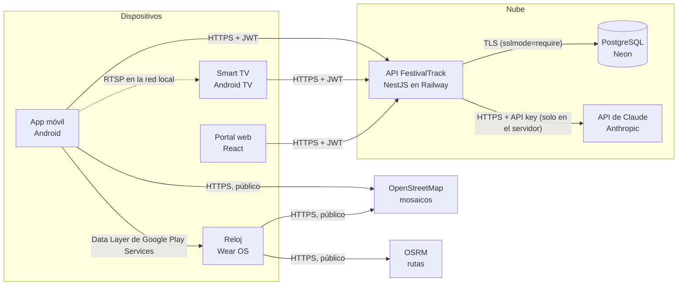

# 🔌 Integración con servicios en la nube y APIs de terceros

Este documento explica qué servicios externos usa FestivalTrack, para qué sirve cada uno, qué datos intercambia, cómo se configura y con qué permisos. Los valores secretos **no aparecen aquí**: solo los nombres de las variables. El inventario completo y cómo configurarlas está en [SECURITY.md](./SECURITY.md).

## 1. Mapa general

**Regla de diseño:** las apps y el portal **nunca** guardan claves de servicios de terceros. Solo conocen la URL de la API y el JWT de la sesión del usuario. Los secretos (base de datos, IA, firma de tokens) viven en las variables de entorno del backend.

## 2. Resumen de servicios

| Servicio | Función en el sistema | Datos que intercambia | Configuración | Acceso y permisos | ¿Secreto? |
| :--- | :--- | :--- | :--- | :--- | :---: |
| **API FestivalTrack** (NestJS en **Railway**) | Lógica de negocio: usuarios, eventos, boletos, chat, foro, AR | Credenciales de login (solo al iniciar sesión), JWT, datos de eventos y boletos | Apps: `festivaltrackApiUrl` (Gradle) · Web: `VITE_API_URL` | JWT en cada petición; rol `ADMINISTRADOR` para crear o editar; límite de intentos en login y registro | URL pública ❌ / JWT ✅ |
| **PostgreSQL en Neon** | Base de datos principal | Usuarios (contraseña con hash bcrypt), eventos, boletos, mensajes, publicaciones | `DATABASE_URL`, `DIRECT_URL` | Solo el backend se conecta, con TLS obligatorio (`sslmode=require`); las apps no tienen acceso directo | ✅ |
| **API de Claude** (Anthropic) | Reconocer en una foto qué sitio cultural del catálogo aparece (módulo AR) | **Envía:** la foto del visitante y el catálogo de sitios (id, nombre y descripción visual). **Recibe:** id del sitio, confianza y una frase de motivo | `ANTHROPIC_API_KEY`, `ANTHROPIC_MODEL`, `ANTHROPIC_WORKSPACE_ID` | La key solo existe en el backend; el endpoint `POST /ar/reconocer` exige sesión, acepta solo imágenes de hasta 5 MB y tiene límite de peticiones | ✅ |
| **Railway** | Hosting del backend y del portal web | Código compilado y variables de entorno | Variables del servicio en el panel de Railway | Solo los integrantes con acceso al proyecto | ✅ (variables) |
| **OSRM** | Ruta peatonal y tiempo estimado hacia un evento (Wear OS) | Coordenadas de origen y destino; **no** se envía el usuario | Ninguna (API pública) | Sin autenticación, sujeta a uso justo | ❌ |
| **OpenStreetMap (Mapnik)** | Imágenes del mapa (app, reloj y web) | Coordenadas y nivel de zoom del mosaico | `User-Agent` propio (`FestivalTrack/1.0`) | Pública, sujeta a la política de uso de OSM | ❌ |
| **Wear OS Data Layer** (Google Play Services) | Sincronizar los próximos eventos del teléfono al reloj | Lista de eventos (nombre, fecha, lugar); sin credenciales | Ninguna | Solo entre dispositivos vinculados a la misma cuenta | ❌ |
| **Streaming RTSP** (puerto 1935) | Transmisión en vivo del admin a la Smart TV | Video y audio del escenario | `POST /stream/status` registra la URL `rtsp://` | Solo un `ADMINISTRADOR` puede publicar la URL; el video viaja por la red local del evento | ❌ |

> **Firestore / Firebase Storage:** `BiographyFirestoreService` sigue la estructura de Firestore, pero en esta versión **guarda los datos localmente** (SharedPreferences). No hay conexión con un proyecto de Firebase ni archivos `google-services.json` en el repositorio.

## 3. Servicios en la nube propios

### 3.1 API REST de FestivalTrack (NestJS · Railway)

- **Base:** `https://<servicio>.up.railway.app/api/v1/` en producción y `http://10.0.2.2:3001/api/v1/` desde el emulador.
- **Autenticación:** `POST /auth/login` devuelve un JWT firmado con `JWT_SECRET`. Las apps lo mandan en `Authorization: Bearer <token>`. En Android el token se guarda cifrado con una llave del Android Keystore.
- **Autorización:**
  - Endpoints de consulta (eventos, galería, catálogo AR): públicos.
  - Compra de boletos, chat, foro, AR y vinculación de TV: requieren sesión.
  - Crear, editar o borrar eventos, canciones, imágenes, biografías y usuarios: requieren el rol `ADMINISTRADOR` (`RolesGuard`).
- **Validación en el servidor:** `ValidationPipe({ whitelist: true })` con DTOs de `class-validator`. El servidor descarta campos que no espera (por ejemplo, el precio de un boleto lo calcula él mismo).
- **Protecciones adicionales:**
  - Límite de peticiones (`@nestjs/throttler`): 5 intentos de login por minuto por IP y correo.
  - Cabeceras de seguridad (`helmet`).
  - CORS restringido a `FRONTEND_URL`.
  - Errores internos responden 500 con un mensaje genérico.
- **Pruebas:** [docs/pruebas/seguridad.md](./docs/pruebas/seguridad.md).

### 3.2 Base de datos PostgreSQL (Neon)

- **Acceso:** Prisma ORM desde el backend. `DATABASE_URL` usa el *pooler* de Neon y `DIRECT_URL` la conexión directa para migraciones.
- **Datos sensibles:**
  - Las contraseñas se guardan con hash bcrypt (10 rondas); nunca en texto plano.
  - El código QR de cada boleto lo genera el servidor con el ID único del boleto. Al escanearlo, el servidor valida que exista y que no se haya usado antes.
- **Permisos mínimos:**
  - La cadena de conexión solo la conoce el backend.
  - Se recomienda una rama de Neon separada para pruebas (`test/app.e2e-spec.ts`).

### 3.3 Reconocimiento visual con IA (API de Claude)

- **Implementación:** `festivaltrack-backend/src/ar/vision/claude-reconocedor.ts`, detrás de la interfaz `ReconocedorVisual`, así el proveedor puede cambiarse sin tocar la app.
- **Flujo:**
  1. La app manda la foto a `POST /api/v1/ar/reconocer`.
  2. El backend valida la sesión, el tipo de archivo (JPEG/PNG/WebP) y el tamaño (máximo 5 MB).
  3. Envía a Claude la imagen y el catálogo de sitios activos.
  4. La respuesta se valida contra un esquema estricto (`zod`).
  5. Se descartan IDs que no existen en el catálogo y resultados con confianza baja.
  6. Si hay coincidencia, se guarda la visita en el historial del usuario.
- **Privacidad:**
  - Solo se envía la foto; no se envían el nombre, el correo ni el ID del usuario.
  - La foto no se guarda en el servidor.

## 4. APIs públicas de terceros (sin credenciales)

### 4.1 Open Source Routing Machine (OSRM) — rutas peatonales en Wear OS

#### ¿Qué API se utiliza?
Se utiliza la API pública de enrutamiento de **Project OSRM (Open Source Routing Machine)**, el cual es un motor de cálculo de rutas de alto rendimiento basado en datos de OpenStreetMap.

#### ¿Para qué se utiliza?
El propósito de negocio es guiar a los asistentes del festival de manera exacta. La API resuelve el problema de trazar una ruta peatonal (caminando) desde la ubicación actual del usuario (GPS del reloj) hasta la ubicación exacta donde se llevará a cabo un evento (ej. el Mausoleo de José Alfredo). Además, nos permite calcular la **distancia en metros/kilómetros** y el **tiempo estimado de llegada**.

#### ¿Cómo se utiliza?
- **Autenticación:** Es una API REST pública y gratuita; no requiere llaves de autenticación (`API_KEYS`) bajo los límites de uso justo.
- **Endpoint principal consumido:** 
  `GET https://router.project-osrm.org/route/v1/foot/{lon_origen},{lat_origen};{lon_destino},{lat_destino}?geometries=geojson`
- **Flujo de la información:**
  1. La aplicación Wear OS detecta las coordenadas actuales del usuario usando `FusedLocationProviderClient` de Android.
  2. Se extraen las coordenadas de destino desde el evento guardado en la base de datos local (Room).
  3. Se realiza la petición HTTP `GET` pasándole ambas coordenadas al endpoint de OSRM (modalidad *foot* / peatonal).
  4. OSRM responde con un objeto `JSON` que contiene un arreglo llamado `routes`.
  5. La aplicación lee `duration`, `distance`, y extrae el arreglo de `coordinates` (GeoJSON) para dibujar una Polyline (línea de guía) visualmente sobre el mapa de OSMDroid.

---

### 4.2 OSMDroid / Mapnik (OpenStreetMap) — mosaicos del mapa

#### ¿Qué API se utiliza?
Se utiliza la API de Web Map Service (WMS) a través de los servidores de mosaicos (Tile Servers) públicos de **Mapnik** (OpenStreetMap).

#### ¿Para qué se utiliza?
Provee las imágenes visuales (el dibujo de las calles, parques y bloques) que conforman el mapa gráfico que ve el usuario en la pantalla del reloj. 

#### ¿Cómo se utiliza?
- **Autenticación:** API pública. Se debe incluir un encabezado HTTP `User-Agent` único (`FestivalTrack/1.0`) para cumplir con las políticas de uso de OSM.
- **Flujo de la información:**
  La librería `osmdroid` solicita automáticamente de manera asíncrona imágenes `.png` al servidor basándose en las coordenadas (X, Y) y el nivel de zoom de la cámara de la pantalla. Estas imágenes se renderizan de fondo en el lienzo debajo de la ruta calculada por OSRM.

#### Imagen de como funciona la API

#### Formato Json que arroja

#### Forma en como se acomoda la ubicación

