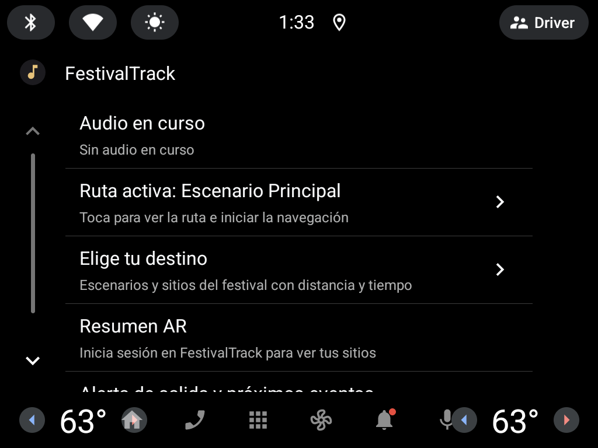
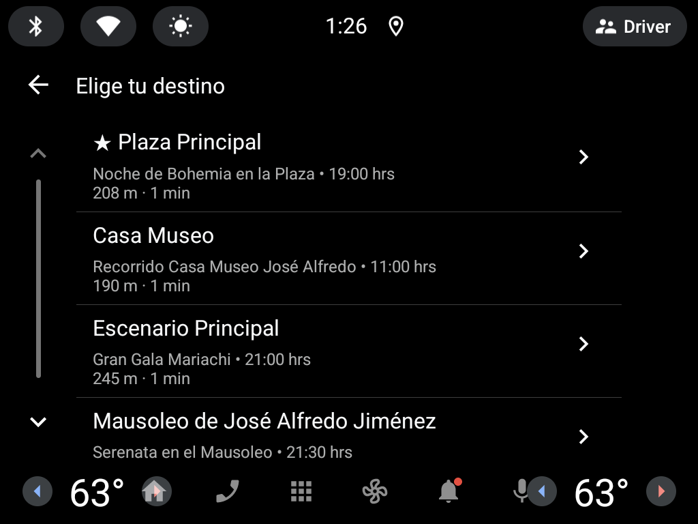
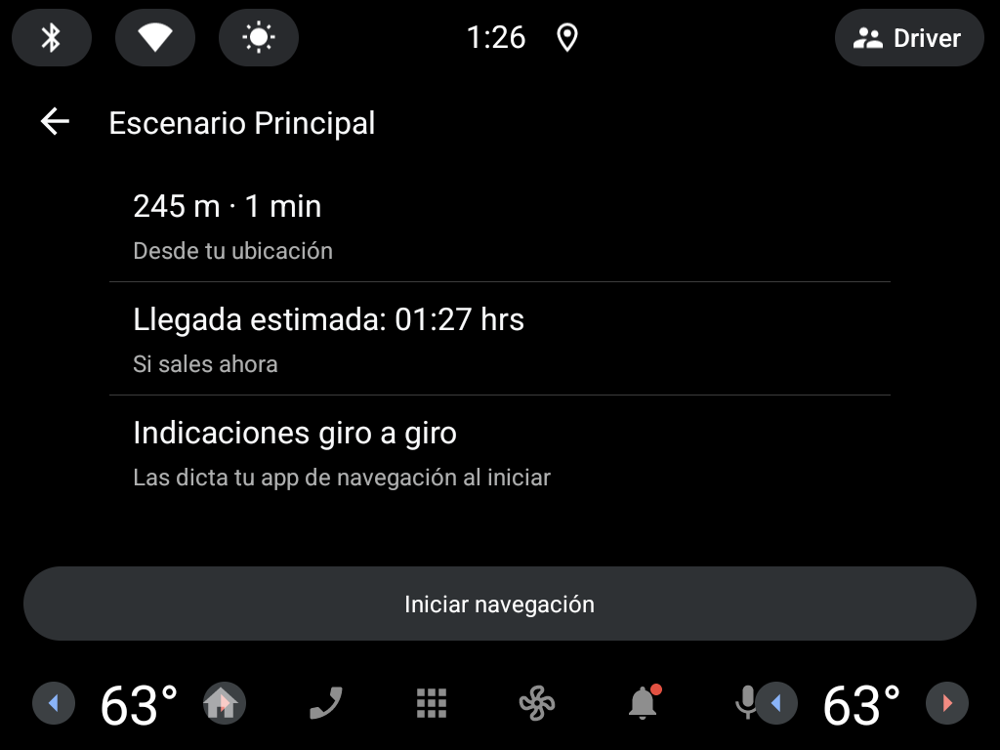
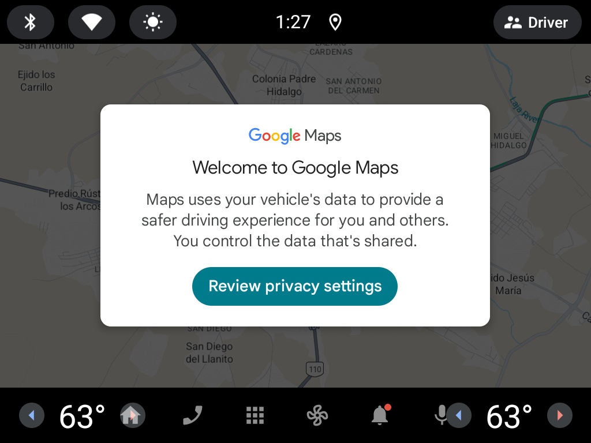
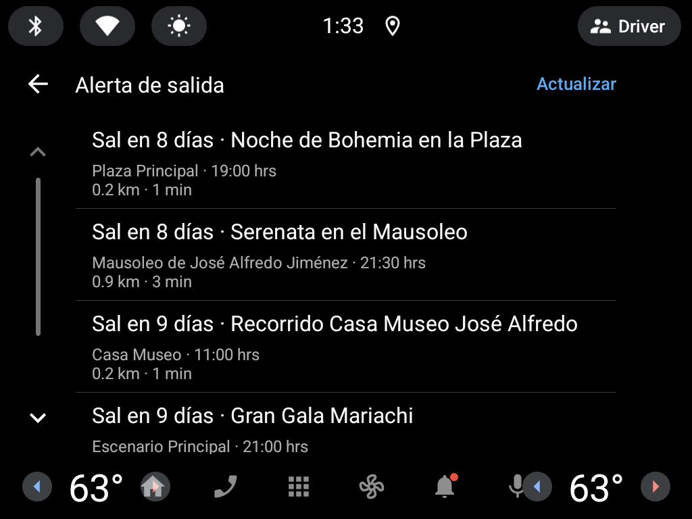

# Prueba del modo automóvil · Sprint 4 (#84)

Cómo probar las pantallas del modo automóvil (épica #21): 7 · Elige tu destino, 8 · Navegación (#39),
9 · Alerta de salida (#37) y 10 · Home (#36).

Hay dos formas de verlas en la pantalla de un auto:

| Forma | Qué se necesita | Estado |
|---|---|---|
| **Android Automotive OS** (recomendada) | Solo la PC: emulador oficial del sistema que va integrado en el auto | ✅ Probado el 12/11/2026 |
| Android Auto + Desktop Head Unit | Celular Android físico con Android Auto | ❌ No se pudo usar (ver abajo) |

## Resultado de la prueba (12/11/2026)

Emulador **Automotive 1024p landscape · Android 14 (API 34) con Google Play**, variante `automotiveDebug` de la app
y backend local con la base del equipo.

| # | Pantalla | Qué se hizo | Resultado | Evidencia |
|---|---|---|---|---|
| 1 | 10 · Home (#36) | Abrir FestivalTrack desde el lanzador del auto | ✅ Tarjetas de audio en curso, ruta activa, elige tu destino, resumen AR y alerta de salida |  |
| 2 | 7 · Elige tu destino | Home → *Elige tu destino* | ✅ Escenarios y sitios reales del backend con distancia y tiempo; el próximo evento marcado con ★ |  |
| 3 | 8 · Navegación (#39) | Tocar *Escenario Principal* | ✅ Distancia y tiempo desde la ubicación del auto, llegada estimada y botón *Iniciar navegación* |  |
| 4 | Prueba de integración | Tocar **Iniciar navegación** | ✅ El GPS envía la ruta a la pantalla del auto: Google Maps se abre en Dolores Hidalgo con el destino |  |
| 5 | 9 · Alerta de salida (#37) | Home → *Alerta de salida y próximos eventos* | ✅ Eventos con cuándo salir ("Sal en 8 días"; cerca del evento cambia a minutos y a "Sal ya"), lugar, hora y traslado |  |
| 6 | Ruta activa | Volver al Home | ✅ La fila muestra *Ruta activa: Escenario Principal* y abre la pantalla 8 | (captura 1) |
| 7 | Prueba con usuarios | Una persona ajena al equipo llega a la navegación sin instrucciones | Pendiente | — |

> Google Maps muestra su aviso de privacidad la primera vez que se usa en el emulador. Hay que aceptarlo a mano en el
> emulador para ver las indicaciones giro a giro; no forma parte de FestivalTrack.

## Opción 1 · Emulador de Android Automotive OS (recomendada)

Android Automotive OS es el sistema que viene integrado en el auto. Corre las mismas pantallas de la Car App Library
que Android Auto, pero **sin teléfono, sin la app Android Auto y sin DHU**. Por eso la app tiene dos variantes:

| Variante | Para qué | APK |
|---|---|---|
| `movil` | Teléfono (y Android Auto cuando se conecta a un auto) | `app/build/outputs/apk/movil/debug/app-movil-debug.apk` |
| `automotive` | Pantalla del auto con Android Automotive OS | `app/build/outputs/apk/automotive/debug/app-automotive-debug.apk` |

### Crear el emulador

1. Android Studio → *Tools → SDK Manager → SDK Platforms* → marcar **Show Package Details** y, en Android 14 (API 34),
   instalar **Android Automotive with Google APIs Intel x86_64 Atom System Image** (≈ 1.5 GB; al crear el emulador
   pide ≈ 8 GB libres).
2. *Device Manager → Create Virtual Device → Automotive → Automotive (1024p landscape)* → elegir la imagen de API 34.
3. En *Advanced Settings*: RAM de 2048 MB y *Graphics: Hardware*. En equipos con poca RAM conviene cerrar el navegador
   y otros programas mientras corre.

### Instalar y abrir la app

```bash
cd festivaltrack-backend && npm run start:dev
```

```bash
./gradlew :app:installAutomotiveDebug
```

En Android Studio también se puede elegir la variante en *Build → Select Build Variant → `automotiveDebug`* y correrla
sobre el emulador del auto.

1. En el emulador, abrir **FestivalTrack** desde el lanzador de apps (ícono de nota musical dorada).
2. La primera vez, permitir la ubicación. Si la app se cierra al dar el permiso, abrirla de nuevo.
3. Para ver la ruta trazada en Maps, activar la ubicación del vehículo en *Settings → Location* del emulador.

Comandos útiles desde la PC:

```bash
adb emu geo fix -100.9318 21.1561
```

```bash
adb shell service call alarm 3 s16 America/Mexico_City
```

El primero pone el auto en el centro de Dolores Hidalgo; el segundo pone la hora de México para que los horarios de
los eventos coincidan.

## Opción 2 · Android Auto con el Desktop Head Unit

Solo funciona con un **celular Android físico** que tenga Android Auto. No se pudo usar en este proyecto:

| Intento | Resultado |
|---|---|
| Pixel 9 Pro XL · Android 16 (API 36) con Google Play | Android Auto viene como *stub*; la Play Store dice *"This app isn't compatible with your device anymore"* |
| Pixel 7 · Android 14 (API 34) con Google Play | Mismo mensaje en la Play Store |
| Celular físico del equipo (12/11/2026) | Android Auto tampoco permitió usar la aplicación |

No instalar apps parecidas de otros desarrolladores (por ejemplo "Car Play Connect"), ni el APK de Android Auto desde
sitios espejo.

Si en algún momento se cuenta con un celular compatible:

1. Instalar la variante móvil en el celular: `./gradlew :app:installMovilDebug`.
2. Abrir Android Auto, tocar 10 veces *Versión* y en el menú ⋮ elegir **Iniciar servidor de unidad principal**.
3. En la PC: `adb forward tcp:5277 tcp:5277` y abrir `desktop-head-unit.exe` desde
   `%LOCALAPPDATA%\Android\Sdk\extras\google\auto`.
4. En la pantalla del auto, abrir **FestivalTrack Phone**.

## Registro de la prueba con usuarios

| Fecha | Probó | Emulador / dispositivo | ¿Llegó a la navegación sin instrucciones? | Tiempo | Comentarios |
|---|---|---|---|---|---|
| | | | | | |
