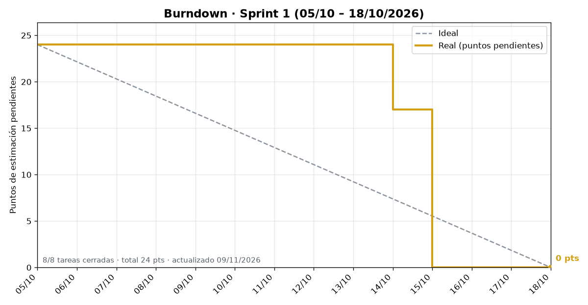
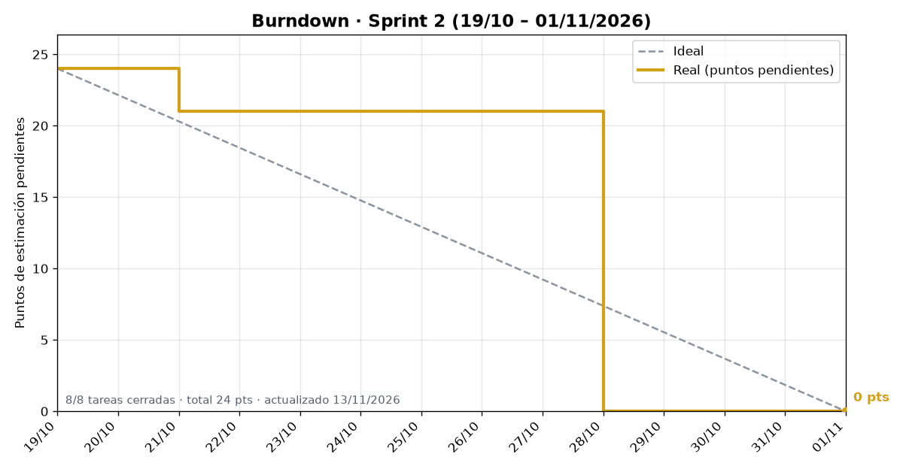
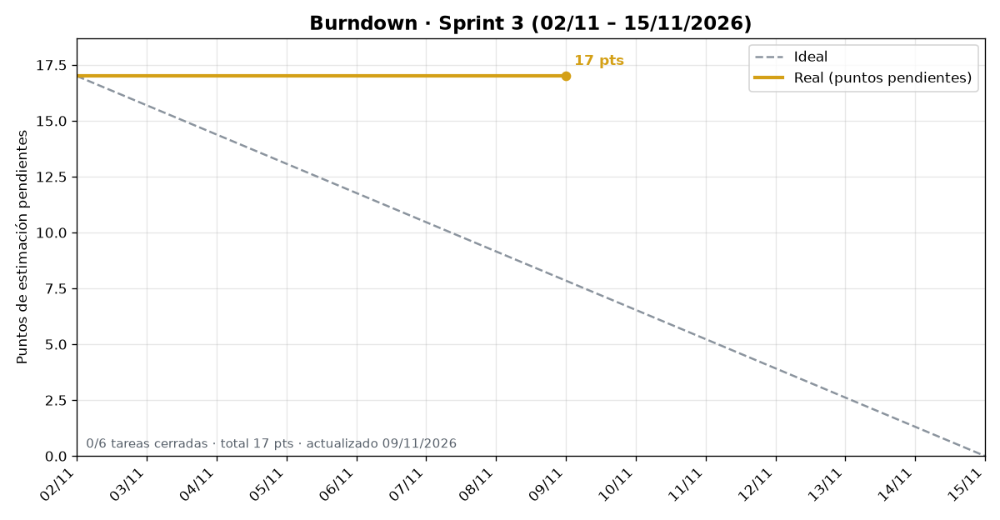

# Evidencias Scrum · FestivalTrack

Registro de las ceremonias Scrum del Proyecto Integrador (Desarrollo Móvil Integral, GIDS6102).

- **Equipo de desarrollo:** Noé Chavero Martínez · Omar Salinas Salinas · Juan Gustavo Ángel Cruz Méndez
- **Product Owner:** Armando Vega (asiste a las Sprint Review)
- **Scrum Master (rota por sprint):** Sprint 1 · Noé Chavero Martínez · Sprint 2 · Omar Salinas Salinas · Sprint 3 · Juan Gustavo Ángel Cruz Méndez
- **Sprints:** 2 semanas · tablero en [GitHub Projects · Festival Track](https://github.com/users/gusmendez3249/projects/2)
- **Avance por sprint:** [Milestones del repositorio](https://github.com/gusmendez3249/Jose_Alfredo/milestones)

## Evidencias por sprint

Cada sprint registra **6 Daily Scrum** (tres por semana: lunes, miércoles y viernes, y lunes, miércoles y jueves), **1 Sprint Review** con el Product Owner, **1 Retrospectiva** y **1 Incremento**.

| Ceremonia | Participantes | Duración | Evidencia |
|---|---|---|---|
| Daily Scrum | Equipo de desarrollo (3) | 15 min | Avance por integrante, capturas de la app y código |
| Sprint Review | Equipo + Product Owner (Armando Vega) | 60 min | Milestone, burndown, demostración y tablero |
| Retrospectiva | Equipo de desarrollo (3) | 45 min | Continuar / Dejar de hacer / Empezar y acciones |
| Incremento | — | — | Funcionalidades entregadas y Release |

| Sprint | Daily Scrum | Sprint Review | Retrospectiva | Incremento |
|---|---|---|---|---|
| Sprint 1 | 6 / 6 | ✅ vie 16/10 | ✅ vie 16/10 | ✅ (entregado en la Release `v4.2-sprint3`) |
| Sprint 2 | 6 / 6 | ✅ vie 30/10 | ✅ vie 30/10 | ✅ (entregado en la Release `v4.2-sprint3`) |
| Sprint 3 | 6 / 6 | ✅ vie 13/11 | ✅ vie 13/11 | ✅ Release [`v4.2-sprint3`](https://github.com/gusmendez3249/Jose_Alfredo/releases/tag/v4.2-sprint3) (10/11) |

> 📷 Cada ceremonia incluye la captura de la videollamada (`img/daily-N-reunion.png`, `img/review-reunion.png`, `img/retro-reunion.png`) con la evidencia que se presentó ese día.

## Sprint 1 · 5 al 16 de octubre de 2026

**Objetivo:** galería interactiva como foro de la comunidad, módulo de realidad aumentada (pantallas 1–3),
base del modo automóvil (Android Auto y alerta de salida), seguridad del backend y flujo de trabajo con `develop` y CI.

| Ceremonia | Fecha | Documento |
|---|---|---|
| Daily Scrum 1 | Lun 05/10 | [daily-1.md](sprint-1/daily-1.md) |
| Daily Scrum 2 | Mié 07/10 | [daily-2.md](sprint-1/daily-2.md) |
| Daily Scrum 3 | Vie 09/10 | [daily-3.md](sprint-1/daily-3.md) |
| Daily Scrum 4 | Lun 12/10 | [daily-4.md](sprint-1/daily-4.md) |
| Daily Scrum 5 | Mié 14/10 | [daily-5.md](sprint-1/daily-5.md) |
| Daily Scrum 6 | Jue 15/10 | [daily-6.md](sprint-1/daily-6.md) |
| Sprint Review | Vie 16/10 | [review.md](sprint-1/review.md) |
| Retrospectiva | Vie 16/10 | [retro.md](sprint-1/retro.md) |
| Incremento | Vie 16/10 | [incremento.md](sprint-1/incremento.md) |

## Sprint 2 · 19 al 30 de octubre de 2026

**Objetivo:** demos de audio de cada concierto, catálogo de sitios para el GPS y la pantalla "Elige tu destino" del modo automóvil.
Se sumaron las correcciones de seguridad #50–#52 y se adelantaron las pantallas 8 y 10 del auto (#39 y #36).

| Ceremonia | Fecha | Documento |
|---|---|---|
| Daily Scrum 1 | Lun 19/10 | [daily-1.md](sprint-2/daily-1.md) |
| Daily Scrum 2 | Mié 21/10 | [daily-2.md](sprint-2/daily-2.md) |
| Daily Scrum 3 | Vie 23/10 | [daily-3.md](sprint-2/daily-3.md) |
| Daily Scrum 4 | Lun 26/10 | [daily-4.md](sprint-2/daily-4.md) |
| Daily Scrum 5 | Mié 28/10 | [daily-5.md](sprint-2/daily-5.md) |
| Daily Scrum 6 | Jue 29/10 | [daily-6.md](sprint-2/daily-6.md) |
| Sprint Review | Vie 30/10 | [review.md](sprint-2/review.md) |
| Retrospectiva | Vie 30/10 | [retro.md](sprint-2/retro.md) |
| Incremento | Vie 30/10 | [incremento.md](sprint-2/incremento.md) |

## Sprint 3 · 2 al 13 de noviembre de 2026

**Objetivo:** cerrar el MVP (reproductor con cola), integrar en `develop` todo lo terminado, probar los módulos nuevos,
alinear el reporte técnico con el stack real y publicar la Release final.

| Ceremonia | Fecha | Documento |
|---|---|---|
| Daily Scrum 1 | Lun 02/11 | [daily-1.md](sprint-3/daily-1.md) |
| Daily Scrum 2 | Mié 04/11 | [daily-2.md](sprint-3/daily-2.md) |
| Daily Scrum 3 | Vie 06/11 | [daily-3.md](sprint-3/daily-3.md) |
| Daily Scrum 4 | Lun 09/11 | [daily-4.md](sprint-3/daily-4.md) |
| Daily Scrum 5 | Mié 11/11 | [daily-5.md](sprint-3/daily-5.md) |
| Daily Scrum 6 | Jue 12/11 | [daily-6.md](sprint-3/daily-6.md) |
| Sprint Review | Vie 13/11 | [review.md](sprint-3/review.md) |
| Retrospectiva | Vie 13/11 | [retro.md](sprint-3/retro.md) |
| Incremento | Vie 13/11 | [incremento.md](sprint-3/incremento.md) |

## Burndown

GitHub Projects solo muestra burn up en Insights. El burndown de cada sprint se genera con los datos reales del Project:

```bash
python docs/scrum/herramientas/burndown.py
```

| Sprint 1 | Sprint 2 | Sprint 3 |
|---|---|---|
|  |  |  |

Requiere GitHub CLI con sesión iniciada (`gh auth login`) y `pip install matplotlib`. Conviene correrlo antes de cada Daily y del Review.

**Automático:** el workflow `.github/workflows/burndown.yml` lo regenera de lunes a viernes a las 07:00 y sube las imágenes a esta rama.
Para que funcione:

1. El dueño del repo agrega el secreto `PROJECT_TOKEN` (*Settings → Secrets and variables → Actions*): un token personal *classic* con los permisos `repo` y `read:project`.
2. El workflow debe estar en `main` (GitHub solo ejecuta los programados desde la rama principal); llega ahí con el PR `develop → main` del cierre de sprint.

> Las gráficas personalizadas de Insights aplican el estado **actual** de cada tarea a todo el historial, por eso no sirven como burndown; se usa esta imagen.

## Cómo registrar una ceremonia

1. Copia la plantilla de [`plantillas/`](plantillas/) a la carpeta del sprint (por ejemplo `sprint-1/daily-2.md`).
2. Guarda las imágenes en `sprint-N/img/` con nombre descriptivo (`daily-2-reunion.png`, `review-demo-galeria.png`).
3. En **Avance mostrado** agrega la captura de la app y el fragmento de código que hace funcionar ese avance, con la ruta del archivo y la issue.
4. Actualiza la tabla de **Evidencias por sprint**.
5. Sube los cambios a la rama `docs/scrum-sprints`. Al cierre de cada sprint se abre un Pull Request hacia `develop` para que otro integrante lo revise.

## Incremento y Release de cada sprint

Al cierre de **cada sprint** se entrega un incremento: el software funcionando que pasa de `develop` a `main`.
Se marca con una [Release](https://github.com/gusmendez3249/Jose_Alfredo/releases) que incluye las notas
generadas y el APK compilado.

Siguiendo los tags que ya existen (`v1.0-wearable`, `v2.0-movil`, `v3.0-tv`):

| Sprint | Tag sugerido |
|---|---|
| Sprint 1 | `v4.0-sprint1` |
| Sprint 2 | `v4.1-sprint2` |
| Sprint 3 | `v4.2-sprint3` |

**Pasos al cierre del sprint:**

1. PR `docs/scrum-sprints` → `develop` con las evidencias del sprint.
2. PR `develop` → `main`, revisado por un compañero.
3. En GitHub: **Releases → Draft a new release** → tag nuevo sobre `main` → **Generate release notes** → adjuntar el APK → **Publish release**.
4. Llenar `sprint-N/incremento.md` con el enlace a la Release.
