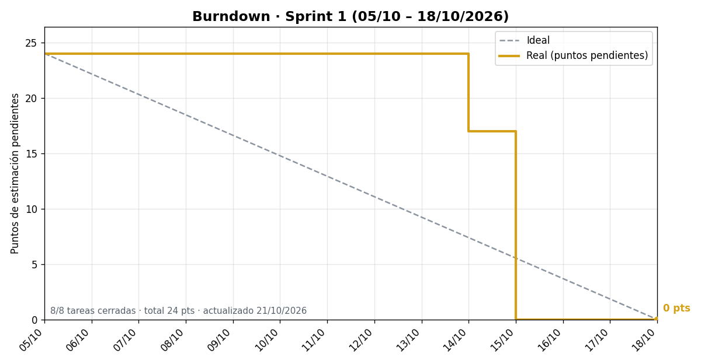
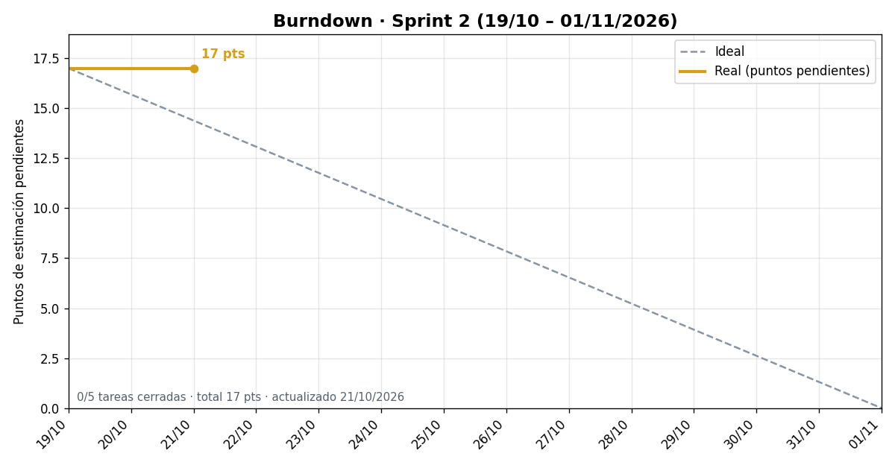

# Evidencias Scrum · FestivalTrack

Registro de las ceremonias Scrum del Proyecto Integrador (Desarrollo Móvil Integral, GIDS6102).

- **Equipo:** Juan Gustavo Ángel Cruz Méndez · Salinas Salinas Omar · Noé Chavero Martínez
- **Sprints:** 2 semanas · tablero en [GitHub Projects · Festival Track](https://github.com/users/gusmendez3249/projects/2)
- **Avance por sprint:** [Milestones del repositorio](https://github.com/gusmendez3249/Jose_Alfredo/milestones)

## Evidencias por sprint

Cada sprint registra 6 Daily Scrum, 1 Sprint Review, 1 Retrospectiva y 1 Incremento.

| Sprint | Daily Scrum | Sprint Review | Retrospectiva | Incremento |
|---|---|---|---|---|
| Sprint 1 | 6 / 6 | Preparada (vie 16/10) | Preparada (vie 16/10) | Pendiente: Release `v4.0-sprint1` |
| Sprint 2 | 0 / 6 | 0 / 1 | 0 / 1 | 0 / 1 |

## Sprint 1 · 5 al 16 de octubre de 2026

**Objetivo:** galería interactiva como foro de la comunidad, módulo de realidad aumentada (pantallas 1–3),
base del modo automóvil (Android Auto y alerta de salida), seguridad del backend y flujo de trabajo con `develop` y CI.

| Ceremonia | Fecha | Documento |
|---|---|---|
| Daily Scrum 1 | Lun 05/10 | [daily-1.md](sprint-1/daily-1.md) |
| Daily Scrum 2 | Mié 07/10 | [daily-2.md](sprint-1/daily-2.md) |
| Daily Scrum 3 | Vie 09/10 | [daily-3.md](sprint-1/daily-3.md) |
| Daily Scrum 4 | Lun 12/10 | [daily-4.md](sprint-1/daily-4.md) |
| Daily Scrum 5 | Mié 14/10 | [daily-5.md](sprint-1/daily-5.md) |
| Daily Scrum 6 | Jue 15/10 | [daily-6.md](sprint-1/daily-6.md) |
| Sprint Review | Vie 16/10 | [review.md](sprint-1/review.md) |
| Retrospectiva | Vie 16/10 | [retro.md](sprint-1/retro.md) |
| Incremento | Vie 16/10 | [incremento.md](sprint-1/incremento.md) |

## Sprint 2 · 19 al 30 de octubre de 2026

**Objetivo:**

| Ceremonia | Fecha | Documento |
|---|---|---|
| Daily Scrum 1 | Lun 19/10 | [daily-1.md](sprint-2/daily-1.md) |
| Daily Scrum 2 | Mié 21/10 | [daily-2.md](sprint-2/daily-2.md) |
| Daily Scrum 3 | Vie 23/10 | [daily-3.md](sprint-2/daily-3.md) |
| Daily Scrum 4 | Lun 26/10 | [daily-4.md](sprint-2/daily-4.md) |
| Daily Scrum 5 | Mié 28/10 | [daily-5.md](sprint-2/daily-5.md) |
| Daily Scrum 6 | Jue 29/10 | [daily-6.md](sprint-2/daily-6.md) |
| Sprint Review | Vie 30/10 | [review.md](sprint-2/review.md) |
| Retrospectiva | Vie 30/10 | [retro.md](sprint-2/retro.md) |
| Incremento | Vie 30/10 | [incremento.md](sprint-2/incremento.md) |

## Burndown

GitHub Projects solo muestra burn up en Insights. El burndown de cada sprint se genera con los datos reales del Project:

```bash
python docs/scrum/herramientas/burndown.py
```

| Sprint 1 | Sprint 2 |
|---|---|
|  |  |

Requiere GitHub CLI con sesión iniciada (`gh auth login`) y `pip install matplotlib`. Conviene correrlo antes de cada Daily y del Review.

## Cómo registrar una ceremonia

1. Copia la plantilla de [`plantillas/`](plantillas/) a la carpeta del sprint (por ejemplo `sprint-1/daily-2.md`).
2. Guarda las imágenes en `sprint-N/img/` con nombre descriptivo (`daily-2-reunion.png`, `review-demo-galeria.png`).
3. En **Avance mostrado** agrega la captura de la app y el fragmento de código que hace funcionar ese avance, con la ruta del archivo y la issue.
4. Actualiza la tabla de **Evidencias por sprint**.
5. Sube los cambios a la rama `docs/scrum-sprints`. Al cierre de cada sprint se abre un Pull Request hacia `develop` para que otro integrante lo revise.

## Incremento y Release de cada sprint

Al cierre de **cada sprint** se entrega un incremento: el software funcionando que pasa de `develop` a `main`.
Se marca con una [Release](https://github.com/gusmendez3249/Jose_Alfredo/releases) que incluye las notas
generadas y el APK compilado.

Siguiendo los tags que ya existen (`v1.0-wearable`, `v2.0-movil`, `v3.0-tv`):

| Sprint | Tag sugerido |
|---|---|
| Sprint 1 | `v4.0-sprint1` |
| Sprint 2 | `v4.1-sprint2` |
| Sprint 3 | `v4.2-sprint3` |

**Pasos al cierre del sprint:**

1. PR `docs/scrum-sprints` → `develop` con las evidencias del sprint.
2. PR `develop` → `main`, revisado por un compañero.
3. En GitHub: **Releases → Draft a new release** → tag nuevo sobre `main` → **Generate release notes** → adjuntar el APK → **Publish release**.
4. Llenar `sprint-N/incremento.md` con el enlace a la Release.
