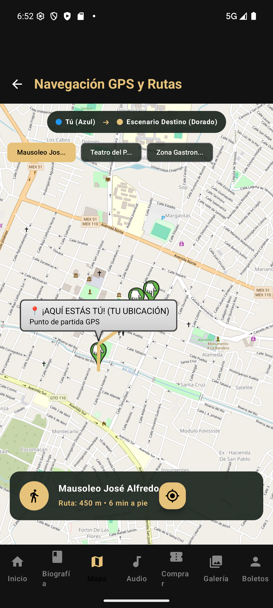

# Daily Scrum 1 · Sprint 1

- **Fecha:** 2026-10-05 (lunes)
- **Duración:** 15 min
- **Asistentes:** Gustavo · Omar · Noé
- **Facilitador (Scrum Master del sprint):**

> 📷 **Captura de la reunión pendiente.** Agrega la captura real de la llamada como `img/daily-1-reunion.png` y reemplaza esta nota por ``.

## Juan Gustavo Ángel Cruz Méndez

- **¿Qué hice desde la última daily?** Sprint Planning: se tomó la épica #20 *Reconocimiento de sitios con realidad aumentada*.
- **¿Qué haré hoy?** Diseñar el flujo AR (apuntar → capturar → reconocer → tarjeta) y el modelo de datos del catálogo de sitios.
- **¿Tengo algún bloqueo?** Definir qué servicio de visión usar (ML Kit, Cloud Vision o un modelo de IA).

## Salinas Salinas Omar

- **¿Qué hice desde la última daily?** Sprint Planning: se tomó la #22 *Galería interactiva de los usuarios* y la épica #24 *Demos de audio*.
- **¿Qué haré hoy?** Definir los criterios de aceptación de la galería como foro de la comunidad (publicar, me gusta, comentar, filtrar).
- **¿Tengo algún bloqueo?** La ficha pedía Firestore; se acordó usar el backend NestJS + PostgreSQL que ya existe.

## Noé Chavero Martínez

- **¿Qué hice desde la última daily?** Sprint Planning: se tomó la épica #21 *Navegación GPS para Android Auto* y las tareas base #26 (ramas) y #27 (CI).
- **¿Qué haré hoy?** Revisar el estado del repositorio y del backend antes de agregar módulos nuevos.
- **¿Tengo algún bloqueo?** Ninguno.

## Avance mostrado

### En la app

Punto de partida del sprint: la app móvil ya contaba con boletos, programación, biografía, mapa y audio.

| Captura | Descripción | Responsable |
|---|---|---|
|  | Mapa y rutas existente: base para la épica del GPS para auto (#21) | Equipo (base existente) |

### Código que lo hace funcionar

**`festivaltrack-backend/prisma/schema.prisma`** — modelo `Evento` del que parten los módulos nuevos: las coordenadas `latitud` / `longitud` las usarán el mapa, el AR y la alerta de salida del auto. · **Responsable:** Equipo (base existente)

```prisma
model Evento {
  id              String         @id @default(cuid())
  nombre          String
  fechaHora       DateTime
  ubicacion       String
  escenario       String?
  capacidad       Int
  estado          EstadoEvento   @default(BORRADOR)
  latitud         Float?
  longitud        Float?
  boletos         Boleto[]
  transmision     Transmision?
  // … (campos de auditoría y relaciones omitidos)
}
```

## Acuerdos

- Sprints de 2 semanas; el Sprint 1 cierra el viernes 16 de octubre con Review y Retrospectiva.
- Cada épica se trabaja en su propia rama y se integra a `develop` con Pull Request.
- El tablero de GitHub Projects y los milestones son la fuente de verdad del avance.
