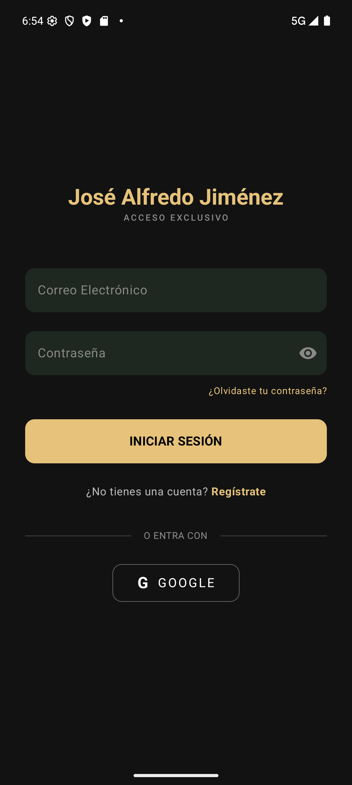

# Daily Scrum 2 · Sprint 1

- **Fecha:** 2026-10-07 (miércoles)
- **Duración:** 15 min
- **Asistentes:** Gustavo · Omar · Noé
- **Facilitador (Scrum Master del sprint):**


## Juan Gustavo Ángel Cruz Méndez

- **¿Qué hice desde la última daily?** Modelo del catálogo `SitioAR` y del historial `VisitaSitio`, con su migración `add_modulo_ar`.
- **¿Qué haré hoy?** Cargar el catálogo inicial (Mausoleo, Parroquia, Monumento a Hidalgo y Casa Museo) con un seed.
- **¿Tengo algún bloqueo?** Ninguno.

## Salinas Salinas Omar

- **¿Qué hice desde la última daily?** Modelo del foro: `Publicacion`, `ComentarioPublicacion` y `LikePublicacion`.
- **¿Qué haré hoy?** Migración `add_foro_galeria` y ajustes del proyecto en Android Studio.
- **¿Tengo algún bloqueo?** Ninguno.

## Noé Chavero Martínez

- **¿Qué hice desde la última daily?** Revisión del repositorio: credenciales de la base de datos en el repo público y endpoints de administrador sin protección.
- **¿Qué haré hoy?** Preparar la corrección de seguridad del backend.
- **¿Tengo algún bloqueo?** Hay que rotar la contraseña de Neon y el `JWT_SECRET`.

## Avance mostrado

### En la app

| Captura | Descripción |
|---|---|
|  | Inicio de sesión, punto de entrada para publicar en el foro y usar el AR |

### Código que lo hace funcionar

**`festivaltrack-backend/prisma/schema.prisma`** — catálogo de sitios AR e historial de visitas (#20, #23)

```prisma
model SitioAR {
  id             String        @id @default(cuid())
  nombre         String
  ubicacion      String
  descripcion    String
  pistasVisuales String
  imagenUrl      String?
  audioUrl       String?
  latitud        Float?
  longitud       Float?
  activo         Boolean       @default(true)
  visitas        VisitaSitio[]
  // … (galeriaId, fechas)
}

model VisitaSitio {
  id          String   @id @default(cuid())
  sitioId     String
  usuarioId   String
  confianza   Float
  fechaVisita DateTime @default(now())
  // … (relaciones e índice)
}
```

**`festivaltrack-backend/prisma/schema.prisma`** — publicaciones, comentarios y me gusta del foro (#22)

```prisma
model Publicacion {
  id          String                  @id @default(cuid())
  autorId     String
  tipo        TipoPublicacion         @default(EXPERIENCIA)
  titulo      String?
  contenido   String
  imagenUrl   String?
  lugar       String?
  comentarios ComentarioPublicacion[]
  likes       LikePublicacion[]
  // … (fechas, autor e índices)
}

model LikePublicacion {
  publicacionId String
  usuarioId     String
  // … (fecha y relaciones)
  @@id([publicacionId, usuarioId])
}
```

## Acuerdos

- Las migraciones se aplican a la base compartida de Neon y se avisa al equipo.
