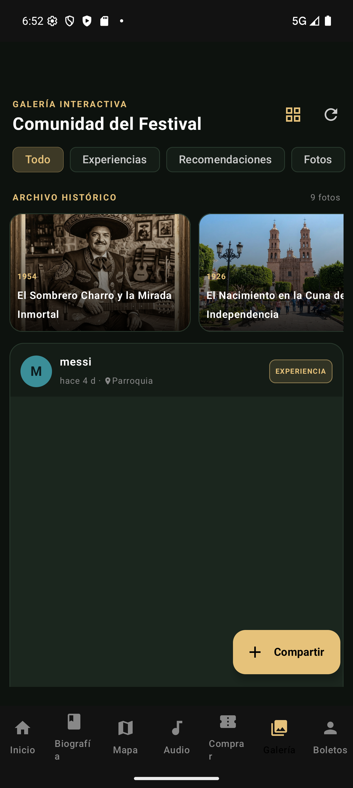

# Daily Scrum 3 · Sprint 1

- **Fecha:** 2026-10-09 (viernes)
- **Duración:** 15 min
- **Asistentes:** Gustavo · Omar · Noé
- **Facilitador (Scrum Master del sprint):**


## Juan Gustavo Ángel Cruz Méndez

- **¿Qué hice desde la última daily?** Seed del catálogo AR y la interfaz `ReconocedorVisual`.
- **¿Qué haré hoy?** Fachada `ArReconocimientoFacade` y endpoints `POST /ar/reconocer` y `GET /ar/historial`.
- **¿Tengo algún bloqueo?** Ninguno.

## Salinas Salinas Omar

- **¿Qué hice desde la última daily?** Migración del foro.
- **¿Qué haré hoy?** Servicio y controlador del foro: publicar, me gusta y comentarios, con guard de JWT opcional para ver sin sesión.
- **¿Tengo algún bloqueo?** Ninguno.

## Noé Chavero Martínez

- **¿Qué hice desde la última daily?** Análisis de la corrección de seguridad.
- **¿Qué haré hoy?** Proteger con JWT y rol ADMINISTRADOR los endpoints de usuarios, canciones, galería y transmisión; `JWT_SECRET` obligatorio.
- **¿Tengo algún bloqueo?** Ninguno.

## Avance mostrado

### En la app

| Captura | Descripción |
|---|---|
|  | Galería como foro de la comunidad: publicaciones de los asistentes |

### Código que lo hace funcionar

**`festivaltrack-backend/src/ar/vision/reconocedor-visual.ts`** — contrato del motor de visión: la fachada no depende de un proveedor concreto (#32)

```ts
export interface ResultadoVisual {
  /** ID del sitio del catálogo que aparece en la foto, o null si ninguno coincide. */
  sitioId: string | null;
  /** 0..1 — qué tan seguro está el modelo de la coincidencia. */
  confianza: number;
  razon: string;
}

export interface ReconocedorVisual {
  identificar(imagen: Buffer, mediaType: MediaTypeImagen, candidatos: SitioCandidato[]): Promise<ResultadoVisual>;
}
```

**`festivaltrack-backend/src/foro/foro.service.ts`** — me gusta de una publicación: si ya existe se quita, si no se agrega (#22)

```ts
async toggleLike(usuario: UsuarioActual, publicacionId: string) {
  const key = { publicacionId_usuarioId: { publicacionId, usuarioId: usuario.id } };
  const previo = await this.prisma.likePublicacion.findUnique({ where: key });
  if (previo) {
    await this.prisma.likePublicacion.deleteMany({ where: { publicacionId, usuarioId: usuario.id } });
  } else {
    await this.prisma.likePublicacion.upsert({ where: key, create: { publicacionId, usuarioId: usuario.id }, update: {} });
  }
  const likes = await this.prisma.likePublicacion.count({ where: { publicacionId } });
  return { liked: !previo, likes };
}
```

**`festivaltrack-backend/src/auth/auth.controller.ts`** — solo un administrador puede listar usuarios, crear administradores y cambiar roles

```ts
@UseGuards(JwtAuthGuard, RolesGuard) @Roles('ADMINISTRADOR')
@Get('usuarios')
getUsuarios() {
  return this.authService.getUsuarios();
}

@UseGuards(JwtAuthGuard, RolesGuard) @Roles('ADMINISTRADOR')
@Put('usuarios/:id/rol')
updateRole(@Param('id') id: string, @Body() dto: RoleUpdateDto) {
  return this.authService.updateRole(id, dto.rol);
}
```

## Acuerdos

- Ver el foro no requiere sesión; publicar, dar me gusta y comentar sí.
