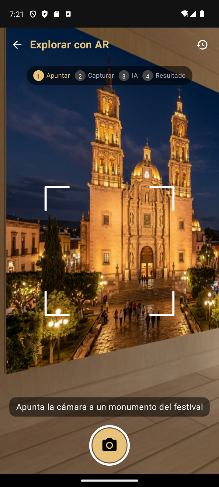

# Daily Scrum 4 · Sprint 1

- **Fecha:** 2026-10-12 (lunes)
- **Duración:** 15 min
- **Asistentes:** Gustavo · Omar · Noé
- **Facilitador (Scrum Master del sprint):**


## Juan Gustavo Ángel Cruz Méndez

- **¿Qué hice desde la última daily?** Fachada AR en el backend con su prueba de integración.
- **¿Qué haré hoy?** Pantalla `ArScannerScreen` con CameraX y la `ArFacade` de la app (captura → envío al backend).
- **¿Tengo algún bloqueo?** Desde un celular físico la app no llega a `10.0.2.2`; se resolverá con la IP de la PC en `local.properties`.

## Salinas Salinas Omar

- **¿Qué hice desde la última daily?** Backend del foro terminado.
- **¿Qué haré hoy?** Pantalla de la galería en la app: vista de foro, filtros por tipo, mosaico de fotos y visor con zoom.
- **¿Tengo algún bloqueo?** Ninguno.

## Noé Chavero Martínez

- **¿Qué hice desde la última daily?** Endpoints de administrador protegidos y `.env` fuera del repositorio (#26).
- **¿Qué haré hoy?** Rama `develop` y workflows de GitHub Actions para backend y Android (#27).
- **¿Tengo algún bloqueo?** 4 pruebas unitarias del backend fallaban por dependencias sin simular; hay que corregirlas para que el CI pase.

## Avance mostrado

### En la app

| Captura | Descripción |
|---|---|
|  | Escáner AR: vista de la cámara con la retícula y el botón de captura |
|  | Galería en modo mosaico, solo fotos |

### Código que lo hace funcionar

**`app/src/main/java/mx/utng/festivaltrack/app/data/ar/ArFacade.kt`** — la app captura la foto con CameraX y la envía al backend en una sola llamada (#32)

```kotlin
suspend fun reconocer(imageCapture: ImageCapture, onFotoCapturada: () -> Unit = {}): ReconocimientoDto {
    val token = requireToken()
    val jpeg = capturarJpeg(imageCapture)
    onFotoCapturada()
    val parte = MultipartBody.Part.createFormData(
        "foto", "captura.jpg", jpeg.toRequestBody("image/jpeg".toMediaType())
    )
    return api.reconocerSitio("Bearer $token", parte)
}
```

**`.github/workflows/backend.yml`** — CI del backend en cada Pull Request (#27)

```yaml
steps:
  - uses: actions/checkout@v4
  - uses: actions/setup-node@v4
    with:
      node-version: 20
  - name: Instalar dependencias
    run: npm ci
  - name: Generar cliente de Prisma
    run: npx prisma generate
  - name: Verificar tipos (TypeScript)
    run: npx tsc -p tsconfig.build.json --noEmit
  - name: Pruebas unitarias (Jest)
    run: npx jest --ci
```

## Acuerdos

- Cada PR hacia `develop` debe pasar los checks de Backend CI y Android CI.
