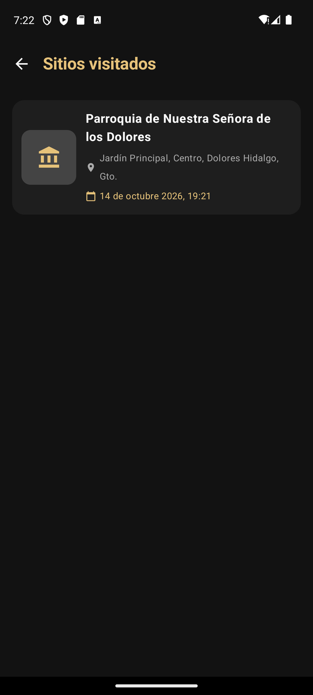

# Daily Scrum 5 · Sprint 1

- **Fecha:** 2026-10-14 (miércoles)
- **Duración:** 15 min
- **Asistentes:** Gustavo · Omar · Noé
- **Facilitador (Scrum Master del sprint):**


## Juan Gustavo Ángel Cruz Méndez

- **¿Qué hice desde la última daily?** Escáner AR con CameraX.
- **¿Qué haré hoy?** Tarjeta del sitio identificado (#35), historial de sitios visitados (#23) y ajuste para reconocer el sitio aunque aparezca en un póster o pantalla.
- **¿Tengo algún bloqueo?** En el emulador el modelo rechazaba la Parroquia vista en un póster; se corrigió el prompt y las pistas visuales.

## Salinas Salinas Omar

- **¿Qué hice desde la última daily?** Galería como foro en la app.
- **¿Qué haré hoy?** Archivo histórico oficial con la Factory de biografías y botón para mostrar u ocultar la contraseña en login y registro. Subir la rama `feature/GaleriaInteractiva`.
- **¿Tengo algún bloqueo?** Ninguno.

## Noé Chavero Martínez

- **¿Qué hice desde la última daily?** Rama `develop`, CI y corrección de las pruebas del backend.
- **¿Qué haré hoy?** Módulo de Android Auto (#34) y pantalla 9 · alerta de salida y próximos eventos (#37).
- **¿Tengo algún bloqueo?** Android Auto solo permite plantillas; el diseño de Figma se adapta a listas.

## Avance mostrado

### En la app

| Captura | Descripción |
|---|---|
|  | Historial de sitios visitados con el módulo AR (#23) |
|  | Entrada del archivo histórico oficial en la galería, creada con la Factory |

### Código que lo hace funcionar

**`festivaltrack-backend/src/ar/ar-reconocimiento.facade.ts`** — fachada AR: foto → reconocimiento visual → catálogo → historial (#32, #35, #23)

```ts
const visual = await this.reconocedor.identificar(
  foto,
  mediaType,
  sitios.map((s) => ({ id: s.id, nombre: s.nombre, pistasVisuales: s.pistasVisuales })),
);

// Solo se aceptan IDs que existan en el catálogo: el modelo no puede inventar sitios.
const sitio = sitios.find((s) => s.id === visual.sitioId);
if (!sitio || visual.confianza < CONFIANZA_MINIMA) {
  return { reconocido: false as const, mensaje: 'No reconocimos ningún sitio del festival. Acércate o intenta con otro ángulo.' };
}

const visita = await this.prisma.visitaSitio.create({
  data: { sitioId: sitio.id, usuarioId, confianza: visual.confianza },
});
```

**`app/src/main/java/mx/utng/festivaltrack/app/data/factory/BiographyFactory.kt`** — patrón Factory: cada tipo de entrada del archivo histórico tiene su fábrica

```kotlin
class MilestoneBiographyFactory : BiographyFactory {
    override fun createEntry(
        titulo: String, anoOEpoca: String, descripcion: String,
        imagenUrl: String?, audioUrl: String?, citaCelebre: String?, ubicacion: String?
    ): InteractiveBiographyItem {
        return InteractiveBiographyItem(
            titulo = titulo.trim(),
            anoOEepoca = if (anoOEpoca.isNotBlank()) anoOEpoca.trim() else "Época de Oro",
            descripcion = descripcion.trim(),
            categoria = "Hitos Históricos",
            entryType = BiographyEntryType.HISTORICAL_MILESTONE,
            // …
        )
    }
}
```

**`app/src/main/java/mx/utng/festivaltrack/app/auto/SalidaCalculator.kt`** — cuándo salir hacia un evento: inicio − traslado − margen (#37)

```kotlin
fun trasladoMin(distanciaKm: Double): Int =
    ceil(distanciaKm * FACTOR_RUTA / VELOCIDAD_PROMEDIO_KMH * 60).toInt().coerceAtLeast(1)

val traslado = distancia?.let { trasladoMin(it) } ?: 0
val faltan = Duration.between(ahora, inicio).toMinutes() - traslado - MARGEN_MIN

fun textoSalida(minutosParaSalir: Long): String = when {
    minutosParaSalir <= 0 -> "Sal ya"
    minutosParaSalir < 60 -> "Sal en $minutosParaSalir min"
    else -> "Sal en ${minutosParaSalir / 60} h ${minutosParaSalir % 60} min"
}
```

## Acuerdos

- Integrar las ramas a `develop` antes del cierre del sprint, en este orden: Navegación (#43, #44), Galería (#45) y AR (#46).
