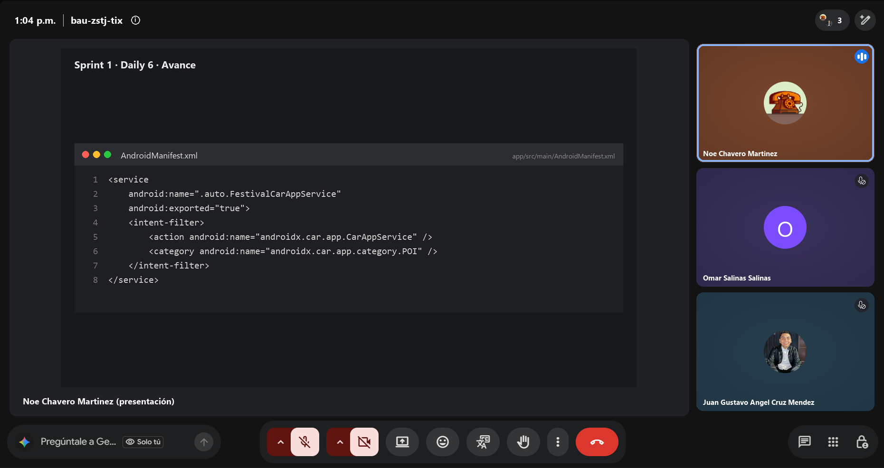
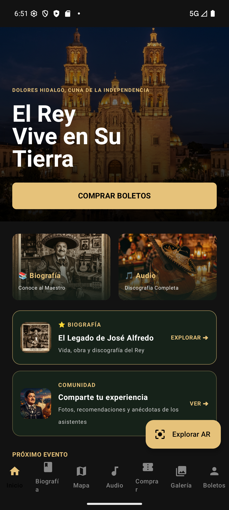
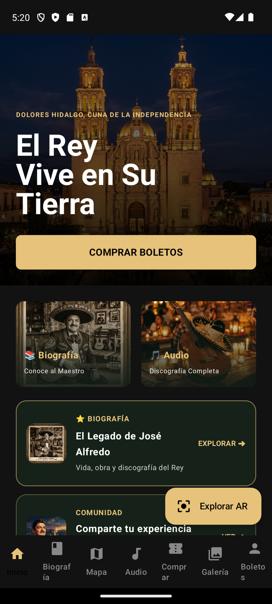
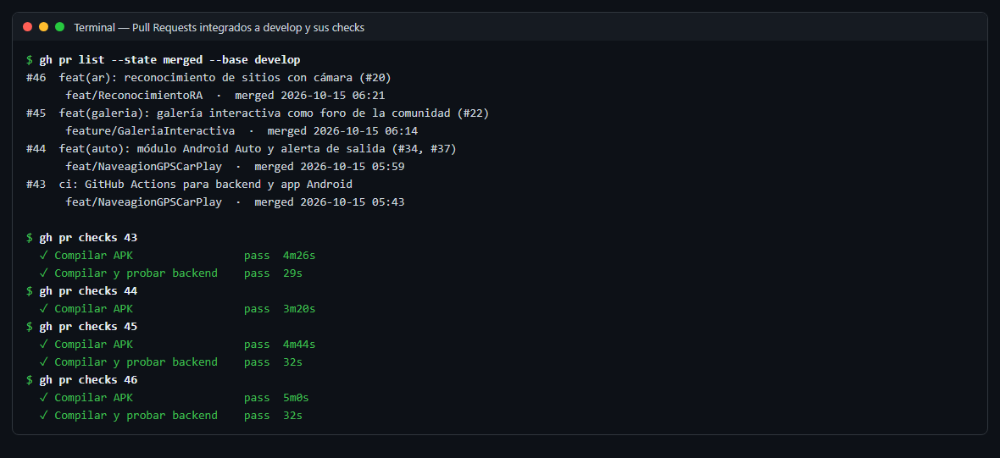
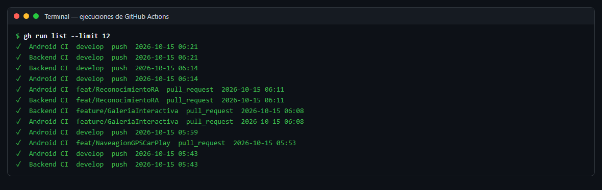
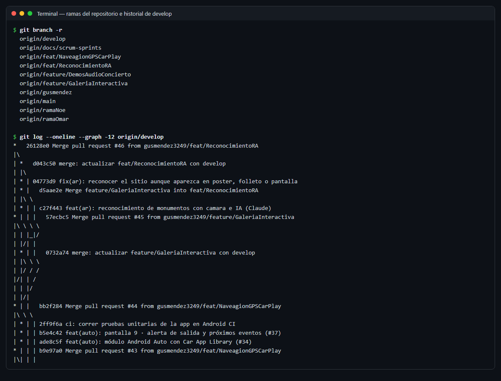
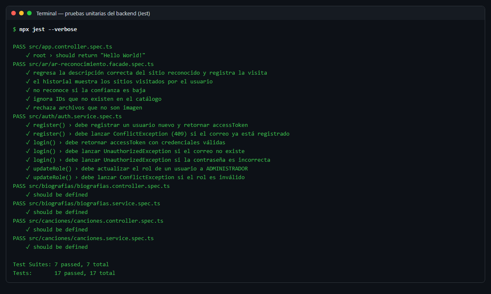

# Daily Scrum 6 · Sprint 1

| Fecha | Hora | Duración | Modalidad | Scrum Master |
|:--|:--|:--|:--|:--|
| Jueves 15 de octubre de 2026 | 13:04 | 15 min | Videollamada | Noé Chavero Martínez |

**Asistentes:** Noé Chavero Martínez · Omar Salinas Salinas · Juan Gustavo Ángel Cruz Méndez

<p align="center"></p>
<p align="center"><sub>Captura de la videollamada · presenta Noé Chavero Martínez</sub></p>

## Juan Gustavo Ángel Cruz Méndez

- **¿Qué hice desde la última daily?** Pantallas 1, 2 y 3 del módulo AR terminadas; PR #46 abierto.
- **¿Qué haré hoy?** Revisar la integración del PR #46 en `develop`.
- **¿Tengo algún bloqueo?** Para probar el reconocimiento cada quien necesita `ANTHROPIC_API_KEY` en su `.env`.

## Omar Salinas Salinas

- **¿Qué hice desde la última daily?** Galería interactiva terminada; PR #45 abierto.
- **¿Qué haré hoy?** Revisar la integración del PR #45 y preparar las tareas de audio del Sprint 2 (#29, #30, #31).
- **¿Tengo algún bloqueo?** Ninguno.

## Noé Chavero Martínez

- **¿Qué hice desde la última daily?** Android Auto y alerta de salida; PRs #43 y #44 integrados con CI en verde.
- **¿Qué haré hoy?** Resolver los conflictos de las ramas de galería y AR con `develop` e integrar los PRs #45 y #46.
- **¿Tengo algún bloqueo?** Las ramas aún versionaban `dist/` y chocaban con `develop`; se resolvió al actualizar cada rama.

## Avance mostrado

### En la app

| Captura | Descripción | Responsable |
|---|---|---|
|  | Inicio con el acceso "Explorar AR" y la galería, ya integrados en `develop` | Gustavo (Explorar AR) · Omar (Comunidad) |
|  | Botón "Explorar AR" en Inicio, punto de entrada al módulo AR | Gustavo |

### Evidencia técnica

| Evidencia | Descripción | Responsable |
|---|---|---|
|  | Pull Requests #43–#46 integrados a `develop`, todos con sus checks en verde | Noé (integración) · Gustavo · Omar |
|  | Ejecuciones de GitHub Actions: Backend CI y Android CI en PRs y en `develop` | Noé |
|  | Ramas del repositorio e historial de `develop` con los merges del sprint | Noé |
|  | 17 pruebas unitarias del backend en verde, incluidas las de autenticación y AR | Equipo |

### Código que lo hace funcionar

**`app/src/main/AndroidManifest.xml`** — servicio que Android Auto llama al conectar el teléfono (#34) · **Responsable:** Noé

```xml
<service
    android:name=".auto.FestivalCarAppService"
    android:exported="true">
    <intent-filter>
        <action android:name="androidx.car.app.CarAppService" />
        <category android:name="androidx.car.app.category.POI" />
    </intent-filter>
</service>
```

**`app/src/main/java/mx/utng/festivaltrack/app/auto/AlertaSalidaScreen.kt`** — cada evento se muestra con "Sal ya" / "Sal en X min" y al tocarlo abre la navegación (#37) · **Responsable:** Noé

```kotlin
return Row.Builder()
    .setTitle("${SalidaCalculator.textoSalida(salida.minutosParaSalir)} · ${evento.nombre}")
    .addText("$lugar · ${formatoHora.format(salida.inicio)} hrs")
    .addText(traslado)
    .setOnClickListener { navegarA(salida) }
    .build()
```

**Integración en `develop`**

| PR | Rama | Checks |
|---|---|---|
| #43 | `feat/NaveagionGPSCarPlay` · CI | Backend CI ✅ · Android CI ✅ |
| #44 | `feat/NaveagionGPSCarPlay` · Android Auto | Android CI ✅ |
| #45 | `feature/GaleriaInteractiva` | Backend CI ✅ · Android CI ✅ |
| #46 | `feat/ReconocimientoRA` | Backend CI ✅ · Android CI ✅ |

## Acuerdos

- Sprint Review y Retrospectiva el viernes 16 de octubre.
- La #28 (destinos del GPS en el catálogo de sitios) pasa al Sprint 2.

---

<p align="center"><sub><a href="daily-5.md">← Daily 5</a> · <a href="../README.md#sprint-1--5-al-16-de-octubre-de-2026">Índice del Sprint 1</a> · <a href="review.md">Sprint Review →</a></sub></p>
