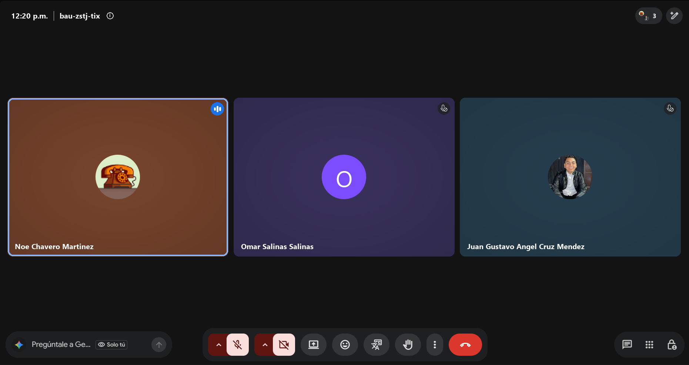

# Retrospectiva · Sprint 1

| Fecha | Hora | Duración | Modalidad | Scrum Master | Formato |
|:--|:--|:--|:--|:--|:--|
| Viernes 16 de octubre de 2026 | 12:20 | 45 min | Videollamada | Noé Chavero Martínez | Continuar / Dejar de hacer / Empezar |

**Asistentes:** Noé Chavero Martínez · Omar Salinas Salinas · Juan Gustavo Ángel Cruz Méndez

Captura de la videollamada · conversación del equipo

## Continuar (lo que funcionó)

- Una rama por épica y Pull Request hacia `develop`: los cuatro PRs del sprint quedaron revisados y trazables.
- CI en cada PR: detectó a tiempo las pruebas del backend que fallaban.
- Tablero con campo Sprint y milestones: el avance del sprint se ve en un solo lugar (8/8 tareas).

## Dejar de hacer (lo que no funcionó)

- Subir al repositorio archivos generados (`dist/`, logs, `.idea`): provocaron la mayoría de los conflictos al integrar.
- Guardar credenciales en archivos versionados (`.env`, README).
- Juntar todo el trabajo el último día: casi todos los commits llegaron el 14 de octubre y la integración se concentró al final.

## Empezar (lo que vamos a intentar)

- Abrir el PR de cada sub-tarea en cuanto esté lista, sin esperar al cierre del sprint.
- Actualizar la rama propia con `develop` cada vez que se integre algo (`git merge develop`).
- Probar cada pantalla nueva en el emulador (y Android Auto en el DHU) antes de pedir la revisión.

## Acciones para el siguiente sprint

| Acción | Responsable | Cómo sabremos que se cumplió |
|---|---|---|
| Al menos un PR por persona antes de la Daily 3 del Sprint 2 | Todos | PRs abiertos antes del viernes 23/10 |
| Regla de protección en `develop`: PR con 1 revisión y checks obligatorios | Gustavo (dueño del repo) | Settings → Branches muestra la regla activa |
| Rotar la contraseña de Neon y el `JWT_SECRET` y repartir el `.env` nuevo | Equipo | Las credenciales anteriores dejan de funcionar |

## Seguimiento de las acciones del sprint anterior

Primer sprint: no hay acciones previas.

---

<a href="review.md">← Sprint Review</a> · <a href="../README.md#sprint-1--5-al-16-de-octubre-de-2026">Índice del Sprint 1</a> · <a href="incremento.md">Incremento →</a>

