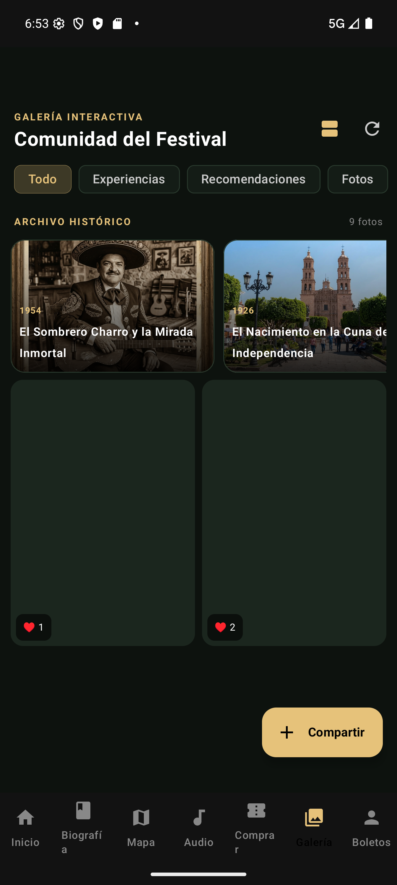
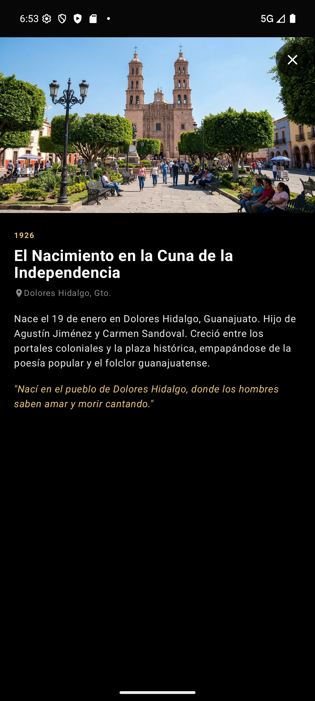
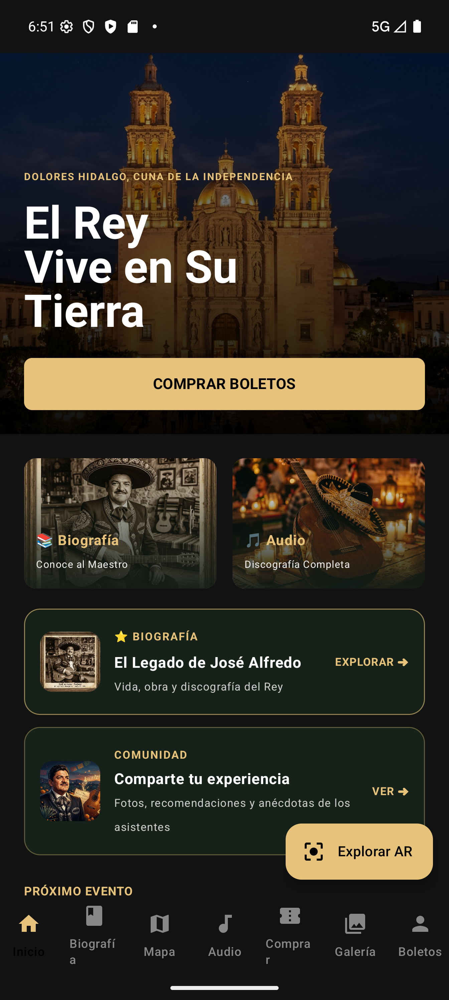
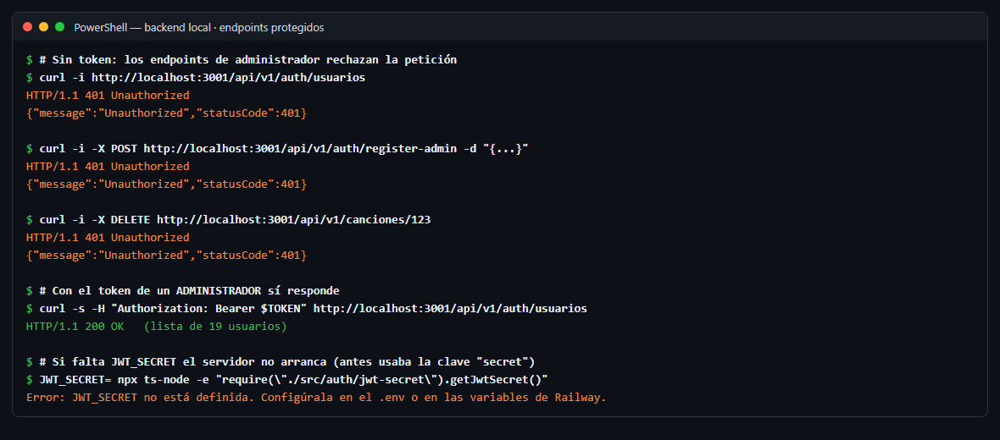
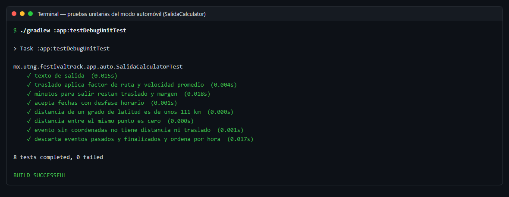
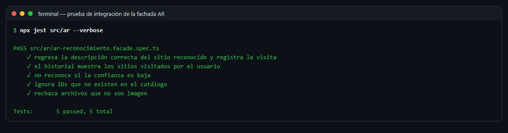
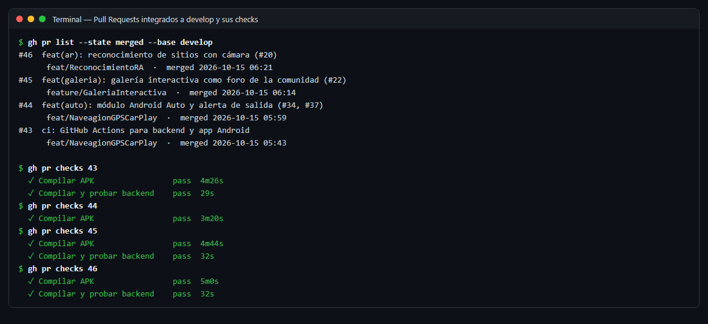

# Sprint Review · Sprint 1

- **Fecha:** 2026-10-16 (viernes)
- **Periodo del sprint:** 2026-10-05 a 2026-10-16
- **Asistentes:** Gustavo · Omar · Noé
- **Objetivo del sprint:** galería interactiva como foro de la comunidad, módulo de realidad aumentada (pantallas 1–3), base del modo automóvil (Android Auto y alerta de salida), seguridad del backend y flujo de trabajo con `develop` y CI.

> 📷 **Captura de la reunión pendiente.** Agrega la captura real de la llamada como `img/review-reunion.png` y reemplaza esta nota por ``.

## Resultado del sprint

Milestone: [Sprint 1](https://github.com/gusmendez3249/Jose_Alfredo/milestone/1) · **8 de 8 tareas cerradas (100 %)**

| Milestone | Cerradas | Abiertas | Avance |
|---|---|---|---|
| [Sprint 1](https://github.com/gusmendez3249/Jose_Alfredo/milestone/1) | 8 | 0 | 100 % |

## Tareas terminadas

| Issue | Tarea | Responsable | Evidencia |
|---|---|---|---|
| #22 | Galería interactiva de los usuarios (foro de la comunidad) | Omar | PR #45 · [Daily 3](daily-3.md), [Daily 4](daily-4.md) |
| #32 | [AR] Pantalla 1 · Cámara de reconocimiento | Gustavo | PR #46 · [Daily 4](daily-4.md) |
| #35 | [AR] Pantalla 2 · Resultado: sitio identificado | Gustavo | PR #46 · [Daily 5](daily-5.md) |
| #23 | [AR] Pantalla 3 · Historial de sitios visitados | Gustavo | PR #46 · [Daily 5](daily-5.md) |
| #26 | [Base] Rama `develop` y flujo `feature/*` con Pull Request | Noé | Rama `develop` · [Daily 4](daily-4.md) |
| #27 | [Base] CI con GitHub Actions: backend y Android | Noé | PR #43 · [Daily 4](daily-4.md) |
| #34 | [Auto] Módulo Android Auto (Car App Library) | Noé | PR #44 · [Daily 6](daily-6.md) |
| #37 | [Auto] Pantalla 9 · Alerta de salida y próximos eventos | Noé | PR #44 · [Daily 5](daily-5.md), [Daily 6](daily-6.md) |

Épica cerrada: **#20 Reconocimiento de sitios con realidad aumentada** (pantallas 1, 2 y 3).

También se integró la corrección de seguridad del backend: endpoints de administrador protegidos con JWT y rol,
`JWT_SECRET` obligatorio, CORS restringido y credenciales fuera del repositorio.

## Tareas no terminadas

| Issue | Tarea | Responsable | Motivo | Pasa al sprint |
|---|---|---|---|---|
| #28 | [Backend] Catálogo de sitios con destinos GPS | Gustavo | El catálogo para AR quedó listo en #46; faltan Plaza Principal, Escenario Principal y el tipo de sitio que usa el GPS | Sprint 2 |

Las épicas #21 (GPS para auto) y #24 (Demos de audio) continúan en el Sprint 2 con sus sub-tareas.

## Demostración

| Captura | Qué se muestra | Responsable |
|---|---|---|
|  | Galería como foro de la comunidad (#22) | Omar |
|  | Galería en modo mosaico | Omar |
| 📷 *Captura pendiente* — la toma Gustavo: agrega `img/daily-4-ar-camara.png` | Escáner AR con la cámara (#32) | Gustavo |
| 📷 *Captura pendiente* — la toma Gustavo: agrega `img/daily-5-ar-historial.png` | Historial de sitios visitados (#23) | Gustavo |
|  | Archivo histórico oficial creado con la Factory | Omar |
|  | Inicio con "Explorar AR" integrado en `develop` | Gustavo (Explorar AR) · Omar (Comunidad) |

### Evidencia técnica

| Evidencia | Qué se muestra | Responsable |
|---|---|---|
|  | Endpoints de administrador protegidos y `JWT_SECRET` obligatorio | Noé |
|  | Pruebas del cálculo de la alerta de salida del auto (#37) | Noé |
|  | Prueba de integración de la fachada AR (#32, #35, #23) | Gustavo |
|  | PRs #43–#46 integrados con CI en verde | Equipo |

**Calidad:** los 4 Pull Requests del sprint (#43–#46) pasaron Backend CI y Android CI.
Pruebas unitarias: 17 del backend y 8 de la app (`SalidaCalculator`).

## Tablero al cierre

Vista del tablero: [GitHub Projects · Festival Track](https://github.com/users/gusmendez3249/projects/2) (filtro `sprint:"Sprint 1"`).

| Estado | Tareas del Sprint 1 |
|---|---|
| Done | #22, #26, #27, #32, #35, #23, #34, #37 y la épica #20 |
| Movida al Sprint 2 | #28 · épicas #21 y #24 |

> 📷 Opcional: agrega una captura del tablero como `img/review-tablero.png`.

## Retroalimentación recibida

-
