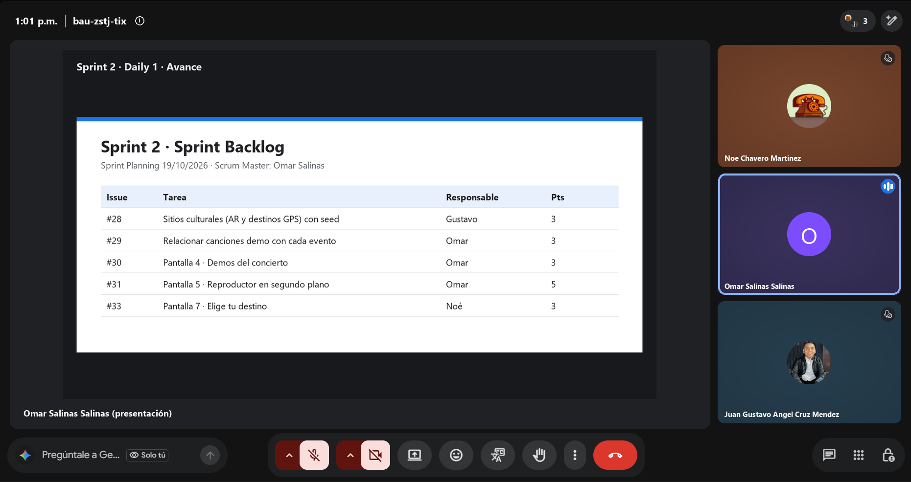
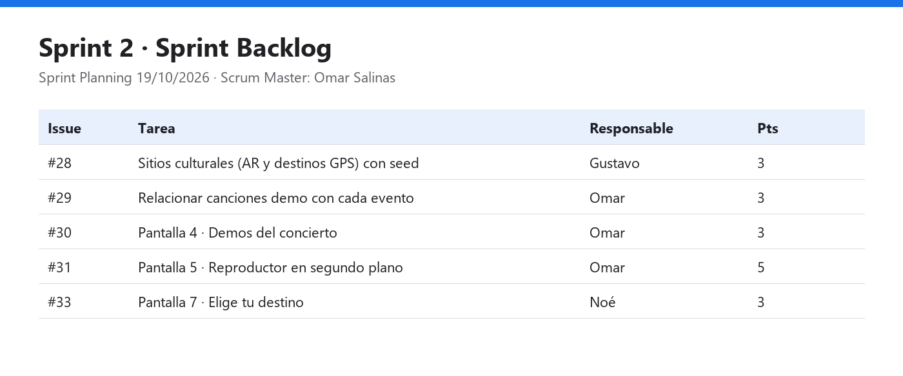

# Daily Scrum 1 · Sprint 2

- **Fecha:** 2026-10-19 (lunes)
- **Duración:** 15 min
- **Asistentes:** Gustavo · Omar · Noé
- **Facilitador (Scrum Master del sprint):** Omar

## Juan Gustavo Ángel Cruz Méndez

- **¿Qué hice desde la última daily?** Sprint Review y Retrospectiva del Sprint 1, y Sprint Planning del Sprint 2: se tomó la #28 (catálogo de sitios con los destinos del GPS), que pasó del Sprint 1.
- **¿Qué haré hoy?** Revisar qué le falta al modelo `SitioAR` para que sirva como destino del GPS (Plaza Principal y Escenario Principal) y preparar la integración de `develop` a `main` del Sprint 1.
- **¿Tengo algún bloqueo?** Ninguno.

## Salinas Salinas Omar

- **¿Qué hice desde la última daily?** Sprint Planning: se tomaron las sub-tareas de la épica #24 *Demos de audio*: #29 (canciones demo por evento), #30 (pantalla de demos) y #31 (reproductor en segundo plano).
- **¿Qué haré hoy?** Empezar la #29: cómo relacionar las canciones del catálogo con cada evento en el backend.
- **¿Tengo algún bloqueo?** Ninguno.

## Noé Chavero Martínez

- **¿Qué hice desde la última daily?** Sprint Planning: se tomó la #33 *Pantalla 7 · Elige tu destino*. Si sobra capacidad, se adelantan la #39 (pantalla 8) y la #36 (pantalla 10) del Sprint 3.
- **¿Qué haré hoy?** Actualizar `feat/NaveagionGPSCarPlay` con `develop`, que ya trae la galería y el AR del Sprint 1, como se acordó en la retro.
- **¿Tengo algún bloqueo?** Para la #33 hacen falta las coordenadas de los sitios (#28); mientras tanto se usan las del evento.

## Avance mostrado

Sprint Planning. Objetivo del Sprint 2: **demos de audio de cada concierto, catálogo de sitios para el GPS y la pantalla
"Elige tu destino" del modo automóvil**.

| Issue | Tarea | Responsable | Estimate |
|---|---|---|---|
| #28 | [Backend] Modelo de sitios culturales (AR y destinos GPS) con seed | Gustavo | 3 |
| #29 | [Backend] Relacionar canciones demo con cada evento | Omar | 3 |
| #30 | [Audio] Pantalla 4 · Demos del concierto en el detalle del evento | Omar | 3 |
| #31 | [Audio] Pantalla 5 · Reproductor en segundo plano (Media3) | Omar | 5 |
| #33 | [Auto] Pantalla 7 · Elige tu destino | Noé | 3 |

## Acuerdos

- Cada quien abre su primer PR antes de la Daily 3 (viernes 23/10), según la acción de la retro del Sprint 1.
- Gustavo integra `develop` → `main` al inicio del sprint para cerrar el incremento del Sprint 1.
