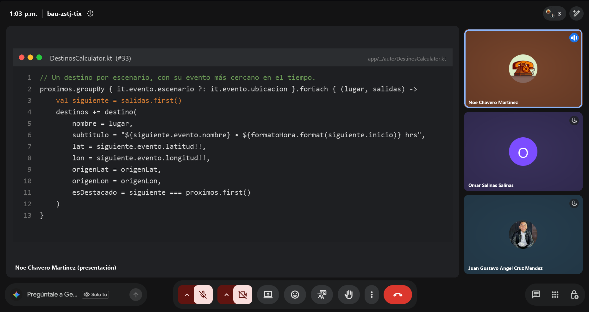

# Daily Scrum 2 · Sprint 2

- **Fecha:** 2026-10-21 (miércoles)
- **Duración:** 15 min
- **Asistentes:** Gustavo · Omar · Noé
- **Facilitador (Scrum Master del sprint):** Omar



## Juan Gustavo Ángel Cruz Méndez

- **¿Qué hice desde la última daily?** Revisé el modelo `SitioAR` contra lo que pide el GPS: ya tiene coordenadas, y el seed incluye Mausoleo, Parroquia, Monumento a Hidalgo y Casa Museo.
- **¿Qué haré hoy?** Revisar el PR #48 (documentación Scrum) y dejar lista la integración `develop` → `main`.
- **¿Tengo algún bloqueo?** Ninguno.

## Salinas Salinas Omar

- **¿Qué hice desde la última daily?** Diseño de la relación canción–evento para las demos (#29).
- **¿Qué haré hoy?** Seguir con la #29 y empezar la pantalla de demos en el detalle del evento (#30).
- **¿Tengo algún bloqueo?** Ninguno.

## Noé Chavero Martínez

- **¿Qué hice desde la última daily?** Actualicé la rama con `develop` y terminé la #33: lista de destinos con distancia y tiempo estimado. "Navegar" guarda la ruta activa y la envía al auto. PR #47 integrado.
- **¿Qué haré hoy?** Generar el burndown de cada sprint con los datos del Project (`burndown.py`) y un workflow que lo actualice cada día.
- **¿Tengo algún bloqueo?** GitHub Projects solo ofrece burn up en Insights; por eso la gráfica se genera con un script propio.

## Avance mostrado

### Código que lo hace funcionar

**`app/src/main/java/mx/utng/festivaltrack/app/auto/DestinosCalculator.kt`**: arma los destinos con un escenario por evento y agrega los sitios del catálogo que no se repiten. El destacado es el siguiente evento (#33) · **Responsable:** Noé

```kotlin
proximos.groupBy { it.evento.escenario ?: it.evento.ubicacion }.forEach { (lugar, salidas) ->
    val siguiente = salidas.first()
    destinos += destino(
        nombre = lugar,
        subtitulo = "${siguiente.evento.nombre} • ${formatoHora.format(siguiente.inicio)} hrs",
        lat = siguiente.evento.latitud!!,
        lon = siguiente.evento.longitud!!,
        origenLat = origenLat,
        origenLon = origenLon,
        esDestacado = siguiente === proximos.first()
    )
}
```

**`docs/scrum/herramientas/burndown.py`**: lee el campo Sprint, el Estimate y la fecha de cierre de cada issue del Project y dibuja la línea ideal contra la real · **Responsable:** Noé

**Integración en `develop`**

| PR | Rama | Contenido |
|---|---|---|
| #47 | `feat/NaveagionGPSCarPlay` | Pantalla 7 · Elige tu destino (#33) con 5 pruebas de `DestinosCalculator` |

## Acuerdos

- El PR #48 (documentación Scrum y burndown) lo revisa Gustavo antes de integrarlo.
