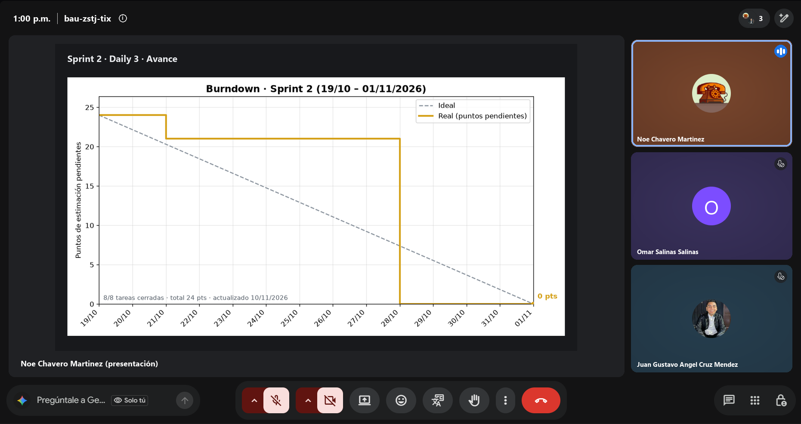
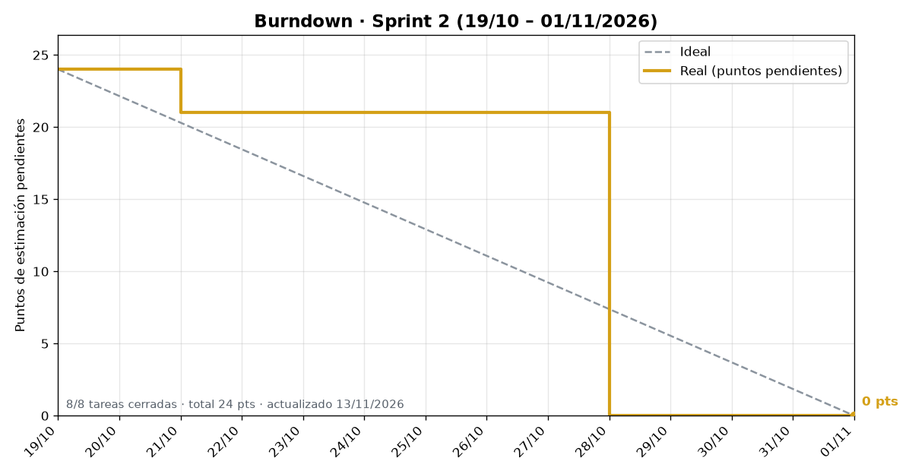

# Daily Scrum 3 · Sprint 2

| Fecha | Hora | Duración | Modalidad | Scrum Master |
|:--|:--|:--|:--|:--|
| Viernes 23 de octubre de 2026 | 13:00 | 15 min | Videollamada | Omar Salinas Salinas |

**Asistentes:** Noé Chavero Martínez · Omar Salinas Salinas · Juan Gustavo Ángel Cruz Méndez

Captura de la videollamada · presenta Noé Chavero Martínez

## Juan Gustavo Ángel Cruz Méndez

- **¿Qué hice desde la última daily?** Integré el PR #48 (documentación Scrum y workflow del burndown) y el PR #49 (`develop` → `main`). Con eso, el workflow programado del burndown ya corre desde `main`.
- **¿Qué haré hoy?** Revisión de seguridad del backend en los flujos que el Sprint 1 no cubrió: chat en vivo, compra de boletos y login.
- **¿Tengo algún bloqueo?** Ninguno.

## Omar Salinas Salinas

- **¿Qué hice desde la última daily?** Avance en las canciones demo por evento (#29).
- **¿Qué haré hoy?** Pantalla de demos en el detalle del evento (#30).
- **¿Tengo algún bloqueo?** Aún no abre su primer PR del sprint; queda como pendiente de la acción de la retro.

## Noé Chavero Martínez

- **¿Qué hice desde la última daily?** Burndown por sprint y workflow diario (`.github/workflows/burndown.yml`) que sube la imagen a `docs/scrum-sprints`.
- **¿Qué haré hoy?** Hay capacidad libre en el sprint, así que se adelanta la #39 *Pantalla 8 · Navegación en Android Auto* del Sprint 3.
- **¿Tengo algún bloqueo?** Ninguno.

## Avance mostrado

### Evidencia técnica

| Evidencia | Descripción | Responsable |
|---|---|---|
|  | Burndown del Sprint 2 generado con `burndown.py` | Noé |

**Integración**

| PR | Rama | Contenido |
|---|---|---|
| #48 | `docs/scrum-sprints` → `develop` | Evidencias del Sprint 1, script y workflow del burndown |
| #49 | `develop` → `main` | Incremento del Sprint 1 más la pantalla 7 |

## Acuerdos

- Seguimiento de la acción de la retro "un PR por persona antes de la Daily 3": cumplida por Noé (#47) y Gustavo (#48 y #49). Omar queda pendiente.
- Gustavo registra como issues los hallazgos de seguridad que encuentre.

---

<a href="daily-2.md">← Daily 2</a> · <a href="../README.md#sprint-2--19-al-30-de-octubre-de-2026">Índice del Sprint 2</a> · <a href="daily-4.md">Daily 4 →</a>

