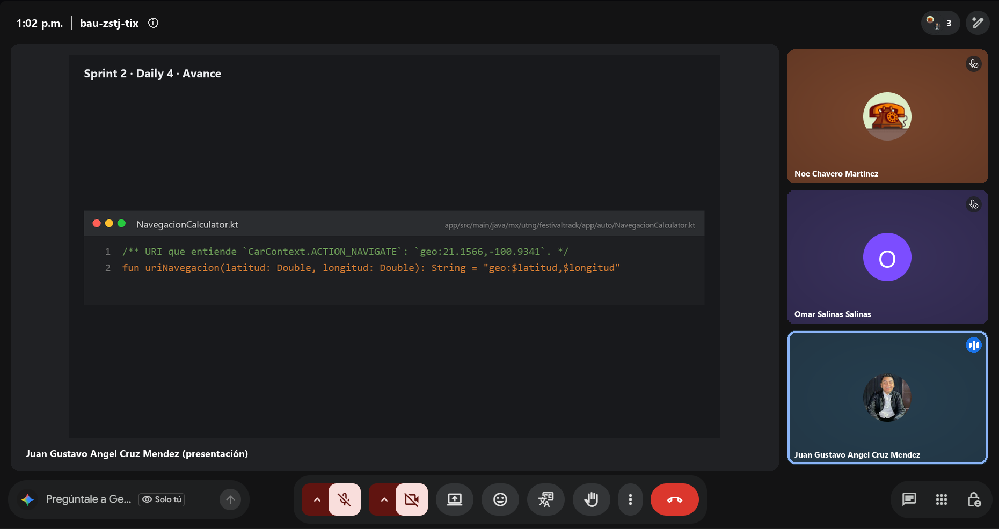
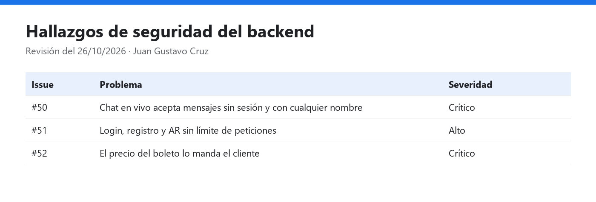

# Daily Scrum 4 · Sprint 2

- **Fecha:** 2026-10-26 (lunes)
- **Duración:** 15 min
- **Asistentes:** Gustavo · Omar · Noé
- **Facilitador (Scrum Master del sprint):** Omar



## Juan Gustavo Ángel Cruz Méndez

- **¿Qué hice desde la última daily?** Encontré tres problemas de seguridad. El chat en vivo acepta mensajes sin sesión y con cualquier nombre. El login, el registro y el reconocimiento AR no tienen límite de peticiones. En la compra de boletos el precio lo manda el cliente.
- **¿Qué haré hoy?** Registrar los tres hallazgos como issues del Sprint 2 y empezar las correcciones en `feature/mejoras-seguridad`.
- **¿Tengo algún bloqueo?** Para probar sin tocar Neon hace falta una base desechable; se usa PostgreSQL en Docker.

## Salinas Salinas Omar

- **¿Qué hice desde la última daily?** Pantalla de demos del concierto (#30).
- **¿Qué haré hoy?** Reproductor en segundo plano con Media3 `MediaSessionService` (#31).
- **¿Tengo algún bloqueo?** Ninguno.

## Noé Chavero Martínez

- **¿Qué hice desde la última daily?** Diseño de la pantalla 8: una `PaneTemplate` con destino, distancia, tiempo estimado y el botón **Iniciar navegación**, que entrega la ruta al navegador del auto.
- **¿Qué haré hoy?** `NavegacionCalculator` con sus pruebas, y la lectura por voz del resumen de la ruta.
- **¿Tengo algún bloqueo?** La plantilla de navegación propia (`NavigationTemplate`) requiere que la app sea de categoría NAVIGATION, así que se usa `ACTION_NAVIGATE`, la alternativa que pide la #39.

## Avance mostrado

### Hallazgos registrados



### Código que lo hace funcionar

**`app/src/main/java/mx/utng/festivaltrack/app/auto/NavegacionCalculator.kt`**: URI que entiende `CarContext.ACTION_NAVIGATE` para mandar la ruta a Google Maps o Waze en el auto (#39) · **Responsable:** Noé

```kotlin
/** URI que entiende `CarContext.ACTION_NAVIGATE`: `geo:21.1566,-100.9341`. */
fun uriNavegacion(latitud: Double, longitud: Double): String = "geo:$latitud,$longitud"
```

## Acuerdos

- Las correcciones de seguridad van en su propia rama y se integran a `develop` con PR al cierre del sprint.
