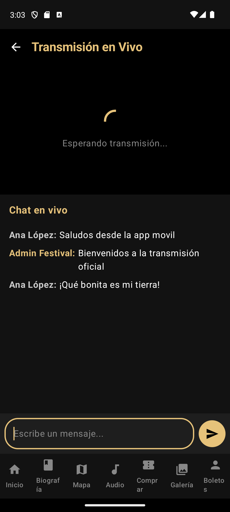
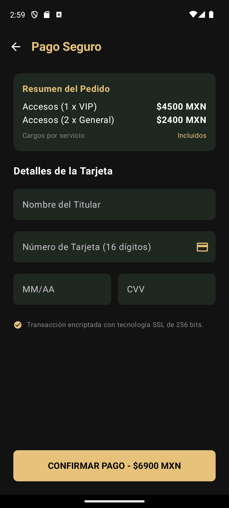
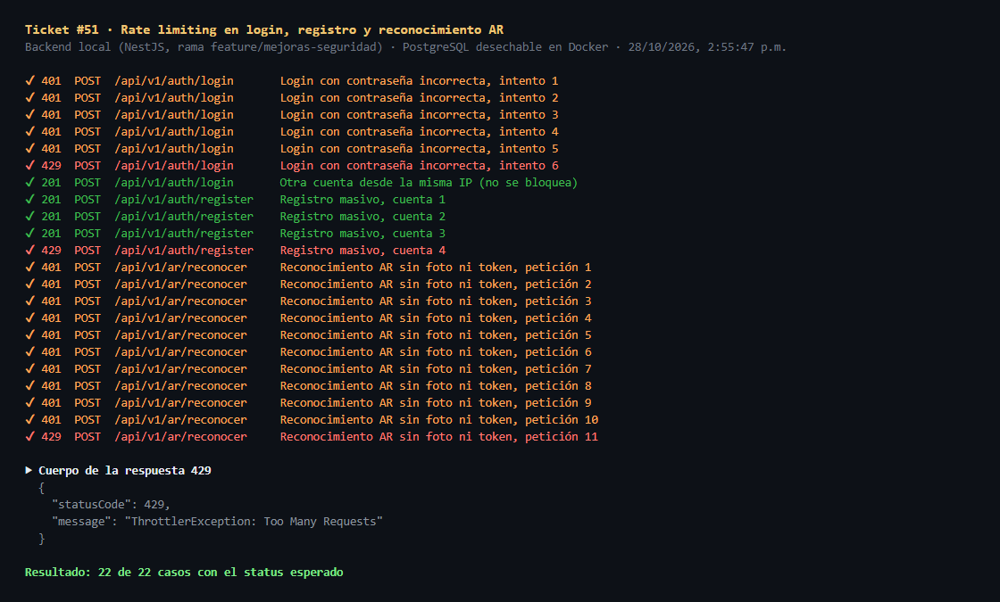
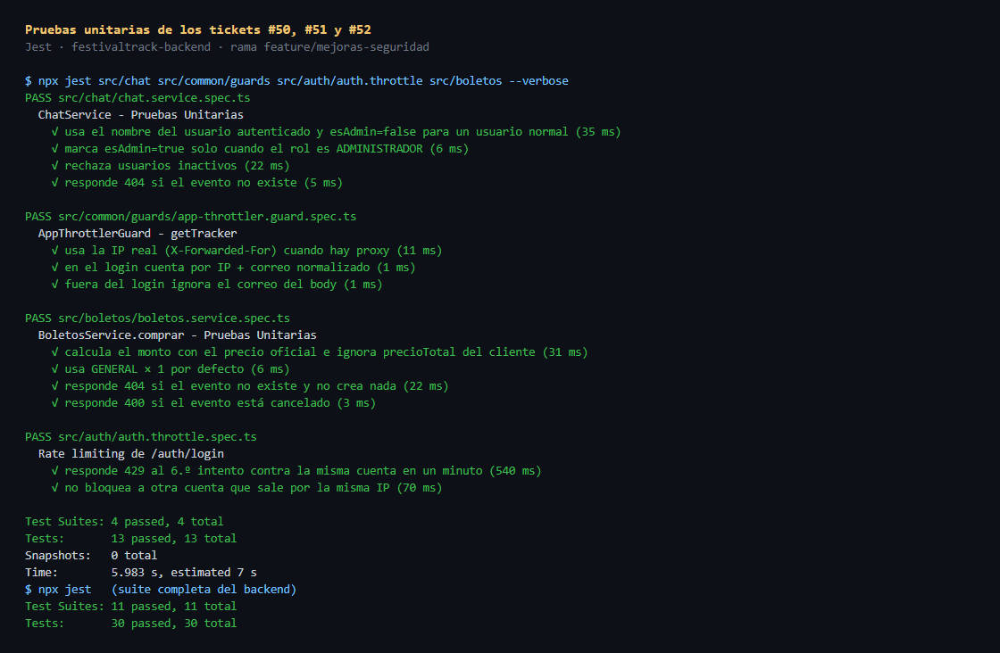

# Daily Scrum 5 · Sprint 2

- **Fecha:** 2026-10-28 (miércoles)
- **Duración:** 15 min
- **Asistentes:** Gustavo · Omar · Noé
- **Facilitador (Scrum Master del sprint):** Omar

> 📷 **Captura de la reunión pendiente.** Agrega la captura real de la llamada como `img/daily-5-reunion.png` y reemplaza esta nota por ``.

## Juan Gustavo Ángel Cruz Méndez

- **¿Qué hice desde la última daily?** Registré las issues #50, #51 y #52 y las corregí en `feature/mejoras-seguridad`. Agregué 13 pruebas unitarias nuevas (la suite del backend pasa 30/30) y la evidencia por API y en la app en `evidencias/seguridad/`.
- **¿Qué haré hoy?** Comentar el código de los tres tickets y preparar el PR hacia `develop`.
- **¿Tengo algún bloqueo?** La rama salió de `main`; hay que confirmar que integra limpio con `develop`.

## Salinas Salinas Omar

- **¿Qué hice desde la última daily?** Reproductor en segundo plano (#31).
- **¿Qué haré hoy?** Terminar la épica de audio y subir la rama.
- **¿Tengo algún bloqueo?** Ninguno reportado.

## Noé Chavero Martínez

- **¿Qué hice desde la última daily?** Terminé la #39, pantalla de navegación con lectura por voz, y adelanté la #36, Home del modo automóvil con las tarjetas de audio en curso, ruta activa y resumen AR del día.
- **¿Qué haré hoy?** Abrir el PR #53 con las dos pantallas y verificar que pase el CI.
- **¿Tengo algún bloqueo?** El reproductor en segundo plano (#31) aún no está en `develop`. Mientras tanto, la tarjeta de audio muestra "Sin audio en curso".

## Avance mostrado

### En la app

| Captura | Descripción | Responsable |
|---|---|---|
|  | Chat en vivo: solo se escribe con sesión y con el nombre del usuario del token (#50) | Gustavo |
|  | Checkout con el precio calculado por el servidor (#52) | Gustavo |

### Evidencia técnica

| Evidencia | Descripción | Responsable |
|---|---|---|
|  | Rate limiting: después del límite el servidor responde 429 (#51) | Gustavo |
|  | Suite del backend 30/30 con las 13 pruebas nuevas de seguridad | Gustavo |

### Código que lo hace funcionar

**`app/src/main/java/mx/utng/festivaltrack/app/auto/InicioAutoScreen.kt`**: Home del modo automóvil con sus tarjetas en una `ListTemplate` (#36) · **Responsable:** Noé

```kotlin
val tarjetas = ItemList.Builder()
    .addItem(filaAudio())
    .addItem(filaRuta())
    .addItem(Row.Builder().setTitle("Resumen AR").addText(textoAr).build())
    .addItem(
        Row.Builder()
            .setTitle("Alerta de salida y próximos eventos")
            .setBrowsable(true)
            .setOnClickListener { screenManager.push(AlertaSalidaScreen(carContext)) }
            .build()
    )
    .build()
```

**`app/src/main/java/mx/utng/festivaltrack/app/auto/NavegacionAutoScreen.kt`**: al iniciar la navegación lee el resumen en voz alta y entrega la ruta al navegador del auto (#39) · **Responsable:** Noé

```kotlin
private fun iniciarNavegacion(resumen: ResumenNavegacion) {
    tts?.speak(NavegacionCalculator.textoVoz(resumen), TextToSpeech.QUEUE_FLUSH, null, "navegacion")
    UbicacionAuto.navegar(carContext, resumen.uriNavegacion)
}
```

## Acuerdos

- El PR #53 se integra antes del cierre del sprint.
- Gustavo abre el PR de `feature/mejoras-seguridad` → `develop`.
