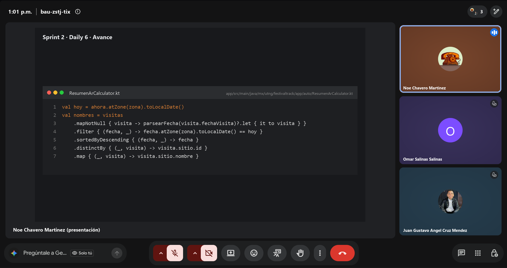

# Daily Scrum 6 · Sprint 2

| Fecha | Hora | Duración | Modalidad | Scrum Master |
|:--|:--|:--|:--|:--|
| Jueves 29 de octubre de 2026 | 13:01 | 15 min | Videollamada | Omar Salinas Salinas |

**Asistentes:** Noé Chavero Martínez · Omar Salinas Salinas · Juan Gustavo Ángel Cruz Méndez

<p align="center"></p>
<p align="center"><sub>Captura de la videollamada · presenta Noé Chavero Martínez</sub></p>

## Juan Gustavo Ángel Cruz Méndez

- **¿Qué hice desde la última daily?** Comenté el código de las correcciones #50, #51 y #52 y subí la evidencia de funcionamiento.
- **¿Qué haré hoy?** Abrir el PR `feature/mejoras-seguridad` → `develop`.
- **¿Tengo algún bloqueo?** Ninguno.

## Omar Salinas Salinas

- **¿Qué hice desde la última daily?** Reporta terminadas las tareas de audio #29, #30 y #31.
- **¿Qué haré hoy?** Subir la rama de audio y abrir su PR hacia `develop`.
- **¿Tengo algún bloqueo?** Ninguno reportado.

## Noé Chavero Martínez

- **¿Qué hice desde la última daily?** Integré el PR #53 (pantallas 8 y 10) en `develop` con el CI en verde.
- **¿Qué haré hoy?** Actualizar el tablero para el cierre del sprint y preparar la Sprint Review.
- **¿Tengo algún bloqueo?** Ninguno.

## Avance mostrado

### Código que lo hace funcionar

**`app/src/main/java/mx/utng/festivaltrack/app/auto/ResumenArCalculator.kt`**: sitios descubiertos hoy con la cámara AR, sin repetir, del más reciente al más antiguo. Alimenta la tarjeta "Resumen AR" del Home del auto (#36) · **Responsable:** Noé

```kotlin
val hoy = ahora.atZone(zona).toLocalDate()
val nombres = visitas
    .mapNotNull { visita -> parsearFecha(visita.fechaVisita)?.let { it to visita } }
    .filter { (fecha, _) -> fecha.atZone(zona).toLocalDate() == hoy }
    .sortedByDescending { (fecha, _) -> fecha }
    .distinctBy { (_, visita) -> visita.sitio.id }
    .map { (_, visita) -> visita.sitio.nombre }
```

**`festivaltrack-backend/src/chat/chat.controller.ts`**: el chat en vivo exige sesión y el remitente sale del token, no del body (#50) · **Responsable:** Gustavo

```ts
// Requiere sesión: el remitente sale del token, no del body (evita suplantación).
@UseGuards(JwtAuthGuard)
@Post()
enviarMensaje(@Body() dto: EnviarMensajeDto, @Request() req: any) {
  return this.chatService.enviarMensaje(req.user.id, dto);
}
```

**Integración en `develop`**

| PR | Rama | Contenido |
|---|---|---|
| #53 | `feat/NaveagionGPSCarPlay` | Pantalla 8 · Navegación (#39) y pantalla 10 · Home del auto (#36), con pruebas de `NavegacionCalculator` (6) y `ResumenArCalculator` (4) |

## Acuerdos

- Sprint Review y Retrospectiva el viernes 30 de octubre.
- Antes de cerrar el sprint, el código de seguridad y el de audio deben estar en un PR hacia `develop`.

---

<p align="center"><sub><a href="daily-5.md">← Daily 5</a> · <a href="../README.md#sprint-2--19-al-30-de-octubre-de-2026">Índice del Sprint 2</a> · <a href="review.md">Sprint Review →</a></sub></p>
