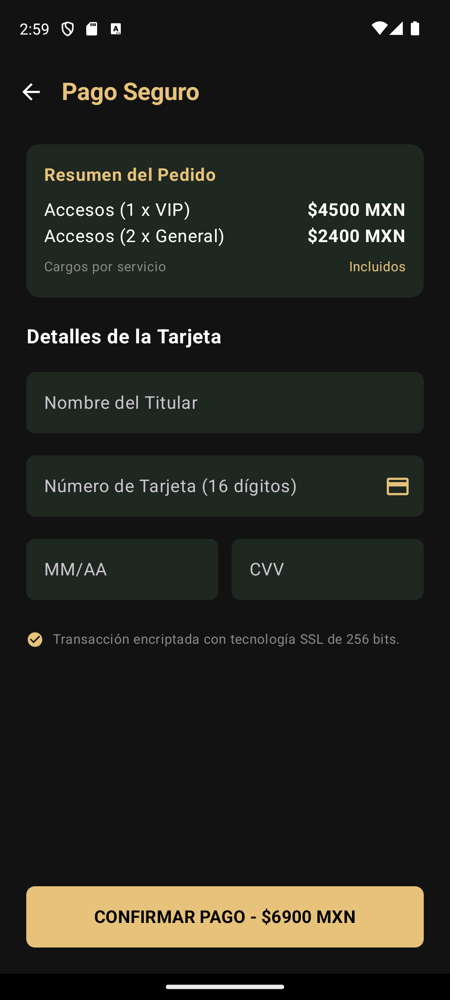

# Incremento · Sprint 2

- **Fecha de entrega:** 2026-10-30
- **Versión:** `v4.1-sprint2`
- **Release:** no se publicó por separado; su contenido se entrega en [v4.2-sprint3](https://github.com/gusmendez3249/Jose_Alfredo/releases/tag/v4.2-sprint3).
- **Pull Request develop → main:** #49 (22/10/2026). Integró el incremento del Sprint 1 y la pantalla 7; lo demás de este sprint entra con el PR de cierre del Sprint 3 (#42).

## Funcionalidades incluidas

En `develop` al cierre del sprint:

| Issue | Funcionalidad | Responsable |
|---|---|---|
| #33 | Pantalla 7 · Elige tu destino: escenarios y sitios con distancia y tiempo; "Navegar" envía la ruta al auto | Noé |
| #39 | Pantalla 8 · Navegación en Android Auto: destino, distancia, tiempo, lectura por voz e "Iniciar navegación" | Noé |
| #36 | Pantalla 10 · Home del modo automóvil: audio en curso, ruta activa, resumen AR del día y acceso a la alerta de salida | Noé |
| #28 | Catálogo de sitios con coordenadas, usado como destinos del GPS | Gustavo |
| — | Burndown por sprint generado desde el Project y workflow diario | Noé |

Terminado fuera de `develop` (se integra en el Sprint 3):

| Issue | Funcionalidad | Responsable | Dónde está |
|---|---|---|---|
| #50, #51, #52 | Chat con sesión obligatoria, rate limiting y precio del boleto en el servidor | Gustavo | `feature/mejoras-seguridad` |
| #29, #30, #31 | Demos de audio por concierto y reproductor en segundo plano | Omar | Pendiente de subir |

## Cómo probarlo

1. Compilar la app desde `develop` (o descargar el artefacto `festivaltrack-app-debug` del último Android CI).
2. Levantar el backend: `cd festivaltrack-backend && npm run start:dev` con el `.env` del equipo.
3. **Pantalla 7:** en el teléfono, Mapa → ícono del auto → elegir un destino → **Navegar**.
4. **Pantallas 8 y 10:** conectar un celular físico al Desktop Head Unit siguiendo [`docs/pruebas/android-auto.md`](../../pruebas/android-auto.md) (en emuladores la Play Store no permite instalar Android Auto). En el Home del auto aparece la ruta activa; al tocarla se abre la pantalla de navegación con **Iniciar navegación**.
5. **Resumen AR:** iniciar sesión con una cuenta de rol USUARIO, reconocer un sitio con la cámara AR y volver al Home del auto.

## Evidencia

| Captura | Qué se muestra | Responsable |
|---|---|---|
| 📷 *Captura pendiente*: agrega `img/incremento-destinos.png` | Pantalla 7 en el teléfono | Noé |
| 📷 *Captura pendiente*: agrega `img/incremento-auto-home.png` | Home del modo automóvil en el DHU | Noé |
|  | Compra con el precio calculado por el servidor (rama de seguridad) | Gustavo |
