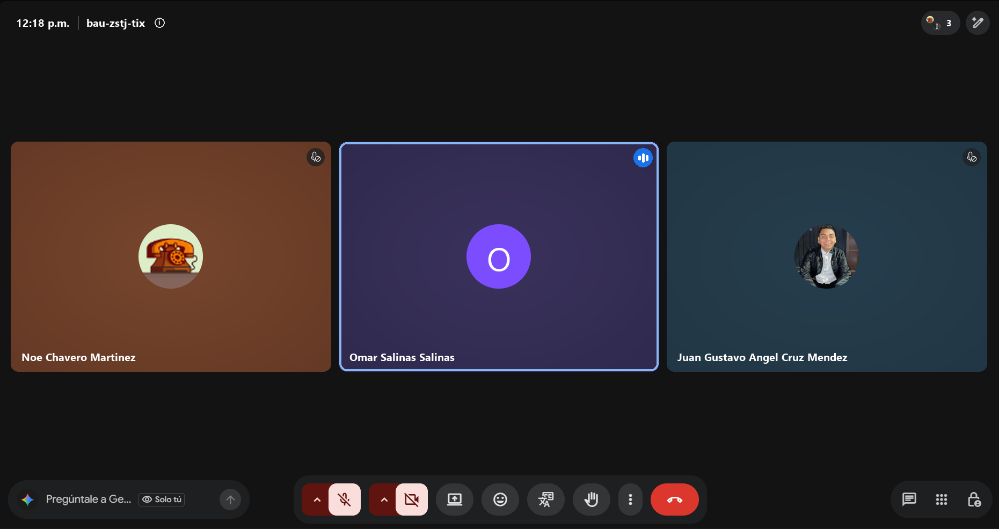

# Retrospectiva · Sprint 2

- **Fecha:** 2026-10-30 (viernes)
- **Asistentes:** Gustavo · Omar · Noé
- **Scrum Master:** Omar Salinas
- **Formato:** Continuar / Dejar de hacer / Empezar

## Continuar (lo que funcionó)

- PR por cada entrega en cuanto está lista (#47 el 21/10 y #53 el 28/10), sin esperar al último día.
- Burndown automático: el workflow diario deja la gráfica al día sin trabajo manual.
- Pruebas unitarias junto con cada pantalla nueva: el módulo auto pasó de 8 a 23 pruebas.
- Probar las correcciones de seguridad con una base desechable en Docker, sin tocar Neon.

## Dejar de hacer (lo que no funcionó)

- Cerrar issues en el tablero antes de que su código esté en `develop` (#29–#31 sin subir; #50–#52 sin PR).
- Crear ramas desde `main` en lugar de `develop` (`feature/mejoras-seguridad`).

## Empezar (lo que vamos a intentar)

- **Definición de Terminado:** una tarea solo pasa a Done cuando su PR está integrado en `develop` con el CI en verde.
- Escribir `Closes #N` en la descripción del PR para que la issue quede ligada a su código.
- Crear las ramas nuevas siempre desde `develop`.

## Acciones para el siguiente sprint

| Acción | Responsable | Cómo sabremos que se cumplió |
|---|---|---|
| Abrir e integrar el PR `feature/mejoras-seguridad` → `develop` | Gustavo | #50–#52 visibles en `develop` |
| Subir la rama de audio (#29–#31) y abrir su PR hacia `develop` | Omar | PR abierto antes de la Daily 3 del Sprint 3 |
| Regla de protección en `develop` (pendiente del Sprint 1) | Gustavo | Settings → Branches muestra la regla activa |

## Seguimiento de las acciones del sprint anterior

| Acción | ¿Se cumplió? | Comentario |
|---|---|---|
| Al menos un PR por persona antes de la Daily 3 | Parcial | Noé (#47) y Gustavo (#48 y #49) sí; Omar no abrió PR en el sprint |
| Regla de protección en `develop` | No | `develop` sigue sin regla de protección; pasa al Sprint 3 |
| Rotar la contraseña de Neon y el `JWT_SECRET` | Sin evidencia | No hay registro de la rotación; confirmar en la próxima daily |
