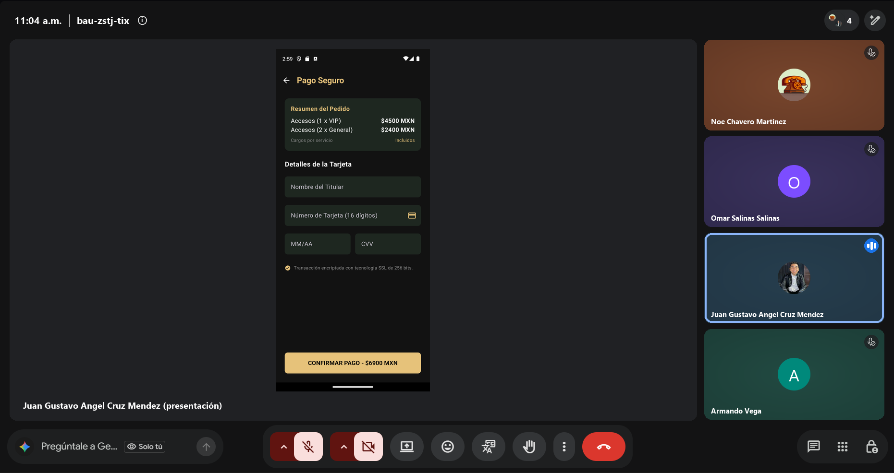
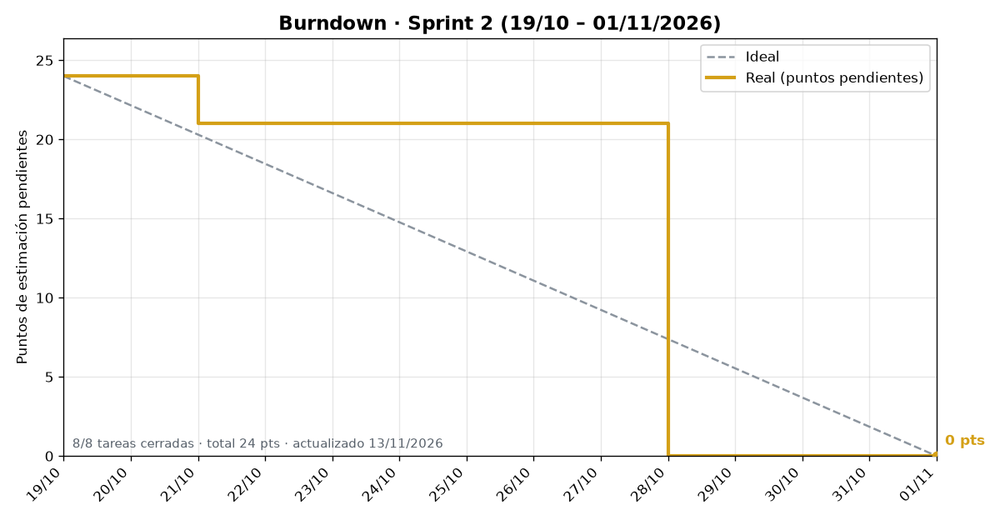
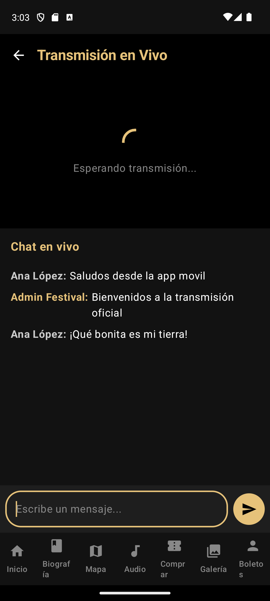
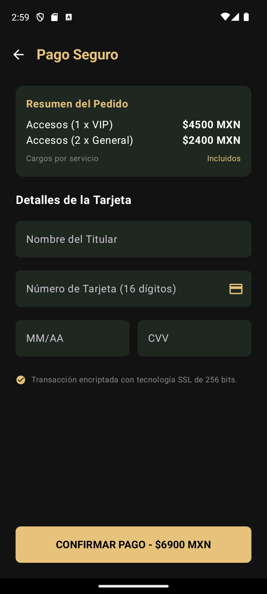
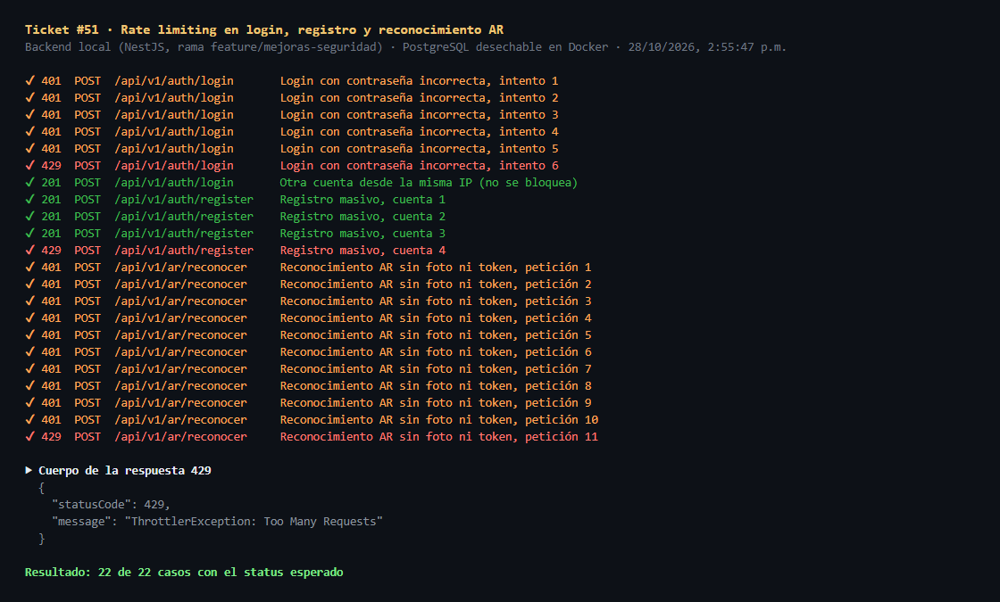
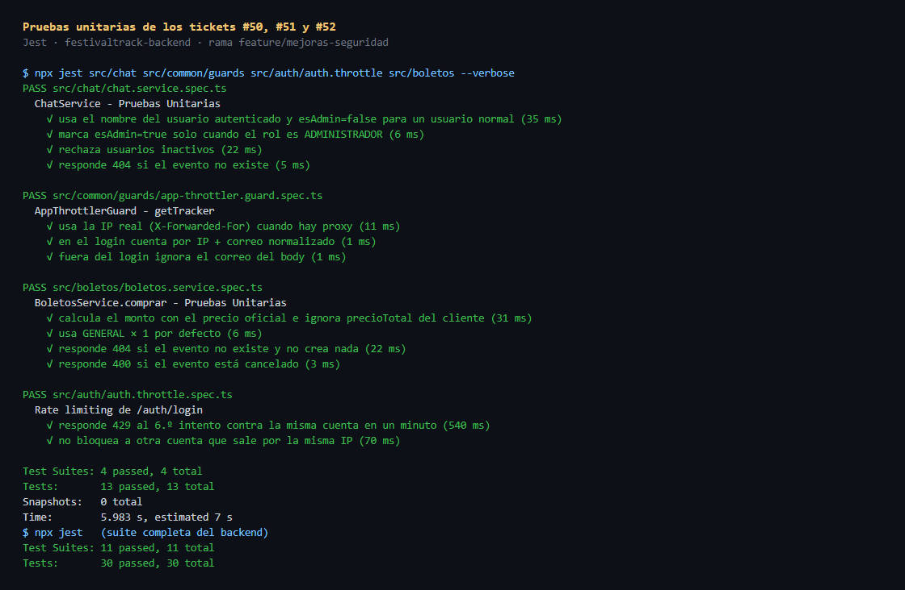

# Sprint Review · Sprint 2

- **Fecha:** 2026-10-30 (viernes)
- **Periodo del sprint:** 2026-10-19 a 2026-10-30
- **Asistentes:** Gustavo · Omar · Noé · Armando Vega (Product Owner)
- **Scrum Master:** Omar Salinas
- **Product Owner:** Armando Vega
- **Objetivo del sprint:** demos de audio de cada concierto, catálogo de sitios para el GPS y la pantalla "Elige tu destino" del modo automóvil.

## Resultado del sprint

Milestone: [Sprint 2](https://github.com/gusmendez3249/Jose_Alfredo/milestone/2) · **8 de 8 tareas cerradas (100 %)**

| Milestone | Cerradas | Abiertas | Avance |
|---|---|---|---|
| [Sprint 2](https://github.com/gusmendez3249/Jose_Alfredo/milestone/2) | 8 | 0 | 100 % |

Además se adelantaron dos tareas del Sprint 3 (#39 y #36), integradas en `develop` con el PR #53.

### Burndown

Gráfica generada con `docs/scrum/herramientas/burndown.py` a partir del campo Sprint, el Estimate y la fecha de cierre de cada issue del Project.

## Tareas terminadas

| Issue | Tarea | Responsable | Evidencia |
|---|---|---|---|
| #33 | [Auto] Pantalla 7 · Elige tu destino (distancia y tiempo estimado) | Noé | PR #47 · [Daily 2](daily-2.md) |
| #28 | [Backend] Sitios culturales (AR y destinos GPS) con seed | Gustavo | Modelo `SitioAR` con coordenadas (PR #46); lo consume la #33 · [Daily 2](daily-2.md) |
| #50 | [Seguridad] Chat en vivo: exige sesión y evita suplantación | Gustavo | Rama `feature/mejoras-seguridad` · [Daily 5](daily-5.md) |
| #51 | [Seguridad] Rate limiting en login, registro y reconocimiento AR | Gustavo | Rama `feature/mejoras-seguridad` · [Daily 5](daily-5.md) |
| #52 | [Seguridad] Precio del boleto calculado en el servidor | Gustavo | Rama `feature/mejoras-seguridad` · [Daily 5](daily-5.md) |
| #29 | [Backend] Relacionar canciones demo con cada evento | Omar | Reportada en [Daily 6](daily-6.md) |
| #30 | [Audio] Pantalla 4 · Demos del concierto | Omar | Reportada en [Daily 6](daily-6.md) |
| #31 | [Audio] Pantalla 5 · Reproductor en segundo plano | Omar | Reportada en [Daily 6](daily-6.md) |

Adelantadas del Sprint 3:

| Issue | Tarea | Responsable | Evidencia |
|---|---|---|---|
| #39 | [Auto] Pantalla 8 · Navegación en Android Auto | Noé | PR #53 · [Daily 5](daily-5.md) |
| #36 | [Auto] Pantalla 10 · Home del modo automóvil | Noé | PR #53 · [Daily 5](daily-5.md), [Daily 6](daily-6.md) |

## Tareas no terminadas

Todas las tareas del milestone se cerraron. **Sin embargo, no todo el código cerrado está en `develop`:**

| Issue | Situación al cierre | Responsable | Pasa al sprint |
|---|---|---|---|
| #50, #51, #52 | Terminadas y probadas en `feature/mejoras-seguridad`, sin PR hacia `develop` | Gustavo | Sprint 3: abrir e integrar el PR |
| #29, #30, #31 | Cerradas en el tablero, pero su código no se ha subido al repositorio | Omar | Sprint 3: subir la rama y abrir el PR junto con la #25 |

## Demostración

| Captura | Qué se muestra | Responsable |
|---|---|---|
|  | Chat en vivo con sesión obligatoria (#50) | Gustavo |
|  | Checkout con el precio del servidor (#52) | Gustavo |
| 📷 *Captura pendiente*: `img/review-auto-destinos.png` | Pantalla 7 · Elige tu destino en el teléfono (#33) | Noé |
| 📷 *Captura pendiente*: `img/review-auto-navegacion.png` | Pantalla 8 · Navegación en el Desktop Head Unit (#39). Se toma con celular físico: [guía](../../pruebas/android-auto.md) | Noé |
| 📷 *Captura pendiente*: `img/review-auto-home.png` | Pantalla 10 · Home del modo automóvil en el DHU (#36) | Noé |

### Evidencia técnica

| Evidencia | Qué se muestra | Responsable |
|---|---|---|
|  | Rate limiting: 429 después del límite (#51) | Gustavo |
|  | Backend 30/30 pruebas en la rama de seguridad | Gustavo |

**Calidad:** los PRs #47 y #53 pasaron Android CI. Pruebas unitarias de la app en el módulo auto: 23
(`SalidaCalculator` 8, `NavegacionCalculator` 6, `DestinosCalculator` 5, `ResumenArCalculator` 4).

## Tablero al cierre

Vista del tablero: [GitHub Projects · Festival Track](https://github.com/users/gusmendez3249/projects/2) (filtro `sprint:"Sprint 2"`).

| Estado | Tareas del Sprint 2 |
|---|---|
| Done | #28, #29, #30, #31, #33, #50, #51, #52 |
| Done (adelantadas del Sprint 3) | #39, #36 |
| Continúan en el Sprint 3 | Épica #24 (falta #25) · épica #21 cerrada al completar #39 y #36 |

> 📷 Agrega la captura del tablero como `img/review-tablero.png`.

## Retroalimentación recibida

- Cerrar una tarea debe significar que su código ya está en `develop` y es demostrable; el cierre en el tablero no basta.
- El modo automóvil ya cubre las cuatro pantallas de la épica #21; falta la prueba con usuarios (#40).
