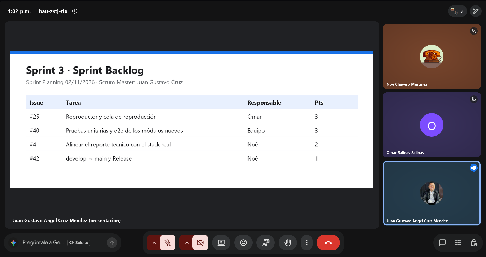
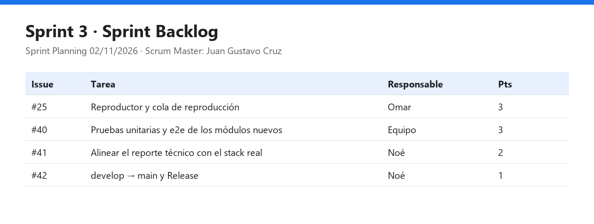

# Daily Scrum 1 · Sprint 3

| Fecha | Hora | Duración | Modalidad | Scrum Master |
|:--|:--|:--|:--|:--|
| Lunes 2 de noviembre de 2026 | 13:02 | 15 min | Videollamada | Juan Gustavo Ángel Cruz Méndez |

**Asistentes:** Noé Chavero Martínez · Omar Salinas Salinas · Juan Gustavo Ángel Cruz Méndez

Captura de la videollamada · presenta Juan Gustavo Ángel Cruz Méndez

## Juan Gustavo Ángel Cruz Méndez

- **¿Qué hice desde la última daily?** Sprint Planning del Sprint 3.
- **¿Qué haré hoy?** Revisar que `feature/mejoras-seguridad` integre limpio con `develop` y abrir su PR (acción de la retro).
- **¿Tengo algún bloqueo?** Ninguno.

## Omar Salinas Salinas

- **¿Qué hice desde la última daily?** Sprint Planning: se toma la #25 *Reproductor y cola de reproducción*, la última de la épica #24.
- **¿Qué haré hoy?** Subir la rama de audio con las tareas #29–#31 para abrir su PR (acción de la retro).
- **¿Tengo algún bloqueo?** Ninguno reportado.

## Noé Chavero Martínez

- **¿Qué hice desde la última daily?** Sprint Planning: se toman la #41 (alinear el reporte técnico con el stack real) y la #42 (integración y Release del incremento).
- **¿Qué haré hoy?** Revisar qué secciones del reporte técnico mencionan Firebase y preparar el plan de la Release.
- **¿Tengo algún bloqueo?** Ninguno.

## Avance mostrado

Sprint Planning. Objetivo del Sprint 3: **cerrar el MVP (reproductor con cola), integrar todo lo terminado en `develop`, pruebas de los módulos nuevos y publicar la Release final.**

| Issue | Tarea | Responsable | Estimate |
|---|---|---|---|
| #25 | Reproductor y cola de reproducción | Omar | 3 |
| #40 | [QA] Pruebas unitarias y e2e de los módulos nuevos | Equipo | 3 |
| #41 | [Docs] Alinear el reporte técnico con el stack real | Noé | 2 |
| #42 | [Release] `develop` → `main` y Release | Noé | 1 |

## Acuerdos

- Definición de Terminado (retro del Sprint 2): una tarea pasa a Done solo con su PR integrado en `develop` y el CI en verde.
- Cierre del sprint el viernes 13/11: integración el jueves 12/11.

---

<a href="../README.md#sprint-3--2-al-13-de-noviembre-de-2026">Índice del Sprint 3</a> · <a href="daily-2.md">Daily 2 →</a>

