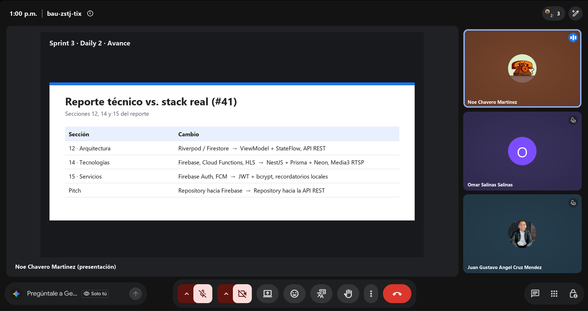
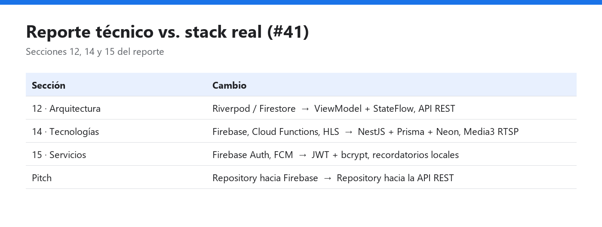

# Daily Scrum 2 · Sprint 3

| Fecha | Hora | Duración | Modalidad | Scrum Master |
|:--|:--|:--|:--|:--|
| Miércoles 4 de noviembre de 2026 | 13:00 | 15 min | Videollamada | Juan Gustavo Ángel Cruz Méndez |

**Asistentes:** Noé Chavero Martínez · Omar Salinas Salinas · Juan Gustavo Ángel Cruz Méndez

<p align="center"></p>
<p align="center"><sub>Captura de la videollamada · presenta Noé Chavero Martínez</sub></p>

## Juan Gustavo Ángel Cruz Méndez

- **¿Qué hice desde la última daily?** Confirmé que `feature/mejoras-seguridad` no tiene conflictos con `develop`.
- **¿Qué haré hoy?** Preparar la descripción del PR con la evidencia de `evidencias/seguridad/`.
- **¿Tengo algún bloqueo?** Ninguno.

## Omar Salinas Salinas

- **¿Qué hice desde la última daily?** Avance en la cola de reproducción (#25).
- **¿Qué haré hoy?** Continuar con la #25.
- **¿Tengo algún bloqueo?** Ninguno reportado.

## Noé Chavero Martínez

- **¿Qué hice desde la última daily?** Comparé el reporte técnico con el código: las secciones 12, 14 y 15 mencionan Firebase, Cloud Functions, HLS y Provider/Riverpod.
- **¿Qué haré hoy?** Redactar las secciones nuevas con el stack real: NestJS + Prisma + Neon, JWT, Media3 con RTSP, MVVM con ViewModel de Jetpack, CameraX con reconocimiento visual en el backend y Car App Library.
- **¿Tengo algún bloqueo?** Ninguno.

## Avance mostrado

### Diferencias encontradas en el reporte (#41)

| Sección | Dice el reporte | Lo que usa el proyecto |
|---|---|---|
| 12 · Arquitectura | ViewModel con Provider / Riverpod; Firestore | ViewModel de Jetpack con `StateFlow`; API REST propia con Retrofit |
| 14 · Tecnologías | Firebase (Firestore, Auth, Storage), Cloud Functions, HLS | NestJS + Prisma + PostgreSQL en Neon; JWT; Media3 (ExoPlayer) con RTSP |
| 15 · Servicios | Firebase Authentication, Cloud Vision, FCM | Login propio con JWT y bcrypt; reconocimiento AR en el backend; recordatorios locales |



### Código que lo hace funcionar

**`app/src/main/java/mx/utng/festivaltrack/app/playback/PlaybackService.kt`**: el reproductor vive en un `MediaSessionService`; el audio sigue sonando en segundo plano y Android muestra la notificación con los controles (#31, #25) · **Responsable:** Omar

```kotlin
class PlaybackService : MediaSessionService() {
    private var session: MediaSession? = null

    override fun onCreate() {
        super.onCreate()
        val player = ExoPlayer.Builder(this)
            .setAudioAttributes(
                AudioAttributes.Builder()
                    .setContentType(C.AUDIO_CONTENT_TYPE_MUSIC)
                    .setUsage(C.USAGE_MEDIA)
                    .build(),
                /* handleAudioFocus = */ true
            )
            .setHandleAudioBecomingNoisy(true) // pausa si se desconectan los audífonos
            .build()
        session = MediaSession.Builder(this, player).build()
    }
}
```

## Acuerdos

- El documento con las secciones corregidas se guarda en `docs/reporte/` para pasarlo al PDF final.

---

<p align="center"><sub><a href="daily-1.md">← Daily 1</a> · <a href="../README.md#sprint-3--2-al-13-de-noviembre-de-2026">Índice del Sprint 3</a> · <a href="daily-3.md">Daily 3 →</a></sub></p>
