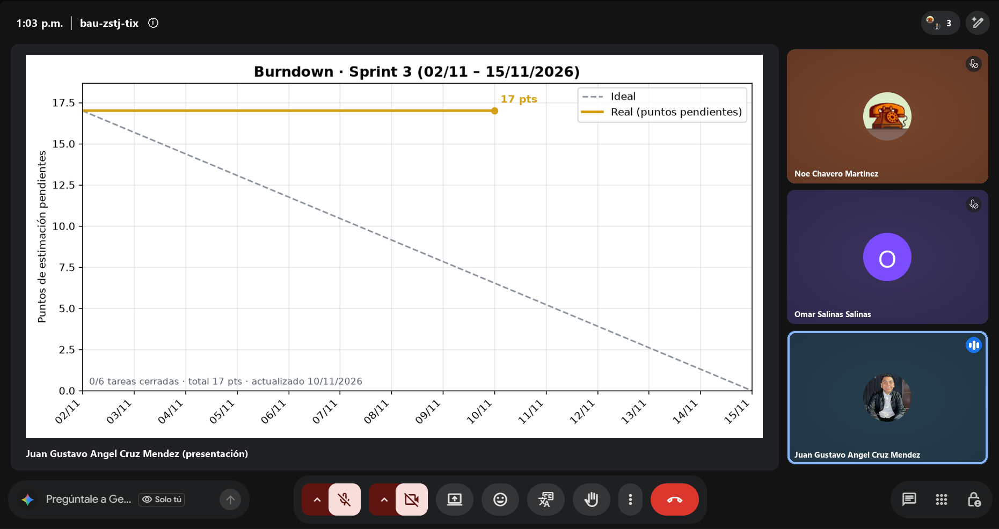
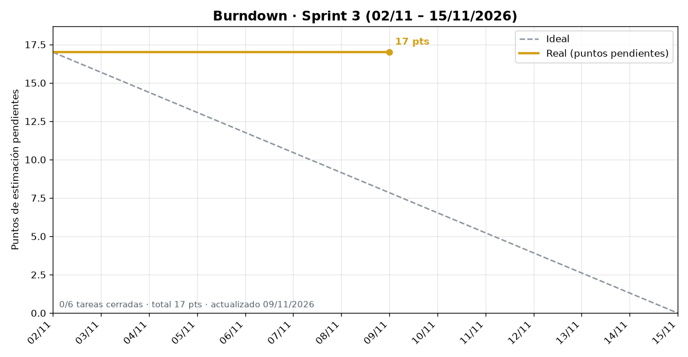

# Daily Scrum 3 · Sprint 3

- **Fecha:** 2026-11-06 (viernes)
- **Duración:** 15 min
- **Asistentes:** Gustavo · Omar · Noé
- **Facilitador (Scrum Master del sprint):** Gustavo



## Juan Gustavo Ángel Cruz Méndez

- **¿Qué hice desde la última daily?** Descripción del PR de seguridad lista.
- **¿Qué haré hoy?** Revisar con el equipo la #40: qué pruebas faltan en backend (`/ar/sitios`, historial).
- **¿Tengo algún bloqueo?** Ninguno.

## Salinas Salinas Omar

- **¿Qué hice desde la última daily?** Avance en la #25.
- **¿Qué haré hoy?** Continuar con la #25.
- **¿Tengo algún bloqueo?** Seguimiento de la acción de la retro: su rama de audio aún no está en el repositorio.

## Noé Chavero Martínez

- **¿Qué hice desde la última daily?** Secciones 12, 14 y 15 del reporte redactadas con el stack real.
- **¿Qué haré hoy?** Actualizar los READMEs con las pantallas del modo automóvil y del AR.
- **¿Tengo algún bloqueo?** Ninguno.

## Avance mostrado

### Evidencia técnica

| Evidencia | Descripción | Responsable |
|---|---|---|
|  | Burndown del Sprint 3 generado por el workflow diario | Noé |

### Documentación

**`docs/reporte/secciones-actualizadas.md`**: tabla de la sección 14 con el stack real del proyecto (#41) · **Responsable:** Noé

```markdown
| Backend           | NestJS (Node.js + TypeScript)        | API REST: autenticación, eventos, boletos con QR, chat, AR |
| Base de datos     | PostgreSQL en Neon + Prisma ORM      | Usuarios, eventos, boletos, canciones y sitios culturales  |
| Realidad aumentada| CameraX + reconocimiento visual (IA) | La app captura la foto y el backend identifica el sitio    |
| Integración auto  | Android Auto · Car App Library       | Home, Navegación y Alerta de salida con plantillas         |
| Streaming y audio | Media3 (ExoPlayer) con RTSP          | Transmisión en vivo y reproducción de audio                |
```

## Acuerdos

- Seguimiento de la acción "PR de audio antes de la Daily 3": no cumplida; se revisa en la Daily 4.
