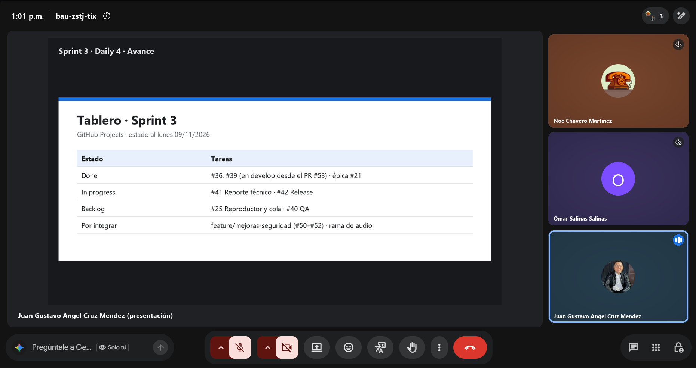
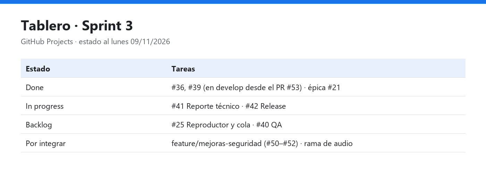

# Daily Scrum 4 · Sprint 3

| Fecha | Hora | Duración | Modalidad | Scrum Master |
|:--|:--|:--|:--|:--|
| Lunes 9 de noviembre de 2026 | 13:01 | 15 min | Videollamada | Juan Gustavo Ángel Cruz Méndez |

**Asistentes:** Noé Chavero Martínez · Omar Salinas Salinas · Juan Gustavo Ángel Cruz Méndez

Captura de la videollamada · presenta Juan Gustavo Ángel Cruz Méndez

## Juan Gustavo Ángel Cruz Méndez

- **¿Qué hice desde la última daily?** Revisión de las pruebas que faltan para la #40.
- **¿Qué haré hoy?** Abrir el PR `feature/mejoras-seguridad` → `develop`.
- **¿Tengo algún bloqueo?** Ninguno.

## Omar Salinas Salinas

- **¿Qué hice desde la última daily?** Avance en la #25.
- **¿Qué haré hoy?** Subir la rama de audio para integrarla el jueves.
- **¿Tengo algún bloqueo?** Ninguno reportado.

## Noé Chavero Martínez

- **¿Qué hice desde la última daily?** READMEs actualizados con las pantallas nuevas.
- **¿Qué haré hoy?** Preparar el PR `develop` → `main`, compilar el APK y dejar en borrador la Release `v4.2-sprint3`.
- **¿Tengo algún bloqueo?** Para publicar la Release faltan en `develop` el PR de seguridad y la rama de audio.

## Avance mostrado

### Estado del tablero

| Estado | Tareas del Sprint 3 |
|---|---|
| Done | #36, #39 (en `develop` desde el PR #53) · épica #21 |
| In progress | #41, #42 |
| Backlog | #25, #40 |

## Acuerdos

- Jueves 12/11: integración en `develop` de seguridad, audio y documentación. Viernes 13/11: PR a `main` y Release.

---

<a href="daily-3.md">← Daily 3</a> · <a href="../README.md#sprint-3--2-al-13-de-noviembre-de-2026">Índice del Sprint 3</a> · <a href="daily-5.md">Daily 5 →</a>

