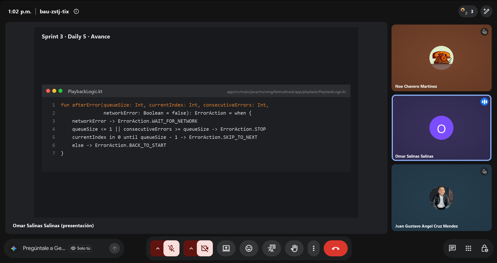
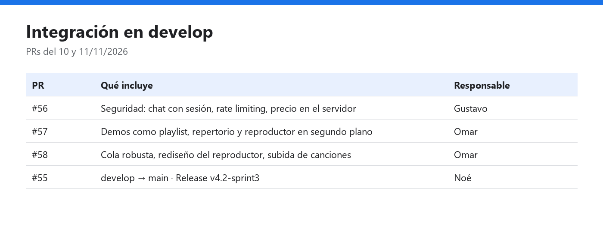

# Daily Scrum 5 · Sprint 3

| Fecha | Hora | Duración | Modalidad | Scrum Master |
|:--|:--|:--|:--|:--|
| Miércoles 11 de noviembre de 2026 | 13:02 | 15 min | Videollamada | Juan Gustavo Ángel Cruz Méndez |

**Asistentes:** Noé Chavero Martínez · Omar Salinas Salinas · Juan Gustavo Ángel Cruz Méndez

<p align="center"></p>
<p align="center"><sub>Captura de la videollamada · presenta Omar Salinas Salinas</sub></p>

## Juan Gustavo Ángel Cruz Méndez

- **¿Qué hice desde la última daily?** El PR #56 integró en `develop` y `main` las correcciones de seguridad #50, #51 y #52, con Backend CI y Android CI en verde.
- **¿Qué haré hoy?** Probar el modo automóvil con mi celular en el Desktop Head Unit siguiendo `docs/pruebas/android-auto.md`, y tomar las capturas para la Review.
- **¿Tengo algún bloqueo?** Ninguno.

## Omar Salinas Salinas

- **¿Qué hice desde la última daily?** Integré el audio en `develop`. El PR #57 trae las demos del concierto como playlist, el repertorio por administrador y el reproductor en segundo plano con cola global (#24, #29, #30, #31, #25). El PR #58 corrige la cola, rediseña el reproductor y agrega la subida de canciones del administrador.
- **¿Qué haré hoy?** Revisar las demos con el backend en el celular y preparar la demostración del reproductor para la Review.
- **¿Tengo algún bloqueo?** Ninguno.

## Noé Chavero Martínez

- **¿Qué hice desde la última daily?** Integré los PRs #54 (documentación y reporte, #41) y #55 (`develop` → `main`), y publiqué la Release `v4.2-sprint3` con el APK. Cerré #41, #42 y #40.
- **¿Qué haré hoy?** Agregar a la documentación las capturas de las reuniones de los tres sprints.
- **¿Tengo algún bloqueo?** El audio llegó a `develop` después de publicar `v4.2-sprint3`, así que esa Release no lo incluye.

## Avance mostrado

### Evidencia técnica

| PR | Contenido | Responsable | Checks |
|---|---|---|---|
| #57 | Demos del concierto como playlist, repertorio por administrador y reproductor en segundo plano | Omar | Compilar APK ✅ · Backend ✅ |
| #58 | Cola robusta ante errores, rediseño del reproductor y subida de canciones | Omar | Compilar APK ✅ · Backend ✅ |
| #56 | Seguridad: chat con sesión, rate limiting y precio del boleto en el servidor | Gustavo | Compilar APK ✅ · Backend ✅ |



### Código que lo hace funcionar

**`app/src/main/java/mx/utng/festivaltrack/app/playback/PlaybackLogic.kt`**: qué hace la cola cuando una demo falla; sin conexión se queda en pausa en lugar de saltar (#25) · **Responsable:** Omar

```kotlin
fun afterError(queueSize: Int, currentIndex: Int, consecutiveErrors: Int,
               networkError: Boolean = false): ErrorAction = when {
    networkError -> ErrorAction.WAIT_FOR_NETWORK
    queueSize <= 1 || consecutiveErrors >= queueSize -> ErrorAction.STOP
    currentIndex in 0 until queueSize - 1 -> ErrorAction.SKIP_TO_NEXT
    else -> ErrorAction.BACK_TO_START
}
```

### Estado del tablero

| Estado | Tareas del Sprint 3 |
|---|---|
| Done | #25, #36, #39, #40, #41, #42 · épicas #21 y #24 |

## Acuerdos

- El viernes 13/11, después de la Review, se integra `develop` → `main` y se publica una Release con el audio.
- Gustavo sube las capturas del modo automóvil a `docs/scrum/sprint-3/img/` con los nombres de la guía.

---

<p align="center"><sub><a href="daily-4.md">← Daily 4</a> · <a href="../README.md#sprint-3--2-al-13-de-noviembre-de-2026">Índice del Sprint 3</a> · <a href="daily-6.md">Daily 6 →</a></sub></p>
