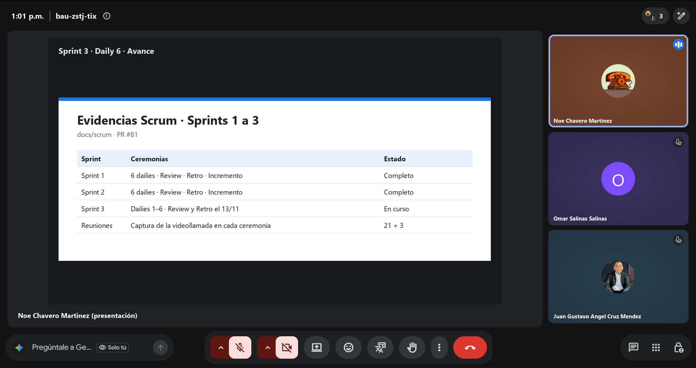
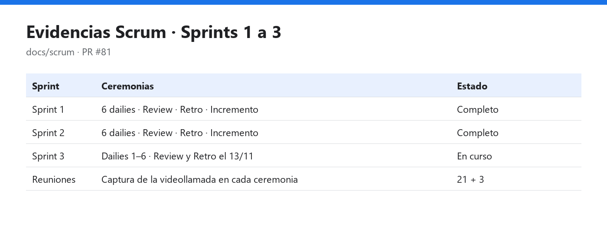

# Daily Scrum 6 · Sprint 3

| Fecha | Hora | Duración | Modalidad | Scrum Master |
|:--|:--|:--|:--|:--|
| Jueves 12 de noviembre de 2026 | 13:01 | 15 min | Videollamada | Juan Gustavo Ángel Cruz Méndez |

**Asistentes:** Noé Chavero Martínez · Omar Salinas Salinas · Juan Gustavo Ángel Cruz Méndez

<p align="center"></p>
<p align="center"><sub>Captura de la videollamada · presenta Noé Chavero Martínez</sub></p>

## Juan Gustavo Ángel Cruz Méndez

- **¿Qué hice desde la última daily?** Preparé la prueba del modo automóvil en el Desktop Head Unit con mi celular, siguiendo `docs/pruebas/android-auto.md`.
- **¿Qué haré hoy?** Organizar la Sprint Review del viernes: agenda, demo por integrante y revisión del milestone con el Product Owner.
- **¿Tengo algún bloqueo?** Ninguno.

## Omar Salinas Salinas

- **¿Qué hice desde la última daily?** Revisé las demos con el backend en el celular: playlist del concierto, cola, minirreproductor y notificación en segundo plano.
- **¿Qué haré hoy?** Preparar la demostración del reproductor para la Review.
- **¿Tengo algún bloqueo?** Ninguno.

## Noé Chavero Martínez

- **¿Qué hice desde la última daily?** Completé las evidencias Scrum de los tres sprints, con la captura de cada ceremonia, y las dejé en el PR #81.
- **¿Qué haré hoy?** Integrar el PR #81 en `develop` y preparar el cierre del Incremento del Sprint 3.
- **¿Tengo algún bloqueo?** Ninguno.

## Avance mostrado



### Código que lo hace funcionar

**`docs/scrum/README.md`**: índice de las ceremonias, con el Scrum Master de cada sprint y el Product Owner · **Responsable:** Noé

```markdown
- **Product Owner:** Armando Vega (asiste a las Sprint Review)
- **Scrum Master por sprint:** Sprint 1 · Noé Chavero · Sprint 2 · Omar Salinas · Sprint 3 · Juan Gustavo Cruz

| Sprint   | Daily Scrum | Sprint Review | Retrospectiva | Incremento |
| Sprint 1 | 6 / 6       | ✅            | ✅            | ✅         |
| Sprint 2 | 6 / 6       | ✅            | ✅            | ✅         |
```

## Acuerdos

- Sprint Review con el Product Owner el viernes 13/11 a las 11:00 y Retrospectiva a las 12:15.
- Orden de la demo: modo automóvil (Noé), audio (Omar), seguridad y pruebas (Gustavo).

---

<p align="center"><sub><a href="daily-5.md">← Daily 5</a> · <a href="../README.md#sprint-3--2-al-13-de-noviembre-de-2026">Índice del Sprint 3</a> · <a href="review.md">Sprint Review →</a></sub></p>
