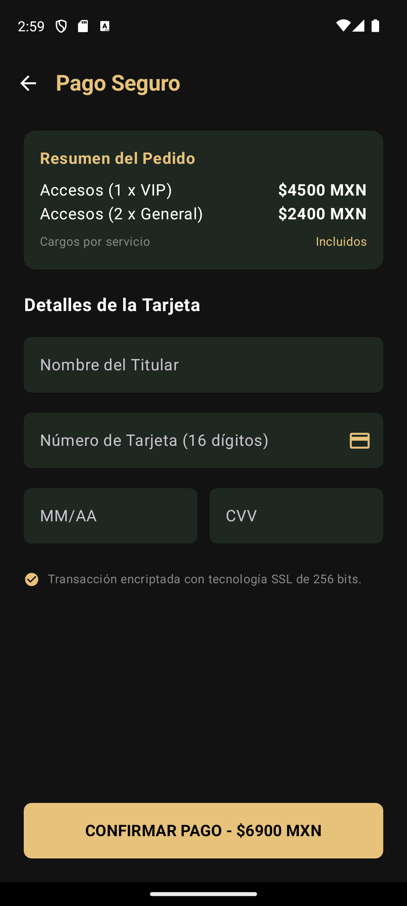
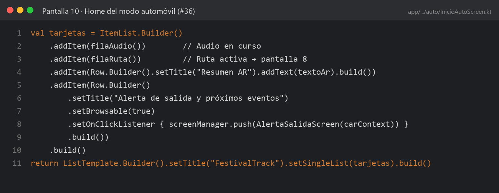
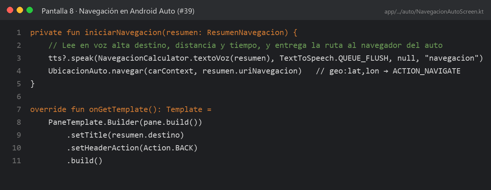
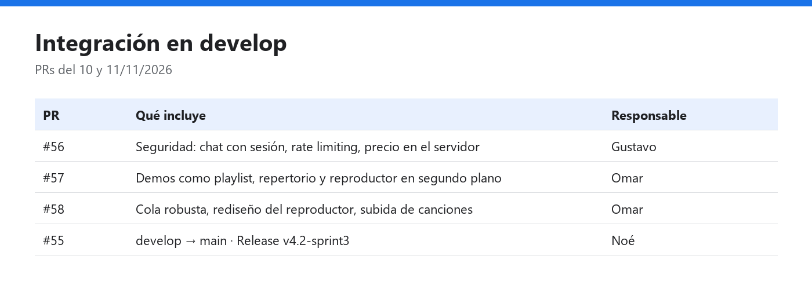

# Incremento · Sprint 3

| Fecha de entrega | Versión | Release | PR `develop` → `main` |
|:--|:--|:--|:--|
| 10/11/2026 | `v4.2-sprint3` | [v4.2-sprint3](https://github.com/gusmendez3249/Jose_Alfredo/releases/tag/v4.2-sprint3): incremento acumulado de los Sprints 1–3 | #55 |
| 11/11/2026 | `v4.3-sprint3` | [v4.3-sprint3](https://github.com/gusmendez3249/Jose_Alfredo/releases/tag/v4.3-sprint3): Release complementaria con el audio y la seguridad en la nube | #82 |

`v4.2-sprint3` es el incremento acumulado de la Unidad II: incluye lo de los Sprints 1 y 2, que no tuvieron Release propia. `v4.3-sprint3` agrega lo que se integró después: el audio del concierto y la segunda ronda de seguridad.

## Funcionalidades incluidas

| Sprint | Issue | Funcionalidad | Responsable |
|---|---|---|---|
| 1 | #22 | Galería interactiva como foro de la comunidad | Omar |
| 1 | #32, #35, #23 | Realidad aumentada: cámara de reconocimiento, sitio identificado e historial | Gustavo |
| 1 | #34, #37 | Módulo Android Auto y pantalla 9 · Alerta de salida | Noé |
| 1 | #26, #27 | Rama `develop`, flujo con PR y CI con GitHub Actions | Noé |
| 2 | #33, #28 | Pantalla 7 · Elige tu destino con el catálogo de sitios | Noé · Gustavo |
| 2 | #50, #51, #52 | Seguridad: chat con sesión, rate limiting y precio del boleto en el servidor | Gustavo |
| 3 | #39 | Pantalla 8 · Navegación en Android Auto | Noé |
| 3 | #36 | Pantalla 10 · Home del modo automóvil | Noé |
| 3 | #41 | Reporte técnico y READMEs alineados con el stack real | Noé |
| 3 | #42 | Integración `develop` → `main` y Release | Noé |

Agregado en `v4.3-sprint3` (11/11/2026):

| Sprint | Issue / PR | Funcionalidad | Responsable |
|---|---|---|---|
| 2–3 | #29, #30, #31, #25 · PR #57 | Demos del concierto como playlist, repertorio por administrador y reproductor en segundo plano con cola | Omar |
| 3 | PR #58 | Cola robusta ante errores, rediseño del reproductor y subida de canciones | Omar |
| 3 | PR #59 | Seguridad y servicios en la nube: secretos, validación de entradas, token cifrado y pruebas HTTP | Noé |
| 3 | PR #81 | Evidencias Scrum completas de los Sprints 1–3 | Noé |
La tarjeta *Audio en curso* del Home del auto muestra "Sin audio en curso" hasta que se integren.

## Cómo probarlo

1. Descargar `FestivalTrack-v4.3-sprint3.apk` de la Release más reciente e instalarlo en un celular Android.
2. Levantar el backend: `cd festivaltrack-backend && npm install && npm run start:dev` con el `.env` del equipo.
3. **Galería y AR:** iniciar sesión con una cuenta de rol USUARIO → **Galería** y **Explorar AR** desde Inicio.
4. **Pantalla 7:** Mapa → ícono del auto → elegir un destino → **Navegar**.
5. **Pantallas 8, 9 y 10:** conectar el celular al Desktop Head Unit siguiendo [`docs/pruebas/android-auto.md`](../../pruebas/android-auto.md).
6. **Seguridad:** el chat en vivo pide sesión, y el checkout muestra el precio calculado por el servidor.

## Evidencia

| Captura | Qué se muestra | Responsable |
|---|---|---|
|  | Compra con el precio calculado por el servidor (#52) | Gustavo |
|  | Pantalla 10 · Home del modo automóvil (#36) | Noé |
|  | Pantalla 8 · Navegación en Android Auto (#39) | Noé |
|  | PRs integrados y Release `v4.2-sprint3` (#42) | Equipo |

**Calidad:** Android CI en verde en el PR #55. Pruebas unitarias: 23 de la app (módulo `auto`) y la suite del backend con las pruebas de seguridad.

---

<a href="retro.md">← Retrospectiva</a> · <a href="../README.md#sprint-3--2-al-13-de-noviembre-de-2026">Índice del Sprint 3</a>

