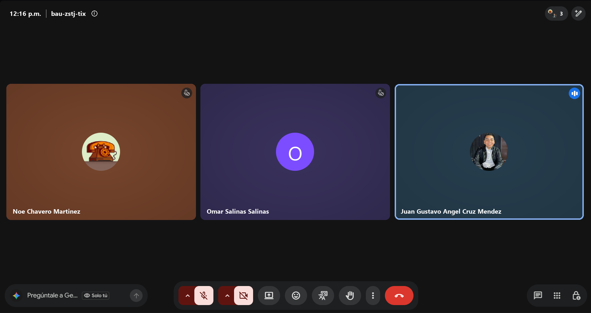

# Retrospectiva · Sprint 3

- **Fecha:** 2026-11-13 (viernes)
- **Asistentes:** Gustavo · Omar · Noé
- **Scrum Master:** Juan Gustavo Cruz
- **Formato:** Continuar / Dejar de hacer / Empezar

## Continuar (lo que funcionó)

- Integrar con PR y CI en verde: los PRs #54 a #58 entraron a `develop` sin conflictos.
- Adelantar trabajo cuando sobra capacidad: las pantallas 8 y 10 llegaron desde el Sprint 2.
- Documentar cada ceremonia el mismo día, con su evidencia (captura de la app o código).

## Dejar de hacer (lo que no funcionó)

- Publicar la Release antes de integrar todo lo del sprint: el audio llegó a `develop` un día después de `v4.2-sprint3`.
- Trabajar una rama mucho tiempo solo en local: la rama de audio se subió al final del sprint.

## Empezar (lo que vamos a intentar)

- Congelar `develop` el jueves de cierre y publicar la Release solo después de integrar todos los PRs del sprint.
- Subir la rama al remoto al menos una vez al día, aunque el trabajo no esté terminado.
- Probar el modo automóvil en un celular físico antes de cada Review.

## Acciones para el siguiente sprint

| Acción | Responsable | Cómo sabremos que se cumplió |
|---|---|---|
| Publicar una Release con el audio (`develop` → `main`) | Noé | Release nueva con el APK que incluye las demos |
| Prueba del modo automóvil con usuarios en celular físico | Gustavo | Tabla de resultados llena en `docs/pruebas/android-auto.md` |
| Regla de protección en `develop` | Gustavo | Settings → Branches muestra la regla activa |

## Seguimiento de las acciones del sprint anterior

| Acción | ¿Se cumplió? | Comentario |
|---|---|---|
| Abrir e integrar el PR `feature/mejoras-seguridad` → `develop` | Sí | PR #56, integrado el 10/11 |
| Subir la rama de audio y abrir su PR hacia `develop` | Sí | PRs #57 y #58, integrados el 10 y 11/11 |
| Regla de protección en `develop` | No | Sigue pendiente; pasa al siguiente sprint |
