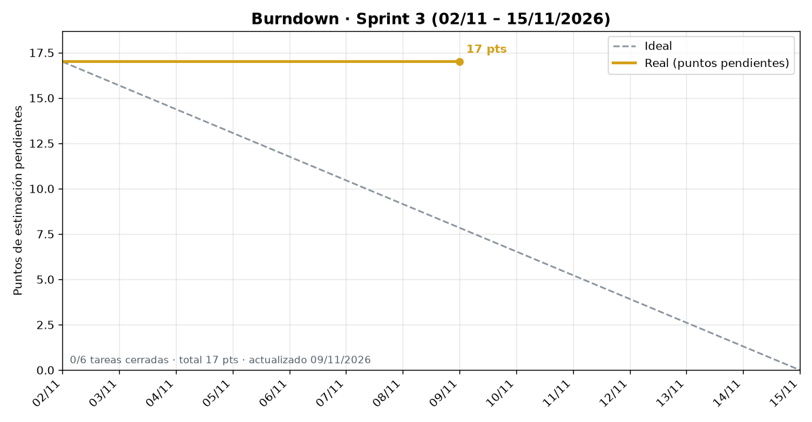
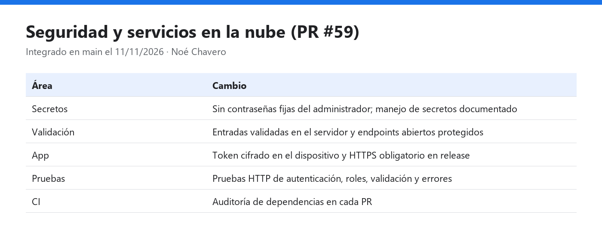
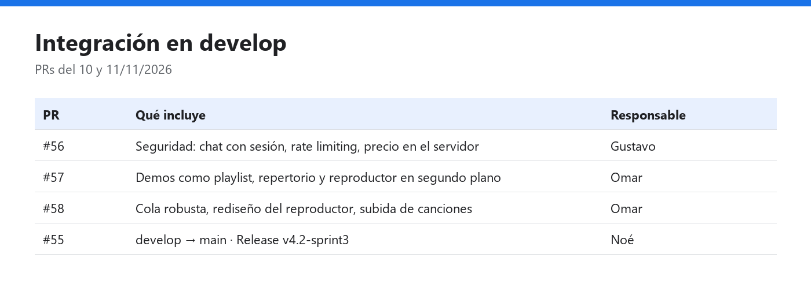

# Sprint Review · Sprint 3

| Fecha | Hora | Duración | Modalidad | Scrum Master | Product Owner |
|:--|:--|:--|:--|:--|:--|
| Viernes 13 de noviembre de 2026 | 11:03 | 60 min | Videollamada | Juan Gustavo Ángel Cruz Méndez | Armando Vega |

**Asistentes:** Noé Chavero Martínez · Omar Salinas Salinas · Juan Gustavo Ángel Cruz Méndez · Armando Vega (Product Owner)

**Periodo del sprint:** 2 al 13 de noviembre de 2026

> **Objetivo del sprint:** cerrar el MVP (reproductor con cola), integrar en `develop` todo lo terminado, probar los módulos nuevos, alinear el reporte técnico con el stack real y publicar la Release.

Captura de la videollamada · presenta Noé Chavero Martínez

## Resultado del sprint

Milestone: [Sprint 3](https://github.com/gusmendez3249/Jose_Alfredo/milestone/3) · **4 de 4 issues cerradas (100 %)**

| Milestone | Cerradas | Abiertas | Avance |
|---|---|---|---|
| [Sprint 3](https://github.com/gusmendez3249/Jose_Alfredo/milestone/3) | 4 | 0 | 100 % |

### Burndown

Gráfica generada con `docs/scrum/herramientas/burndown.py` a partir del campo Sprint, el Estimate y la fecha de cierre de cada issue del Project.

## Tareas terminadas

| Issue | Tarea | Responsable | Evidencia |
|---|---|---|---|
| #25 | Reproductor y cola de reproducción | Omar | PRs #57 y #58 · [Daily 5](daily-5.md) |
| #40 | [QA] Pruebas unitarias y e2e de los módulos nuevos | Equipo | 53 pruebas unitarias de la app (incluida la cola de audio) y pruebas HTTP de seguridad del backend |
| #41 | [Docs] Reporte técnico alineado con el stack real | Noé | PR #54 · [Daily 2](daily-2.md), [Daily 3](daily-3.md) |
| #42 | [Release] `develop` → `main` y Release | Noé | PR #55 · [v4.2-sprint3](https://github.com/gusmendez3249/Jose_Alfredo/releases/tag/v4.2-sprint3) |

Épica cerrada: **#24 Demos de audio del concierto**.

Integraciones del sprint: PR #56 (seguridad #50–#52), PR #59 (seguridad en la nube), PRs #57 y #58 (audio), PR #54 (documentación) y PR #55 (`develop` → `main`).

## Tareas no terminadas

Ninguna: todas las issues del milestone quedaron cerradas e integradas en `develop`.

## Demostración

| Evidencia | Qué se muestra | Responsable |
|---|---|---|
|  | Seguridad y servicios en la nube: secretos, validación, token cifrado y pruebas (PR #59) | Noé |
|  | Cola de reproducción: qué hace cuando una demo falla (#25) | Omar |
|  | PRs integrados en el sprint, con CI en verde | Equipo |

**Calidad:** los PRs #55, #56, #57, #58 y #59 pasaron Backend CI y Android CI. Pruebas: 53 unitarias de la app, incluida la cola de audio (`PlaybackLogicTest`), y la suite del backend con las pruebas HTTP de seguridad.

## Cambios de alcance

El modo automóvil (#21, #36 y #39) pasa al **Sprint 4** (#84) para validarlo en un head unit.

## Tablero al cierre

## Retroalimentación del Product Owner

- La seguridad quedó reforzada en dos rondas (#50–#52 y PR #59). Como el repositorio es público, hay que rotar la contraseña de la base de datos y el `JWT_SECRET`.
- El audio quedó integrado después de la Release `v4.2-sprint3`, así que hay que publicar una Release complementaria con las demos y el reproductor.
- Se aprueba el incremento del sprint.

---

<a href="daily-6.md">← Daily 6</a> · <a href="../README.md#sprint-3--2-al-13-de-noviembre-de-2026">Índice del Sprint 3</a> · <a href="retro.md">Retrospectiva →</a>

