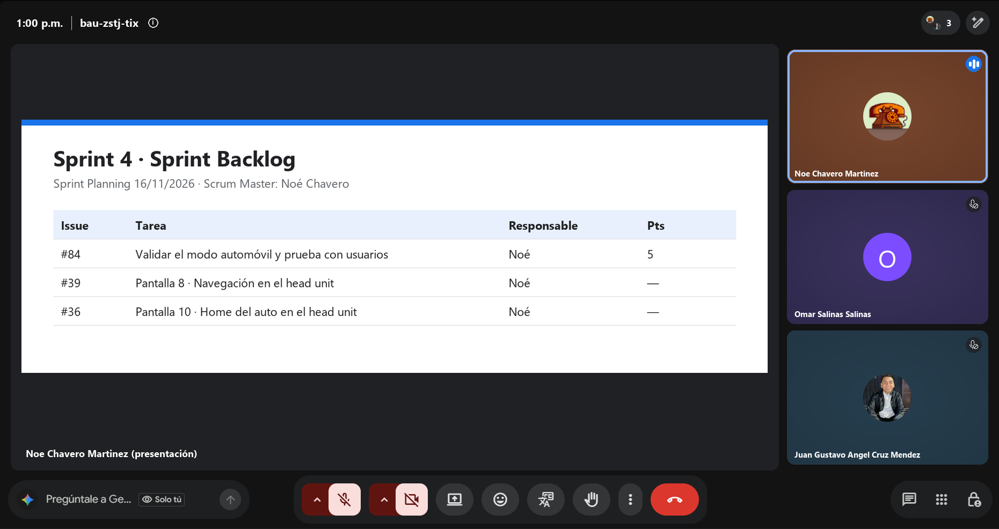
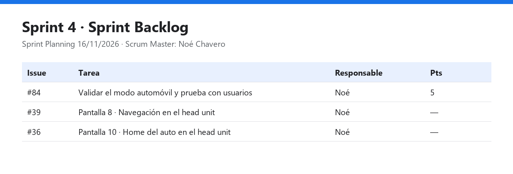

# Daily Scrum 1 · Sprint 4

| Fecha | Hora | Duración | Modalidad | Scrum Master |
|:--|:--|:--|:--|:--|
| Lunes 16 de noviembre de 2026 | 13:00 | 15 min | Videollamada | Noé Chavero Martínez |

**Asistentes:** Noé Chavero Martínez · Omar Salinas Salinas · Juan Gustavo Ángel Cruz Méndez

Captura de la videollamada · presenta Noé Chavero Martínez

## Noé Chavero Martínez

- **¿Qué hice desde la última daily?** Sprint Planning del Sprint 4: se toma la #84 para validar el modo automóvil en un head unit, con el emulador de Android Automotive OS. #39 y #36 pasan con ella.
- **¿Qué haré hoy?** Presentar el PR #86 con la variante `automotive` y repasar las capturas de la prueba del 12/11.
- **¿Tengo algún bloqueo?** Ninguno.

## Omar Salinas Salinas

- **¿Qué hice desde la última daily?** Sprint Planning.
- **¿Qué haré hoy?** Revisar cómo se ve la tarjeta *Audio en curso* del Home del auto con el reproductor en segundo plano.
- **¿Tengo algún bloqueo?** Ninguno.

## Juan Gustavo Ángel Cruz Méndez

- **¿Qué hice desde la última daily?** Sprint Planning.
- **¿Qué haré hoy?** Preparar el guion de la prueba con usuarios del modo automóvil.
- **¿Tengo algún bloqueo?** Ninguno.

## Avance mostrado

**Objetivo del Sprint 4:** validar el modo automóvil (épica #21) en la pantalla de un auto y hacer la prueba con usuarios.

## Acuerdos

- Scrum Master del Sprint 4: Noé (rotación Noé → Omar → Gustavo).
- La prueba con usuarios se hace en el emulador Automotive, porque Android Auto no se pudo usar en el celular.

---

<a href="../README.md#sprint-4--16-al-27-de-noviembre-de-2026">Índice del Sprint 4</a> · <a href="daily-2.md">Daily 2 →</a>

