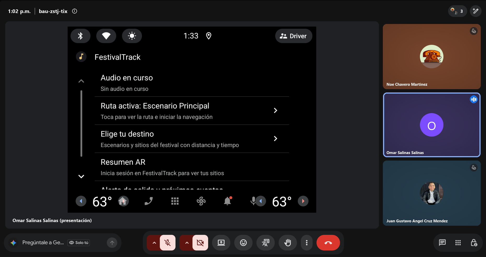
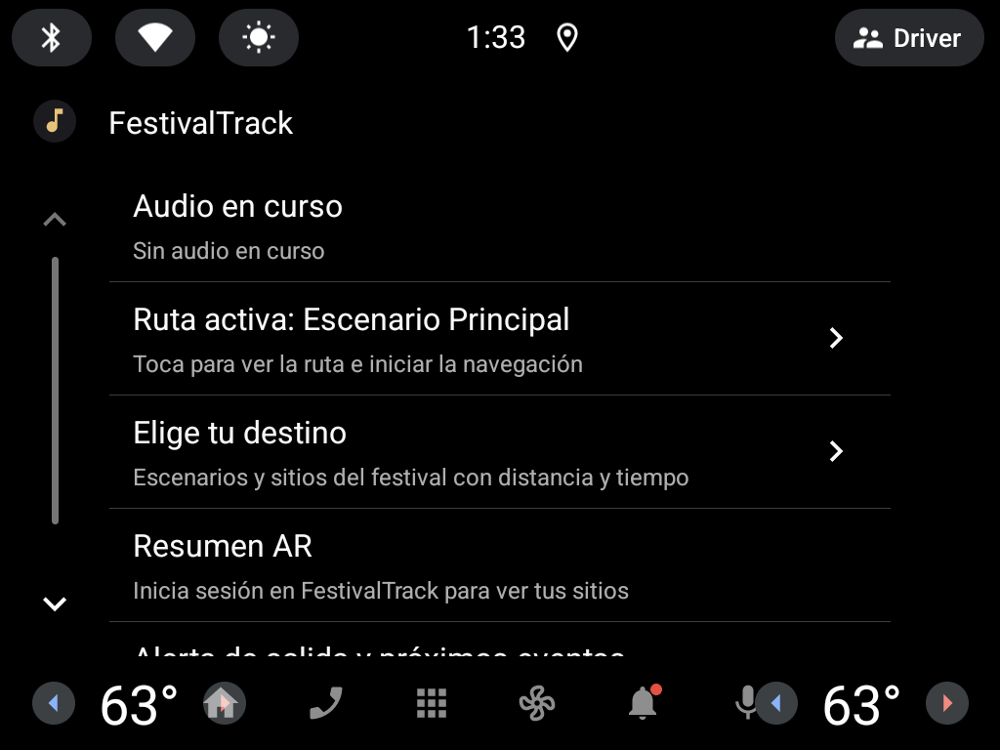

# Daily Scrum 2 · Sprint 4

| Fecha | Hora | Duración | Modalidad | Scrum Master |
|:--|:--|:--|:--|:--|
| Miércoles 18 de noviembre de 2026 | 13:02 | 15 min | Videollamada | Noé Chavero Martínez |

**Asistentes:** Noé Chavero Martínez · Omar Salinas Salinas · Juan Gustavo Ángel Cruz Méndez

<p align="center"></p>
<p align="center"><sub>Captura de la videollamada · presenta Omar Salinas Salinas</sub></p>

## Noé Chavero Martínez

- **¿Qué hice desde la última daily?** Presenté el PR #86: variante `automotive`, elegir destino desde el auto, audio en el Home y alerta de salida en días. Android CI en verde.
- **¿Qué haré hoy?** Atender los comentarios del equipo sobre el PR #86.
- **¿Tengo algún bloqueo?** Ninguno.

## Omar Salinas Salinas

- **¿Qué hice desde la última daily?** Revisé la tarjeta *Audio en curso* en el emulador Automotive: sigue al reproductor, pero en Automotive no hay pantalla de conciertos para iniciar una demo, así que muestra "Sin audio en curso".
- **¿Qué haré hoy?** Proponer cómo iniciar las demos desde el auto en un sprint siguiente.
- **¿Tengo algún bloqueo?** Ninguno.

## Juan Gustavo Ángel Cruz Méndez

- **¿Qué hice desde la última daily?** Primer borrador del guion de la prueba con usuarios.
- **¿Qué haré hoy?** Conseguir dos personas ajenas al equipo para la prueba.
- **¿Tengo algún bloqueo?** Ninguno.

## Avance mostrado

### En el auto

| Captura | Descripción | Responsable |
|---|---|---|
|  | Home del auto en Android Automotive OS: audio en curso, ruta activa, elige tu destino, resumen AR y alerta de salida | Noé · Omar |

### Código que lo hace funcionar

**`app/src/main/java/mx/utng/festivaltrack/app/auto/InicioAutoScreen.kt`**: la tarjeta de audio sigue al reproductor en segundo plano; al tocarla pausa o reanuda (#36) · **Responsable:** Noé

```kotlin
combine(PlaybackManager.queue, PlaybackManager.currentIndex, PlaybackManager.isPlaying) { cola, i, sonando ->
    val pista = cola.getOrNull(i)
    hayAudio = pista != null
    audio = when {
        pista == null -> "Sin audio en curso"
        sonando -> "▶ ${pista.title} · ${pista.eventoNombre}"
        else -> "⏸ ${pista.title} · ${pista.eventoNombre}"
    }
}.collect { invalidate() }
```

## Acuerdos

- Iniciar las demos desde el auto (catálogo de medios de Android Automotive) queda como propuesta para el siguiente sprint.

---

<p align="center"><sub><a href="daily-1.md">← Daily 1</a> · <a href="../README.md#sprint-4--16-al-27-de-noviembre-de-2026">Índice del Sprint 4</a> · <a href="daily-3.md">Daily 3 →</a></sub></p>
