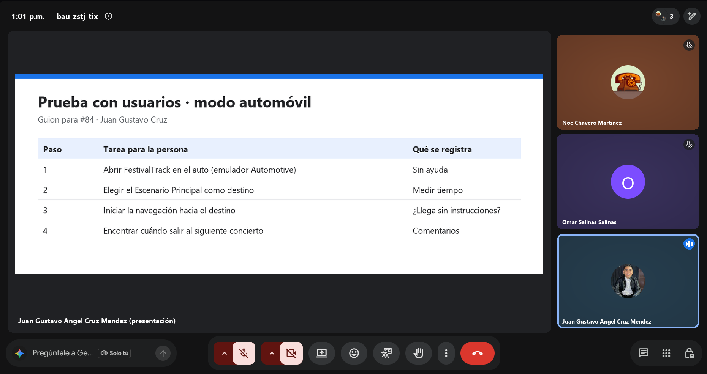
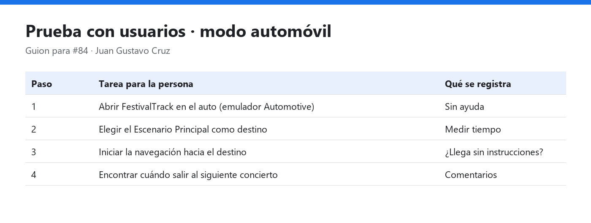
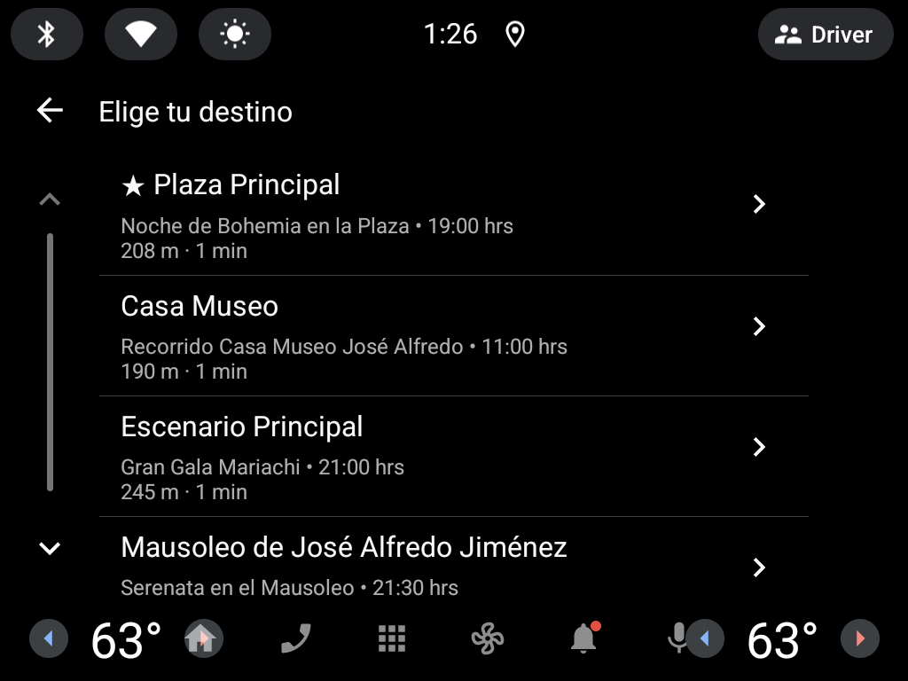
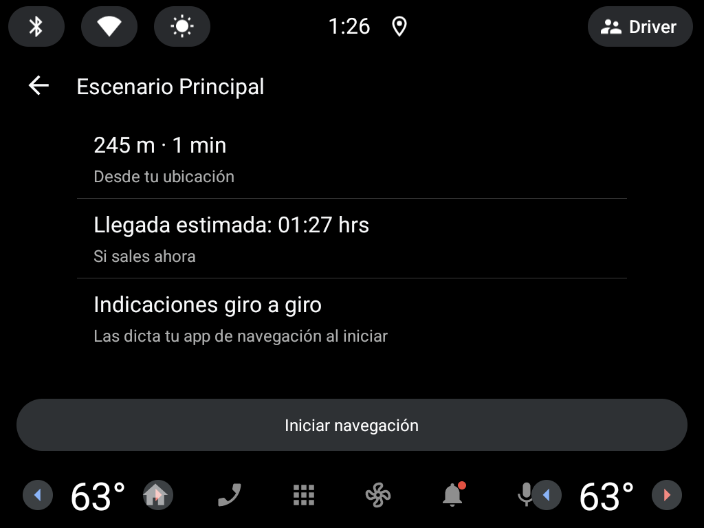

# Daily Scrum 3 · Sprint 4

| Fecha | Hora | Duración | Modalidad | Scrum Master |
|:--|:--|:--|:--|:--|
| Viernes 20 de noviembre de 2026 | 13:01 | 15 min | Videollamada | Noé Chavero Martínez |

**Asistentes:** Noé Chavero Martínez · Omar Salinas Salinas · Juan Gustavo Ángel Cruz Méndez

Captura de la videollamada · presenta Juan Gustavo Ángel Cruz Méndez

## Noé Chavero Martínez

- **¿Qué hice desde la última daily?** Agregué al PR #86 la guía `docs/pruebas/android-auto.md` con los pasos del emulador Automotive y el resultado de cada pantalla.
- **¿Qué haré hoy?** Revisar con Gustavo el guion de la prueba con usuarios.
- **¿Tengo algún bloqueo?** Ninguno.

## Omar Salinas Salinas

- **¿Qué hice desde la última daily?** Revisé la propuesta para iniciar demos desde el auto.
- **¿Qué haré hoy?** Probar el flujo completo del PR #86 en su equipo con la guía.
- **¿Tengo algún bloqueo?** Ninguno.

## Juan Gustavo Ángel Cruz Méndez

- **¿Qué hice desde la última daily?** Terminé el guion de la prueba con usuarios: cuatro tareas, tiempo y comentarios.
- **¿Qué haré hoy?** Agendar la prueba con dos personas ajenas al equipo.
- **¿Tengo algún bloqueo?** Ninguno.

## Avance mostrado

### En el auto

| Captura | Descripción | Responsable |
|---|---|---|
|  | Paso 2 del guion: elegir destino desde el auto | Gustavo |
|  | Paso 3 del guion: pantalla 8 con *Iniciar navegación* | Gustavo |

## Acuerdos

- La prueba con usuarios queda registrada en la tabla de `docs/pruebas/android-auto.md`.

---

<a href="daily-2.md">← Daily 2</a> · <a href="../README.md#sprint-4--16-al-27-de-noviembre-de-2026">Índice del Sprint 4</a> · <a href="daily-4.md">Daily 4 →</a>

