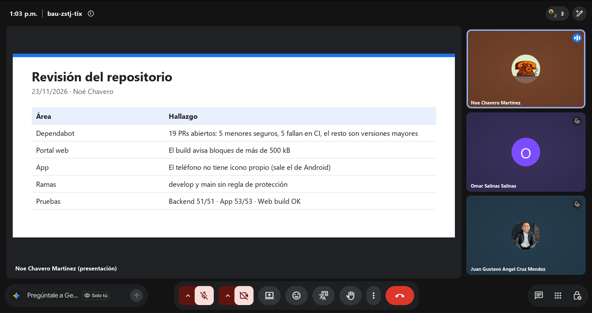
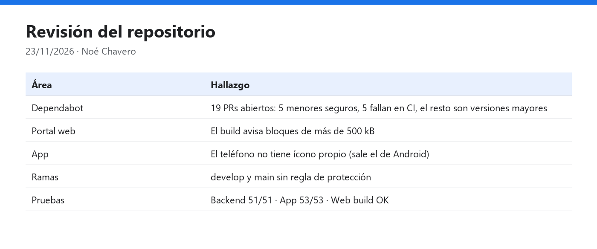
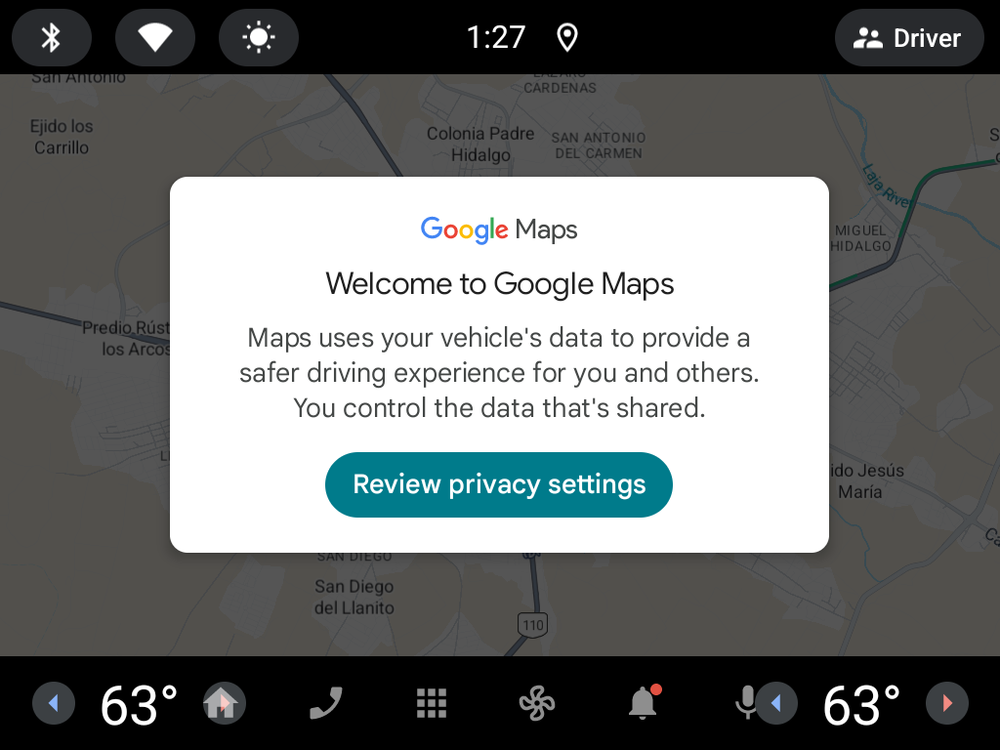
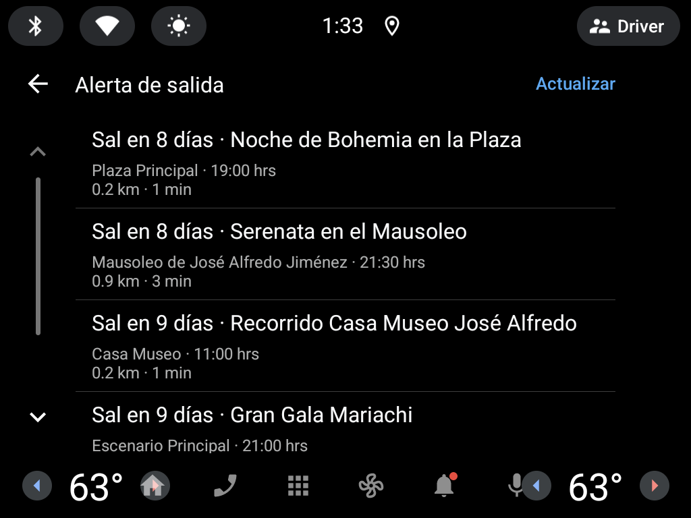

# Daily Scrum 4 · Sprint 4

| Fecha | Hora | Duración | Modalidad | Scrum Master |
|:--|:--|:--|:--|:--|
| Lunes 23 de noviembre de 2026 | 13:03 | 15 min | Videollamada | Noé Chavero Martínez |

**Asistentes:** Noé Chavero Martínez · Omar Salinas Salinas · Juan Gustavo Ángel Cruz Méndez

Captura de la videollamada · presenta Noé Chavero Martínez

## Noé Chavero Martínez

- **¿Qué hice desde la última daily?** Revisión completa del repositorio: pruebas del backend (51/51), de la app (53/53) y build del portal en verde. Encontré 19 PRs de Dependabot acumulados, el aviso de bundle grande en el portal, que el teléfono no tiene ícono propio y que `develop` sigue sin protección.
- **¿Qué haré hoy?** Registrar esas mejoras como issues del Sprint 4 y preparar el cierre con la Release `v4.4-sprint4`.
- **¿Tengo algún bloqueo?** El PR #86 está listo para integrarse.

## Omar Salinas Salinas

- **¿Qué hice desde la última daily?** Probé el flujo del PR #86 con la guía: Home, destinos, navegación y Maps.
- **¿Qué haré hoy?** Revisar las actualizaciones de Dependabot del portal web.
- **¿Tengo algún bloqueo?** Ninguno.

## Juan Gustavo Ángel Cruz Méndez

- **¿Qué hice desde la última daily?** Prueba con usuarios agendada.
- **¿Qué haré hoy?** Activar la regla de protección en `develop` y `main` (acción pendiente desde el Sprint 1).
- **¿Tengo algún bloqueo?** Ninguno.

## Avance mostrado

### En el auto

| Captura | Descripción | Responsable |
|---|---|---|
|  | Prueba de integración: *Iniciar navegación* abre Google Maps del auto con el destino | Noé |
|  | Pantalla 9 · Alerta de salida con "Sal en N días" | Noé |

## Acuerdos

- Mejoras registradas como issues del Sprint 4: Release (#90), Dependabot (#91), ícono del teléfono (#92), bundle del portal (#93) y protección de ramas (#94).

---

<a href="daily-3.md">← Daily 3</a> · <a href="../README.md#sprint-4--16-al-27-de-noviembre-de-2026">Índice del Sprint 4</a>

