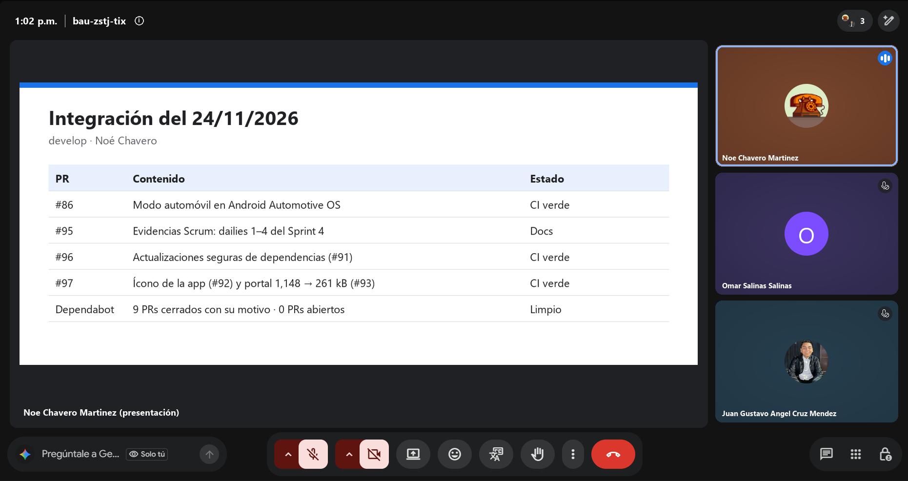
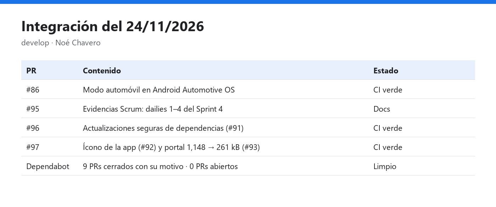

# Daily Scrum 5 · Sprint 4

| Fecha | Hora | Duración | Modalidad | Scrum Master |
|:--|:--|:--|:--|:--|
| Miércoles 25 de noviembre de 2026 | 13:02 | 15 min | Videollamada | Noé Chavero Martínez |

**Asistentes:** Noé Chavero Martínez · Omar Salinas Salinas · Juan Gustavo Ángel Cruz Méndez

<p align="center"></p>
<p align="center"><sub>Captura de la videollamada · presenta Noé Chavero Martínez</sub></p>

## Noé Chavero Martínez

- **¿Qué hice desde la última daily?** Integré en `develop` el PR #86 (Android Automotive), el #95 (dailies), el #96 (dependencias seguras) y el #97 (ícono de la app y portal más ligero). Revisé los 20 PRs de Dependabot: los seguros entraron en el #96 y los que rompían se cerraron con su motivo.
- **¿Qué haré hoy?** Pasar `develop` a `main` y publicar la Release `v4.4-sprint4` con los APK móvil y automotive (#90).
- **¿Tengo algún bloqueo?** Ninguno.

## Omar Salinas Salinas

- **¿Qué hice desde la última daily?** Probé el portal con la carga de páginas bajo demanda: inicio, eventos, mapa, checkout y mis boletos funcionan; el mapa tarda un poco más la primera vez porque descarga su bloque.
- **¿Qué haré hoy?** Revisar en el teléfono el ícono nuevo de la app.
- **¿Tengo algún bloqueo?** Ninguno.

## Juan Gustavo Ángel Cruz Méndez

- **¿Qué hice desde la última daily?** Revisé la configuración de ramas del repositorio.
- **¿Qué haré hoy?** Activar la regla de protección en `develop` y `main` (#94).
- **¿Tengo algún bloqueo?** Ninguno.

## Avance mostrado



### Código que lo hace funcionar

**`festivaltrack-web/src/App.tsx`**: cada página del portal se descarga solo cuando se visita (#93) · **Responsable:** Noé

```tsx
const Home = lazy(() => import('./pages/Home'));
const MapRoute = lazy(() => import('./pages/MapRoute'));
const Checkout = lazy(() => import('./pages/Checkout'));

<Suspense fallback={<Cargando />}>
  <Routes>…</Routes>
</Suspense>
```

## Acuerdos

- La Release `v4.4-sprint4` se publica antes de la Review para tener los APK listos en la demostración.

---

<p align="center"><sub><a href="daily-4.md">← Daily 4</a> · <a href="../README.md#sprint-4--16-al-27-de-noviembre-de-2026">Índice del Sprint 4</a> · <a href="daily-6.md">Daily 6 →</a></sub></p>
