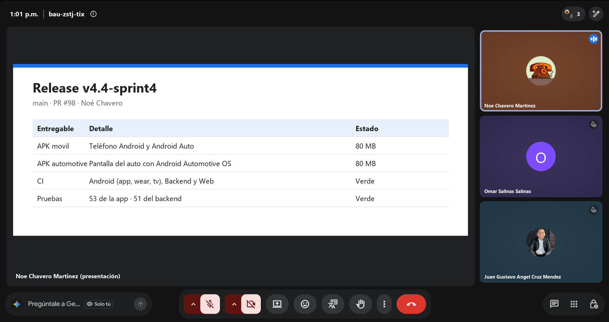
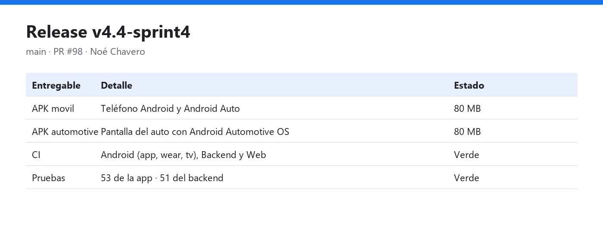
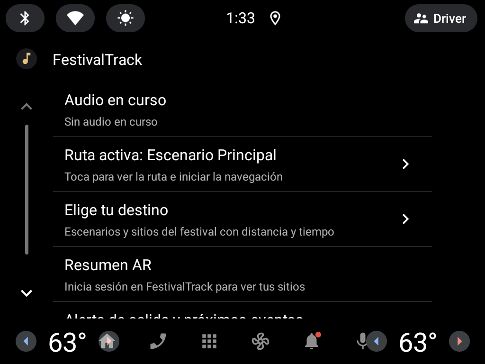

# Daily Scrum 6 · Sprint 4

| Fecha | Hora | Duración | Modalidad | Scrum Master |
|:--|:--|:--|:--|:--|
| Jueves 26 de noviembre de 2026 | 13:01 | 15 min | Videollamada | Noé Chavero Martínez |

**Asistentes:** Noé Chavero Martínez · Omar Salinas Salinas · Juan Gustavo Ángel Cruz Méndez

Captura de la videollamada · presenta Noé Chavero Martínez

## Noé Chavero Martínez

- **¿Qué hice desde la última daily?** Integré `develop` → `main` con el PR #98 (CI en verde) y publiqué la Release `v4.4-sprint4` con los dos APK.
- **¿Qué haré hoy?** Preparar la Sprint Review: demostración del modo automóvil en el emulador Automotive y del portal.
- **¿Tengo algún bloqueo?** Ninguno.

## Omar Salinas Salinas

- **¿Qué hice desde la última daily?** Revisé el ícono nuevo en el teléfono y en el emulador del auto.
- **¿Qué haré hoy?** Preparar la demostración del reproductor junto con la tarjeta de audio del auto.
- **¿Tengo algún bloqueo?** Ninguno.

## Juan Gustavo Ángel Cruz Méndez

- **¿Qué hice desde la última daily?** Avance en la regla de protección de ramas (#94).
- **¿Qué haré hoy?** Preparar la prueba con usuarios para la Review.
- **¿Tengo algún bloqueo?** Ninguno.

## Avance mostrado

### En el auto

| Captura | Descripción | Responsable |
|---|---|---|
|  | Home del auto en Android Automotive OS, con el ícono de FestivalTrack | Noé |

## Acuerdos

- Sprint Review con el Product Owner el viernes 27/11 a las 11:00 y Retrospectiva a las 12:15.

---

<a href="daily-5.md">← Daily 5</a> · <a href="../README.md#sprint-4--16-al-27-de-noviembre-de-2026">Índice del Sprint 4</a> · <a href="review.md">Sprint Review →</a>

