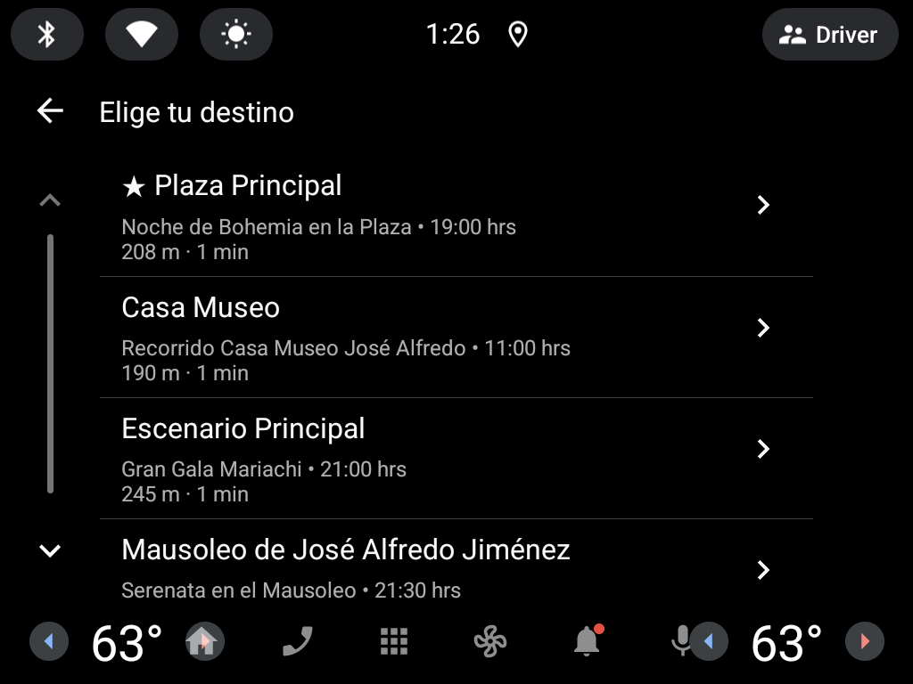
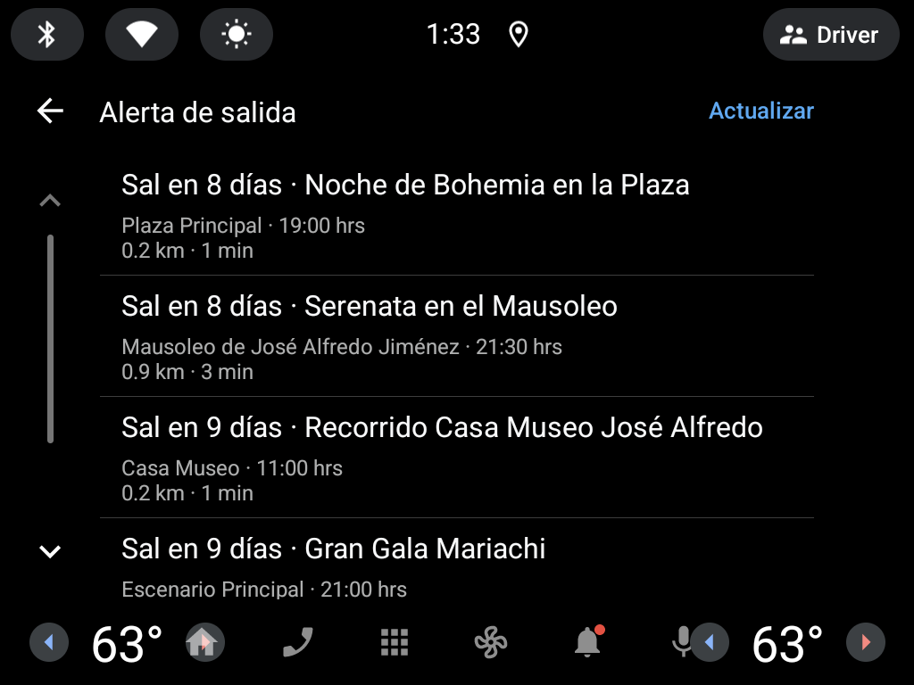
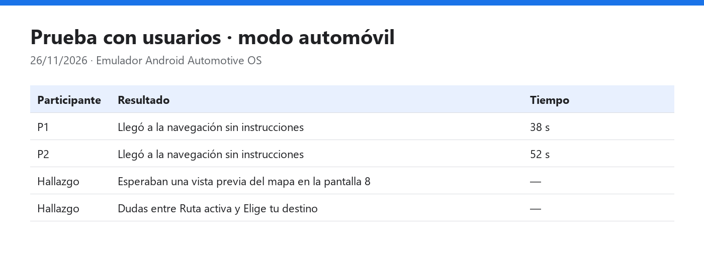

# Incremento · Sprint 4

| Fecha de entrega | Versión | Release | PR `develop` → `main` |
|:--|:--|:--|:--|
| 26/11/2026 | `v4.4-sprint4` | [v4.4-sprint4](https://github.com/gusmendez3249/Jose_Alfredo/releases/tag/v4.4-sprint4), con los APK móvil y automotive | #98 |

## Funcionalidades incluidas

| Issue | Funcionalidad | Responsable |
|---|---|---|
| #84, #36, #39 | Modo automóvil en **Android Automotive OS**: Home, Elige tu destino, Navegación y Alerta de salida en la pantalla del auto, sin teléfono | Noé |
| #84 | *Iniciar navegación* entrega la ruta a Google Maps del auto; audio real en el Home; alerta de salida en días | Noé |
| #92 | Ícono de FestivalTrack en el teléfono y en el auto | Noé |
| #93 | Portal web con carga de páginas bajo demanda (bundle inicial de 1,148 kB → 261 kB) | Noé |
| #91 | Dependencias al día, CI de Android con `wear` y `tv`, Dependabot solo con parches y menores | Noé |

## Cómo probarlo

1. **Teléfono:** instalar `FestivalTrack-v4.4-sprint4-movil.apk`.
2. **Auto:** crear el emulador *Automotive (1024p landscape)* de API 34 e instalar `FestivalTrack-v4.4-sprint4-automotive.apk`. Pasos en [`docs/pruebas/android-auto.md`](../../pruebas/android-auto.md).
3. **Backend:** `cd festivaltrack-backend && npm install && npm run start:dev` con el `.env` del equipo.
4. En el auto: Home → *Elige tu destino* → *Escenario Principal* → **Iniciar navegación**.

## Evidencia

| Captura | Qué se muestra | Responsable |
|---|---|---|
|  | Elige tu destino desde el auto | Noé |
|  | Alerta de salida (#37) | Noé |
|  | Resultado de la prueba con usuarios | Gustavo |

**Calidad:** CI en verde (Android con `app`, `wear` y `tv`, Backend y Web). Pruebas: 53 de la app y 51 del backend.

---

<a href="retro.md">← Retrospectiva</a> · <a href="../README.md#sprint-4--16-al-27-de-noviembre-de-2026">Índice del Sprint 4</a>

