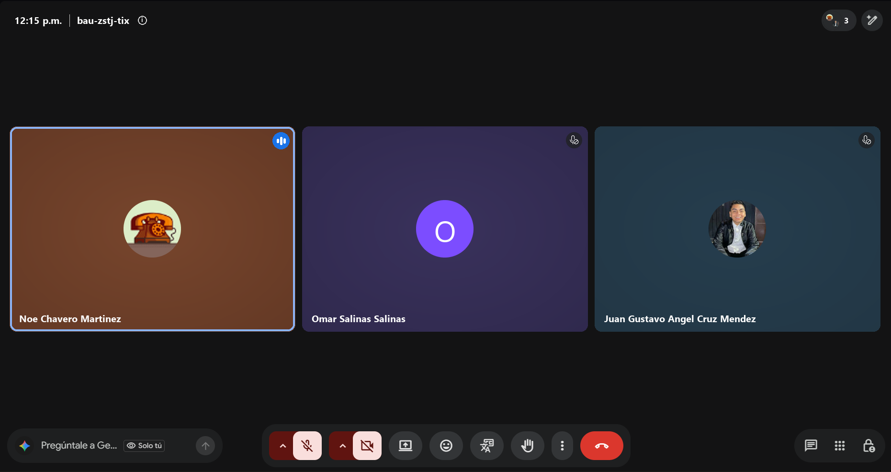

# Retrospectiva · Sprint 4

| Fecha | Hora | Duración | Modalidad | Scrum Master | Formato |
|:--|:--|:--|:--|:--|:--|
| Viernes 27 de noviembre de 2026 | 12:15 | 45 min | Videollamada | Noé Chavero Martínez | Continuar / Dejar de hacer / Empezar |

**Asistentes:** Noé Chavero Martínez · Omar Salinas Salinas · Juan Gustavo Ángel Cruz Méndez

Captura de la videollamada · conversación del equipo

## Continuar (lo que funcionó)

- Buscar alternativas cuando una herramienta no funciona: Android Automotive OS desbloqueó la validación que Android Auto impedía.
- Probar todo junto antes de integrar: así se detectó que una actualización de Dependabot rompía el reloj (`wear`).
- Publicar la Release antes de la Review, con los APK listos para la demostración.

## Dejar de hacer (lo que no funcionó)

- Dejar acumular los PRs de Dependabot: llegaron a 20 abiertos.
- Revisar solo la app del teléfono en el CI: los módulos `wear` y `tv` no se compilaban.

## Empezar (lo que vamos a intentar)

- Revisar los PRs de Dependabot cada semana, en la Daily del lunes.
- Hacer la prueba con usuarios a mitad del sprint, no al final, para alcanzar a aplicar los cambios.

## Acciones para el siguiente sprint

| Acción | Responsable | Cómo sabremos que se cumplió |
|---|---|---|
| Regla de protección en `develop` y `main` (#94) | Gustavo | Settings → Branches muestra la regla activa |
| Vista previa del mapa en la pantalla 8 y texto de *Ruta activa* | Noé | Nueva prueba con usuarios sin dudas en ese paso |
| Iniciar demos de audio desde el auto | Omar | La tarjeta *Audio en curso* reproduce desde el auto |

## Seguimiento de las acciones del sprint anterior

| Acción | ¿Se cumplió? | Comentario |
|---|---|---|
| Publicar una Release con el audio | Sí | `v4.3-sprint3` (11/11) y `v4.4-sprint4` (26/11) |
| Prueba del modo automóvil con usuarios | Sí | En el emulador Automotive: 2 de 2 llegaron a la navegación |
| Regla de protección en `develop` | No | Pasa otra vez al siguiente sprint (#94) |

---

<a href="review.md">← Sprint Review</a> · <a href="../README.md#sprint-4--16-al-27-de-noviembre-de-2026">Índice del Sprint 4</a> · <a href="incremento.md">Incremento →</a>

