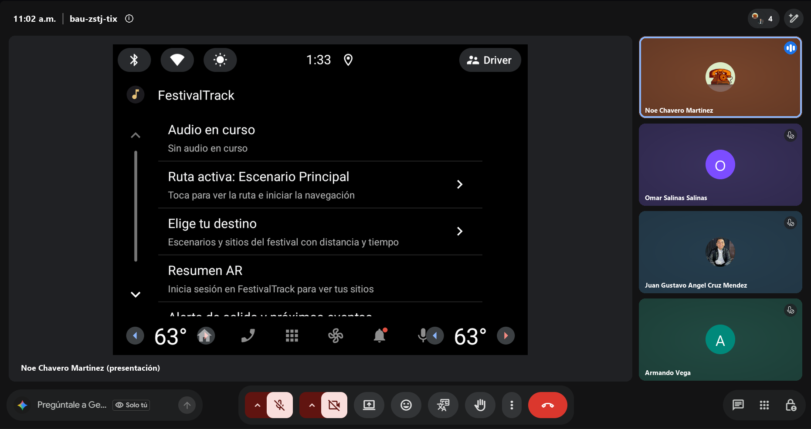
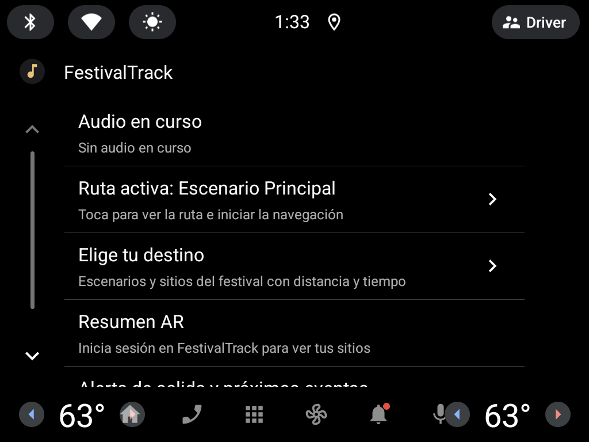
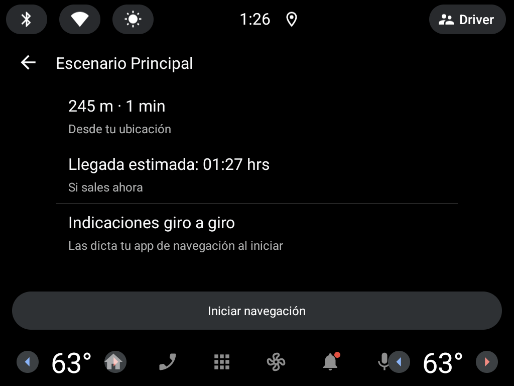
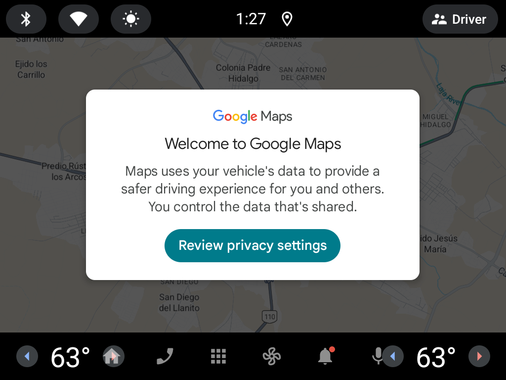
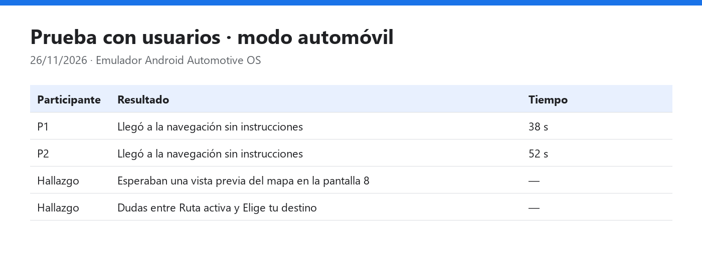
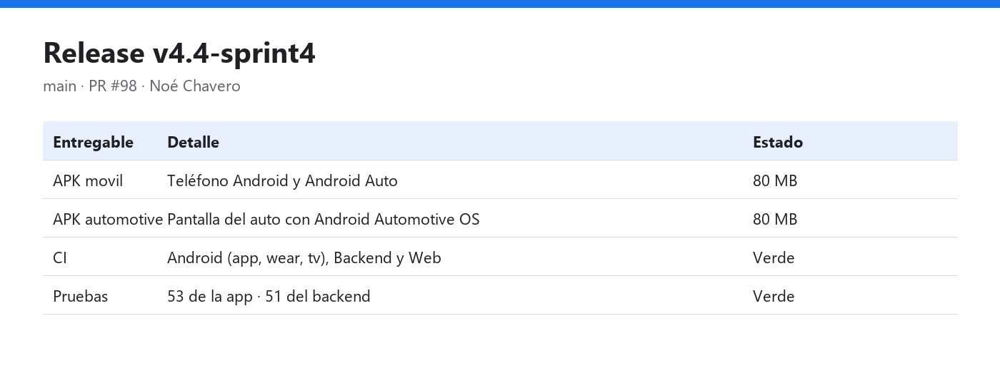
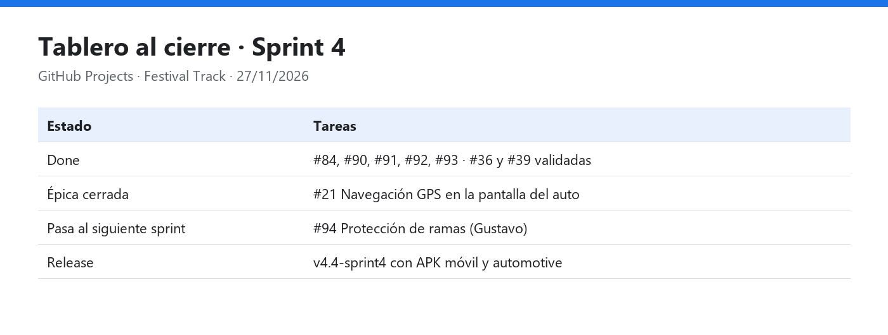

# Sprint Review · Sprint 4

| Fecha | Hora | Duración | Modalidad | Scrum Master | Product Owner |
|:--|:--|:--|:--|:--|:--|
| Viernes 27 de noviembre de 2026 | 11:02 | 60 min | Videollamada | Noé Chavero Martínez | Armando Vega |

**Asistentes:** Noé Chavero Martínez · Omar Salinas Salinas · Juan Gustavo Ángel Cruz Méndez · Armando Vega (Product Owner)

**Periodo del sprint:** 16 al 27 de noviembre de 2026

> **Objetivo del sprint:** validar el modo automóvil (épica #21) en la pantalla de un auto y hacer la prueba con usuarios.

Captura de la videollamada · presenta Noé Chavero Martínez

## Resultado del sprint

Milestone: [Sprint 4](https://github.com/gusmendez3249/Jose_Alfredo/milestone/4) · **8 de 9 issues cerradas (89 %)**

| Milestone | Cerradas | Abiertas | Avance |
|---|---|---|---|
| [Sprint 4](https://github.com/gusmendez3249/Jose_Alfredo/milestone/4) | 8 | 1 | 89 % |

## Tareas terminadas

| Issue | Tarea | Responsable | Evidencia |
|---|---|---|---|
| #84 | Validar el modo automóvil en Android Automotive OS y prueba con usuarios | Noé | PR #86 · `docs/pruebas/android-auto.md` |
| #39 | Pantalla 8 · Navegación validada en el head unit | Noé | [Daily 3](daily-3.md), [Daily 4](daily-4.md) |
| #36 | Pantalla 10 · Home del auto validado en el head unit | Noé | [Daily 2](daily-2.md) |
| #90 | `develop` → `main` y Release `v4.4-sprint4` | Noé | PR #98 · [v4.4-sprint4](https://github.com/gusmendez3249/Jose_Alfredo/releases/tag/v4.4-sprint4) |
| #91 | Ordenar las actualizaciones de Dependabot | Noé | PR #96 · [Daily 5](daily-5.md) |
| #92 | Ícono de FestivalTrack en el teléfono | Noé | PR #97 |
| #93 | Portal web con carga de páginas bajo demanda | Noé | PR #97 · [Daily 5](daily-5.md) |

Épica cerrada: **#21 Vista de navegación GPS para el auto**. Las pantallas 7, 8, 9 y 10 corren en la pantalla del auto.

## Tareas no terminadas

| Issue | Tarea | Responsable | Motivo | Pasa al sprint |
|---|---|---|---|---|
| #94 | Regla de protección en `develop` y `main` | Gustavo | Requiere permisos de administrador del repositorio | Siguiente sprint |

## Demostración

| Evidencia | Qué se muestra | Responsable |
|---|---|---|
|  | Home del auto en Android Automotive OS (#36) | Noé |
|  | Navegación con distancia, tiempo y llegada estimada (#39) | Noé |
|  | Prueba de integración: la ruta llega a Google Maps del auto | Noé |
|  | Prueba con usuarios: 2 de 2 llegaron a la navegación sin ayuda | Gustavo |
|  | Release `v4.4-sprint4` con los APK móvil y automotive | Noé |

**Calidad:** los PRs #86, #96, #97 y #98 pasaron Android CI (ahora con `app`, `wear` y `tv`), Backend CI y Web CI.
Pruebas: 53 unitarias de la app y 51 del backend. Bundle inicial del portal: 1,148 kB → 261 kB.

## Tablero al cierre

## Retroalimentación del Product Owner

- El modo automóvil ya se puede demostrar sin depender de Android Auto; se aprueba el incremento.
- De la prueba con usuarios: agregar una vista previa del mapa en la pantalla 8 y aclarar el texto de *Ruta activa* sin destino.
- Iniciar las demos de audio desde el auto (propuesta de Omar) entra al backlog.

---

<a href="daily-6.md">← Daily 6</a> · <a href="../README.md#sprint-4--16-al-27-de-noviembre-de-2026">Índice del Sprint 4</a> · <a href="retro.md">Retrospectiva →</a>

