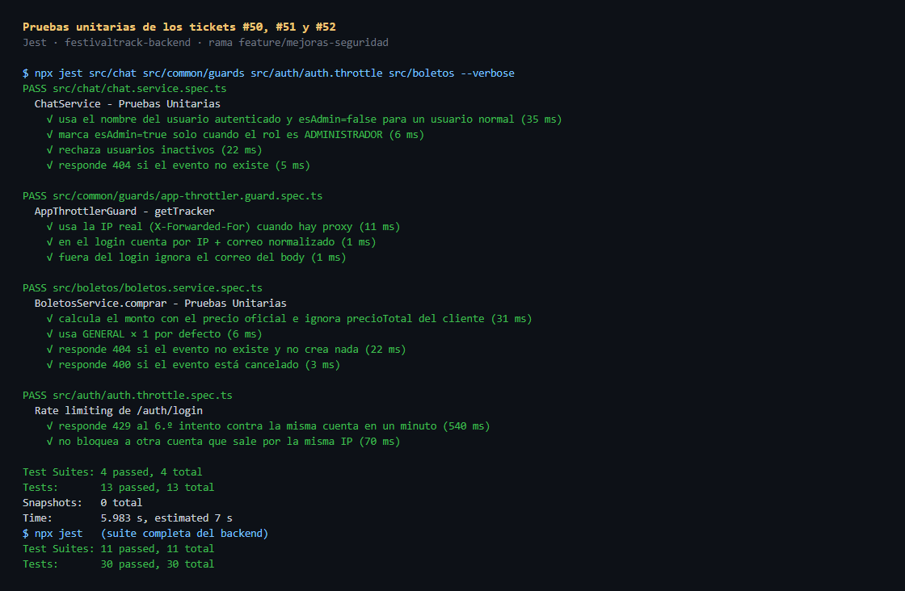
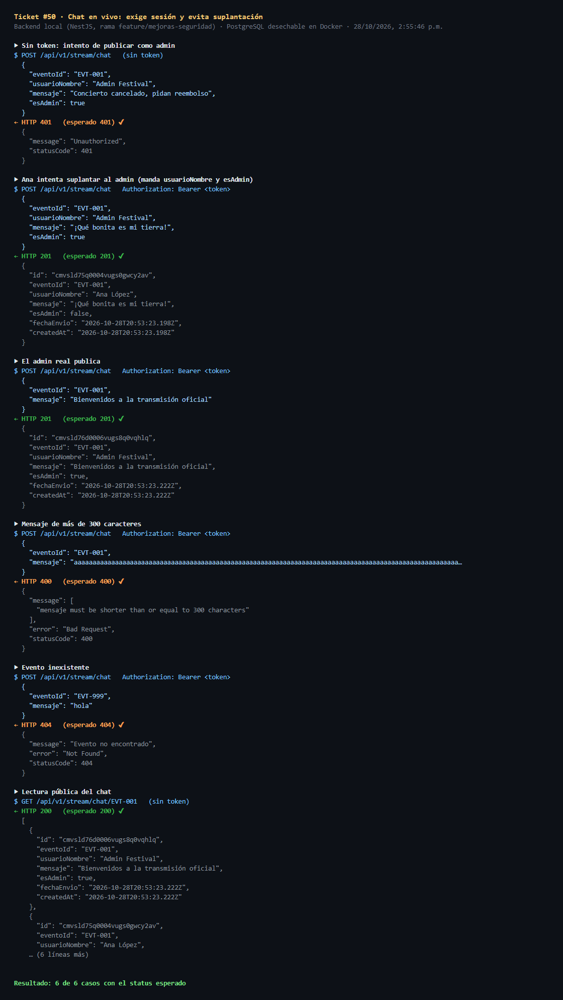
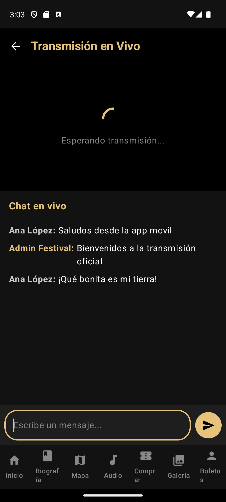
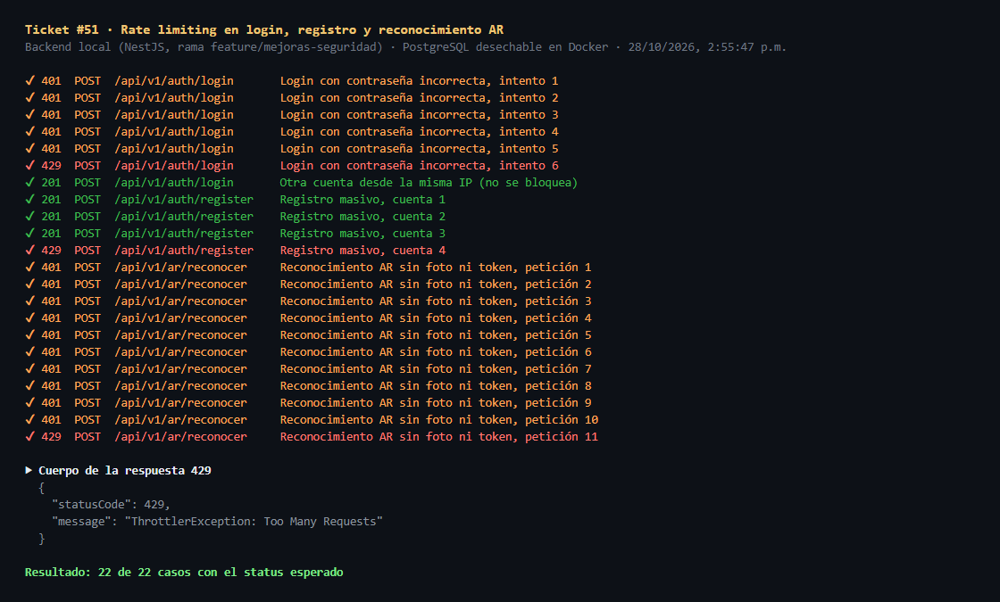
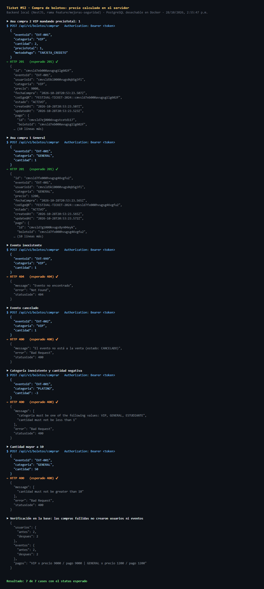
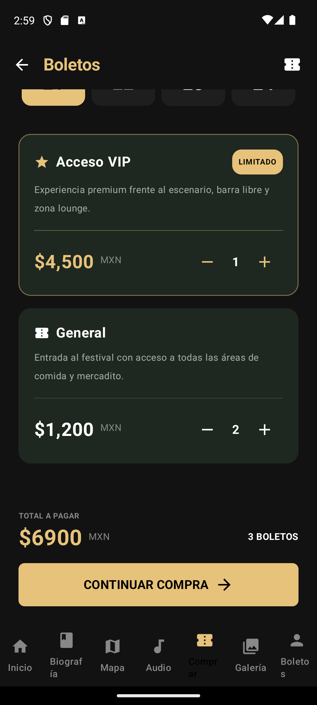
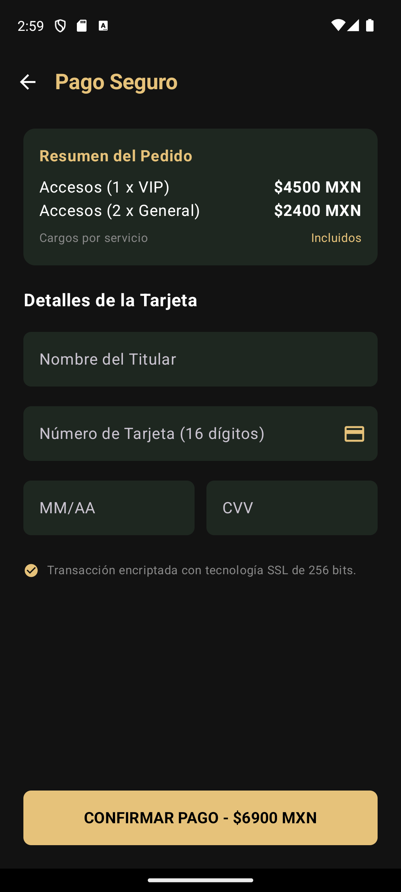
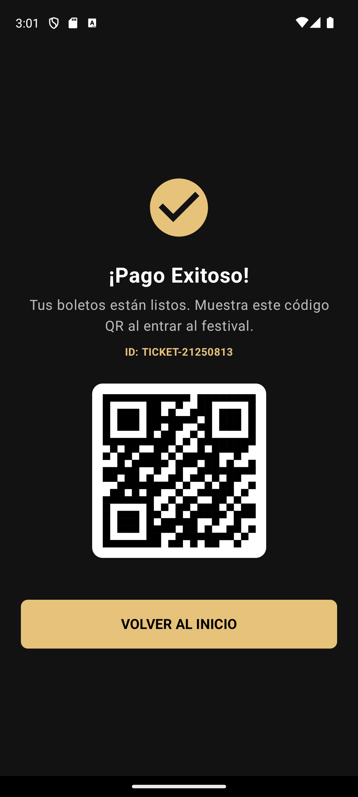
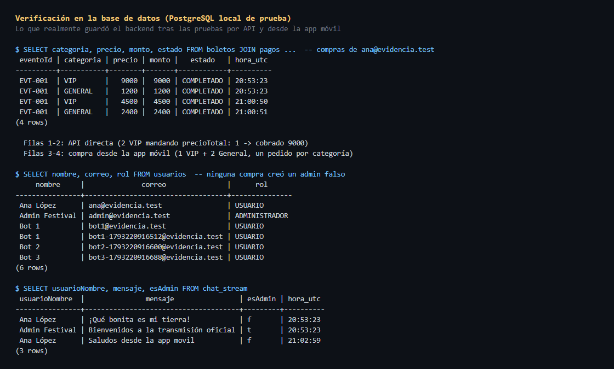

# Evidencia · Mejoras de seguridad (#50, #51, #52)

- **Fecha de la prueba:** 2026-10-28
- **Rama:** `feature/mejoras-seguridad` (creada desde `main`)
- **Responsable:** Juan Gustavo Ángel Cruz Méndez
- **Sprint:** Sprint 2

| Ticket | Problema | Resultado |
|---|---|---|
| [#50](https://github.com/gusmendez3249/Jose_Alfredo/issues/50) Chat en vivo | Cualquiera, sin cuenta, podía escribir en el chat con el nombre de otra persona o marcado como administrador | ✔ 6 de 6 casos por API + prueba en la app |
| [#51](https://github.com/gusmendez3249/Jose_Alfredo/issues/51) Rate limiting | Se podían probar contraseñas sin límite, crear cuentas en masa y abusar del reconocimiento AR (que se cobra por uso) | ✔ 22 de 22 casos por API |
| [#52](https://github.com/gusmendez3249/Jose_Alfredo/issues/52) Compra de boletos | El cliente decidía cuánto pagar y una compra con un evento inválido creaba un admin falso | ✔ 6 de 6 casos por API + compra completa en la app |

## Cómo se probó

1. **Pruebas unitarias** con Jest: 13 pruebas nuevas, y la suite completa del backend pasa (30/30).
2. **Pruebas de punta a punta por API**: se levantó el backend de la rama en local y se le mandaron peticiones HTTP reales. Las capturas muestran la petición enviada, el status esperado y la respuesta real del servidor.
3. **Pruebas en la app móvil**: se instaló el APK de debug en el emulador Pixel 7, que se conecta al mismo backend local (`10.0.2.2:3001`), y se hizo el flujo como usuaria normal.
4. **Verificación en la base de datos**: consultas SQL para confirmar lo que quedó guardado.

> **Base de datos de prueba.** Todo se ejecutó contra una base PostgreSQL **desechable en Docker** (`postgres:16-alpine`, puerto 55432), con las migraciones del proyecto aplicadas. **No se tocó la base de Neon.** Las cuentas usadas (`ana@evidencia.test` y `admin@evidencia.test`) solo existen en esa base de prueba.



---

## #50 · Chat en vivo: exige sesión y evita suplantación

**Antes:** `POST /api/v1/stream/chat` no pedía token y guardaba tal cual el `usuarioNombre` y el `esAdmin` que mandara el cliente. Cualquiera podía publicar *"Concierto cancelado, pidan reembolso"* como si fuera el administrador del festival.

**Ahora:**
- El endpoint exige sesión (`JwtAuthGuard`).
- El nombre del remitente y si es admin salen del usuario del token, no del body.
- El mensaje tiene un máximo de 300 caracteres.
- Si el evento no existe, responde 404.

### Evidencia por API

| Caso | Esperado | Obtenido |
|---|---|---|
| Publicar sin token haciéndose pasar por el admin | 401 | ✔ 401 |
| Ana manda `usuarioNombre: "Admin Festival"` y `esAdmin: true` | se guarda como **Ana López**, `esAdmin: false` | ✔ |
| El admin real publica | `esAdmin: true` | ✔ |
| Mensaje de 301 caracteres | 400 | ✔ 400 |
| Evento inexistente | 404 | ✔ 404 |
| Leer el chat sin sesión (sigue siendo público) | 200 | ✔ 200 |



### Evidencia en la app

| Captura | Descripción |
|---|---|
|  | Pantalla *Transmisión en Vivo* con la sesión de Ana. Su mensaje *"Saludos desde la app movil"* se envió con su token y el servidor lo guardó con su nombre real. El mensaje del admin aparece resaltado en dorado porque `esAdmin` lo puso el servidor. |

> **Smart TV:** la app de TV no tiene inicio de sesión, así que ya no publica en el chat del servidor. Sigue leyendo los mensajes, y lo que escribe el espectador solo se muestra en la propia TV.

### Código que lo hace funcionar

**`festivaltrack-backend/src/chat/chat.service.ts`**: el remitente sale del token, nunca del body.

```ts
async enviarMensaje(usuarioId: string, dto: EnviarMensajeDto) {
  // 1. El remitente se busca con el ID del token: así el nombre y el rol son los reales (#50)
  const usuario = await this.prisma.usuario.findUnique({ where: { id: usuarioId } });
  if (!usuario || !usuario.activo) throw new UnauthorizedException();

  // 2. El mensaje solo se guarda si el evento existe
  const evento = await this.prisma.evento.findUnique({ where: { id: dto.eventoId } });
  if (!evento) throw new NotFoundException('Evento no encontrado');

  // 3. Se guarda con datos del servidor: el cliente ya no puede mandar usuarioNombre ni esAdmin
  return this.prisma.chatStream.create({
    data: {
      eventoId: dto.eventoId,
      usuarioNombre: usuario.nombre,
      mensaje: dto.mensaje.trim(),
      esAdmin: usuario.rol === 'ADMINISTRADOR',
    }
  });
}
```

---

## #51 · Rate limiting en login, registro y reconocimiento AR

**Antes:** no había ningún límite de peticiones.

**Ahora:** se usa `@nestjs/throttler` con un guard global. Al pasarse del límite, el servidor responde `429 Too Many Requests`.

| Endpoint | Límite | Se cuenta por |
|---|---|---|
| Todas las rutas | 300 por minuto | IP |
| `POST /auth/login` | 5 por minuto | IP + correo |
| `POST /auth/register` | 3 por minuto | IP |
| `POST /ar/reconocer` | 10 por minuto | IP |

El login se cuenta por **IP + correo** porque en el festival muchos celulares salen por la misma IP pública (el Wi-Fi del evento). Si se contara solo por IP, unos cuantos errores bloquearían a todos. Así se frena la fuerza bruta contra una cuenta sin afectar a las demás.

### Evidencia por API

| Caso | Esperado | Obtenido |
|---|---|---|
| Intentos de login 1 a 5 con contraseña incorrecta | 401 | ✔ 401 |
| 6.º intento contra la misma cuenta | 429 | ✔ 429 |
| Otra cuenta desde la misma IP, justo después | 201 (no se bloquea) | ✔ 201 |
| Registros 1 a 3 | 201 | ✔ 201 |
| 4.º registro en el mismo minuto | 429 | ✔ 429 |
| Peticiones 1 a 10 a `/ar/reconocer` (sin token) | 401 | ✔ 401 |
| Petición 11 a `/ar/reconocer` | 429 | ✔ 429 |



> El límite se aplica **antes** de validar el token. Por eso la petición 11 a `/ar/reconocer` recibe 429 aunque no traiga sesión: un atacante no puede saturar el endpoint ni siquiera con peticiones inválidas.

### Código que lo hace funcionar

**`festivaltrack-backend/src/common/guards/app-throttler.guard.ts`**: la clave con la que se cuentan las peticiones.

```ts
protected async getTracker(req: Record<string, any>): Promise<string> {
  // Con `trust proxy` activo, req.ips trae la cadena de X-Forwarded-For; la primera es el cliente real.
  const ip = req.ips?.length ? req.ips[0] : req.ip;
  // El correo se normaliza para que "Ana@Test.com" y "ana@test.com" cuenten como la misma cuenta.
  const esLogin = typeof req.originalUrl === 'string' && req.originalUrl.includes('/auth/login');
  const correo = typeof req.body?.correo === 'string' ? req.body.correo.trim().toLowerCase() : '';
  return esLogin && correo ? `${ip}:${correo}` : ip;
}
```

**`festivaltrack-backend/src/auth/auth.controller.ts`**: límites por endpoint.

```ts
@Throttle({ default: { limit: 3, ttl: 60_000 } })
@Post('register') register(@Body() dto: RegisterDto) { return this.authService.register(dto); }
@Throttle({ default: { limit: 5, ttl: 60_000 } })
@Post('login')    login(@Body() dto: LoginDto)       { return this.authService.login(dto); }
```

---

## #52 · Compra de boletos: precio calculado en el servidor

**Antes:**
- El monto se calculaba con el `precioTotal` que mandaba el cliente. Se podía comprar un VIP por $1.
- Si el `eventoId` no existía, el backend usaba el primer evento de la base. Si no había ninguno, **creaba un usuario ADMINISTRADOR con un hash de contraseña falso** y un evento inventado.
- La app móvil mandaba siempre `EVT-001` y registraba todos los boletos como VIP.

**Ahora:**
- El monto sale de la tabla oficial de precios del servidor: VIP $4,500, General $1,200, Estudiante $600.
- El body se valida con un DTO.
- Si el evento no existe responde 404, y si está cancelado o finalizado responde 400.
- Una compra ya nunca crea usuarios ni eventos.
- La app compra para el próximo evento a la venta y hace un pedido por categoría.

### Evidencia por API

| Caso | Esperado | Obtenido |
|---|---|---|
| 2 VIP mandando `precioTotal: 1` | se cobran **$9,000** | ✔ precio 9000 / pago 9000 |
| 1 General sin precio | se cobran $1,200 | ✔ |
| Evento inexistente | 404 | ✔ 404 |
| Evento cancelado | 400 | ✔ 400 |
| Categoría `PLATINO` y cantidad `-3` | 400 | ✔ 400 |
| Cantidad 50 (máximo 10) | 400 | ✔ 400 |
| Usuarios y eventos antes y después de las compras fallidas | sin cambios | ✔ 2 → 2 y 2 → 2 |



### Evidencia en la app

| Captura | Descripción |
|---|---|
|  | Selección de boletos: 1 VIP + 2 General, total $6,900. El botón solo se habilita si hay un evento a la venta. |
|  | Checkout con el desglose por categoría. Antes mostraba todo como "x VIP". |
|  | Compra confirmada por el backend. |

### Verificación en la base de datos

Las filas 3 y 4 son la compra hecha desde la app: **dos pedidos, VIP $4,500 y General $2,400, para el evento real `EVT-001`**. La tabla de usuarios confirma que no se creó ningún admin falso, y la del chat muestra los nombres y la marca de admin que puso el servidor.



### Código que lo hace funcionar

**`festivaltrack-backend/src/boletos/boletos.service.ts`**: el monto lo decide el servidor.

```ts
// El monto SIEMPRE sale de la tabla de precios del servidor (#52): un cliente modificado
// ya no puede pagar $1 por un boleto VIP mandando su propio precioTotal.
const montoTotal = PRECIOS_BOLETO[categoria] * cantidad;

// El evento debe existir; antes se usaba el primero de la BD o se creaba uno (y un admin falso)
const evento = await this.prisma.evento.findUnique({ where: { id: dto.eventoId } });
if (!evento) throw new NotFoundException('Evento no encontrado');
if (evento.estado !== 'PUBLICADO' && evento.estado !== 'EN_CURSO') {
  throw new BadRequestException(`El evento no está a la venta (estado: ${evento.estado})`);
}
```

**`app/.../ui/viewmodels/CheckoutViewModel.kt`**: un pedido por categoría desde la app.

```kotlin
listOf("VIP" to vipTickets, "GENERAL" to generalTickets)
    .filter { (_, cantidad) -> cantidad > 0 }
    .forEach { (categoria, cantidad) ->
        val dto = CompraBoletoDto(
            eventoId = eventoId,
            categoria = categoria,
            cantidad = cantidad,
            metodoPago = "TARJETA_CREDITO"
        )
        api.comprarBoleto("Bearer $token", dto)
    }
```

---

## Compilación

| Proyecto | Comando | Resultado |
|---|---|---|
| Backend | `npm run build` + `npx jest` | ✔ compila · 30/30 pruebas |
| Web | `npm run build` | ✔ compila |
| Android (app, TV, Wear, shared) | `./gradlew assembleDebug` | ✔ `BUILD SUCCESSFUL` |
